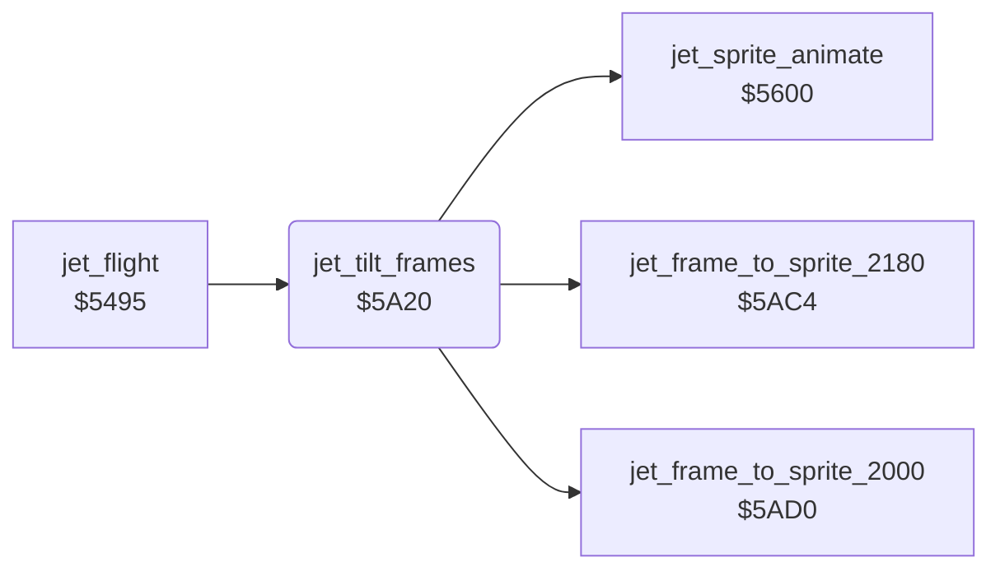

<!-- Generated by c64-docs from knowledge revision 20261024T103119.179-vx1fei and .c64-re-tools/local/generated/src/source-map.json. Do not edit: change the knowledge, generate the source again, then run docs.ts generate. -->
# player/jet_tilt_frames.asm: Jet tilt frames at full speed

Range `$5A20-$5AC1`. Source: [player/jet_tilt_frames.asm](../../../../src/player/jet_tilt_frames.asm). Index: [the reference](../../index.md).

## Call graph

A solid arrow is a call, a thick arrow a table entry, a dotted arrow a jump. Rounded nodes are in this file.

## Data

| Range | Type | Name | Read by | Written by |
|---|---|---|---|---|
| [`$5A3E`](../../../../src/player/jet_tilt_frames.asm#L22)-`$5A3F` | dual-use |  |  |  |

## Names

### [`jet_tilt_frames`](../../../../src/player/jet_tilt_frames.asm#L6) `$5A20`

*routine*

Every 8th tick at speed +3 or -3, steps the tilt $99 (-2..+2) by the climb rate $2b. It copies the frame at ($96) to the jet sprite data. Then it calls $5600. Below full speed, $99 steps back to 0 and $98 is cleared. Speed +3 uses $2cc0 to $2180, speed -3 uses $2b80 to $2000. One step is $40 bytes.

- **Called from:** [`jet_flight`](flight.md#jet_flight) [`$5500`](../../../../src/player/flight.asm#L101)
- **Calls:** [`jet_frame_to_sprite_2180`](jet_tilt_frames_5ac4.md#jet_frame_to_sprite_2180), [`jet_frame_to_sprite_2000`](jet_tilt_frames_5ad0.md#jet_frame_to_sprite_2000), [`jet_sprite_animate`](jet_sprite.md#jet_sprite_animate)
- **Reads:** [`jet_state`](../../memory-map.md#jet_state), [`tick`](../../memory-map.md#tick), [`pitch_active`](../../memory-map.md#pitch_active), [`jet_speed_x`](../../memory-map.md#jet_speed_x), [`pitch_step`](../../memory-map.md#pitch_step), [`pitch_frame_ptr`](../../memory-map.md#pitch_frame_ptr), [`pitch_frame_ptr_hi`](../../memory-map.md#pitch_frame_ptr_hi), [`jet_climb`](../../memory-map.md#jet_climb)
- **Writes:** [`pitch_active`](../../memory-map.md#pitch_active), [`pitch_frame_ptr`](../../memory-map.md#pitch_frame_ptr), [`pitch_frame_ptr_hi`](../../memory-map.md#pitch_frame_ptr_hi), [`pitch_step`](../../memory-map.md#pitch_step)

### [`jet_tilt_check_left`](../../../../src/player/jet_tilt_frames.asm#L26) `$5A46`

*label*

- **Jumped to from:** [`jet_tilt_frames`](jet_tilt_frames.md#jet_tilt_frames) [`$5A34`](../../../../src/player/jet_tilt_frames.asm#L17)

### [`jet_tilt_skip`](../../../../src/player/jet_tilt_frames.asm#L28) `$5A48`

*label*

- **Jumped to from:** [`jet_tilt_frames`](jet_tilt_frames.md#jet_tilt_frames) [`$5A24`](../../../../src/player/jet_tilt_frames.asm#L9), [`jet_tilt_frames`](jet_tilt_frames.md#jet_tilt_frames) [`$5A2A`](../../../../src/player/jet_tilt_frames.asm#L12)

### [`jet_tilt_active`](../../../../src/player/jet_tilt_frames.asm#L35) `$5A5A`

*label*

- **Jumped to from:** [`jet_tilt_frames`](jet_tilt_frames.md#jet_tilt_frames) [`$5A2E`](../../../../src/player/jet_tilt_frames.asm#L14)

### [`jet_tilt_step_back`](../../../../src/player/jet_tilt_frames.asm#L45) `$5A6C`

*label*

- **Jumped to from:** [`jet_tilt_frames`](jet_tilt_frames.md#jet_tilt_frames) [`$5A66`](../../../../src/player/jet_tilt_frames.asm#L42)

### [`jet_tilt_frame_down`](../../../../src/player/jet_tilt_frames.asm#L47) `$5A6E`

*label*

$99 - 1 and the frame pointer - $40.

- **Jumped to from:** [`jet_tilt_frames`](jet_tilt_frames.md#jet_tilt_frames) [`$5A9E`](../../../../src/player/jet_tilt_frames.asm#L76), [`jet_tilt_frames`](jet_tilt_frames.md#jet_tilt_frames) [`$5AB5`](../../../../src/player/jet_tilt_frames.asm#L89)

### [`jet_tilt_frame_up`](../../../../src/player/jet_tilt_frames.asm#L56) `$5A7D`

*label*

$99 + 1 and the frame pointer + $40.

- **Jumped to from:** [`jet_tilt_frames`](jet_tilt_frames.md#jet_tilt_frames) [`$5A6C`](../../../../src/player/jet_tilt_frames.asm#L46), [`jet_tilt_frames`](jet_tilt_frames.md#jet_tilt_frames) [`$5AA1`](../../../../src/player/jet_tilt_frames.asm#L78), [`jet_tilt_frames`](jet_tilt_frames.md#jet_tilt_frames) [`$5AAC`](../../../../src/player/jet_tilt_frames.asm#L84)

### [`jet_tilt_copy_frame`](../../../../src/player/jet_tilt_frames.asm#L64) `$5A8A`

*label*

- **Jumped to from:** [`jet_tilt_frames`](jet_tilt_frames.md#jet_tilt_frames) [`$5A77`](../../../../src/player/jet_tilt_frames.asm#L53), [`jet_tilt_frames`](jet_tilt_frames.md#jet_tilt_frames) [`$5A7B`](../../../../src/player/jet_tilt_frames.asm#L55), [`jet_tilt_frames`](jet_tilt_frames.md#jet_tilt_frames) [`$5A86`](../../../../src/player/jet_tilt_frames.asm#L62)

### [`jet_tilt_full_speed`](../../../../src/player/jet_tilt_frames.asm#L70) `$5A94`

*label*

Climb rate 0: steps $99 back to 0.

- **Jumped to from:** [`jet_tilt_frames`](jet_tilt_frames.md#jet_tilt_frames) [`$5A5E`](../../../../src/player/jet_tilt_frames.asm#L38), [`jet_tilt_frames`](jet_tilt_frames.md#jet_tilt_frames) [`$5A62`](../../../../src/player/jet_tilt_frames.asm#L40)

### [`jet_tilt_jump_up`](../../../../src/player/jet_tilt_frames.asm#L77) `$5AA1`

*label*

- **Jumped to from:** [`jet_tilt_frames`](jet_tilt_frames.md#jet_tilt_frames) [`$5A9C`](../../../../src/player/jet_tilt_frames.asm#L75)

### [`jet_tilt_climb_dir`](../../../../src/player/jet_tilt_frames.asm#L79) `$5AA4`

*label*

- **Jumped to from:** [`jet_tilt_frames`](jet_tilt_frames.md#jet_tilt_frames) [`$5A96`](../../../../src/player/jet_tilt_frames.asm#L72)

### [`jet_tilt_dive`](../../../../src/player/jet_tilt_frames.asm#L85) `$5AAF`

*label*

Dive: down to $99 = $fe.

- **Jumped to from:** [`jet_tilt_frames`](jet_tilt_frames.md#jet_tilt_frames) [`$5AA4`](../../../../src/player/jet_tilt_frames.asm#L80)

### [`jet_tilt_exit`](../../../../src/player/jet_tilt_frames.asm#L90) `$5AB8`

*label*

- **Jumped to from:** [`jet_tilt_frames`](jet_tilt_frames.md#jet_tilt_frames) [`$5A44`](../../../../src/player/jet_tilt_frames.asm#L25), [`jet_tilt_frames`](jet_tilt_frames.md#jet_tilt_frames) [`$5A48`](../../../../src/player/jet_tilt_frames.asm#L29), [`jet_tilt_frames`](jet_tilt_frames.md#jet_tilt_frames) [`$5A58`](../../../../src/player/jet_tilt_frames.asm#L34), [`jet_tilt_frames`](jet_tilt_frames.md#jet_tilt_frames) [`$5A6A`](../../../../src/player/jet_tilt_frames.asm#L44), [`jet_tilt_frames`](jet_tilt_frames.md#jet_tilt_frames) [`$5A92`](../../../../src/player/jet_tilt_frames.asm#L69), [`jet_tilt_frames`](jet_tilt_frames.md#jet_tilt_frames) [`$5A9A`](../../../../src/player/jet_tilt_frames.asm#L74), [`jet_tilt_frames`](jet_tilt_frames.md#jet_tilt_frames) [`$5AAA`](../../../../src/player/jet_tilt_frames.asm#L83), [`jet_tilt_frames`](jet_tilt_frames.md#jet_tilt_frames) [`$5AB3`](../../../../src/player/jet_tilt_frames.asm#L88), [`jet_tilt_frames`](jet_tilt_frames.md#jet_tilt_frames) [`$5AC0`](../../../../src/player/jet_tilt_frames.asm#L96)

### [`jet_tilt_copy_left`](../../../../src/player/jet_tilt_frames.asm#L93) `$5ABC`

*label*

- **Jumped to from:** [`jet_tilt_frames`](jet_tilt_frames.md#jet_tilt_frames) [`$5A8C`](../../../../src/player/jet_tilt_frames.asm#L66)
