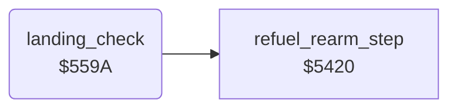

<!-- Generated by c64-docs from knowledge revision 20261025T214607.441-00m56k and .c64-re-tools/local/generated/src/source-map.json. Do not edit: change the knowledge, generate the source again, then run docs.ts generate. -->
# player/landing.asm: Landing check and extra jet

Range `$559A-$55EF`. Source: [player/landing.asm](../../../../src/player/landing.asm). Index: [the reference](../../index.md).

## Routines

| Routine | Address | Reached from | Summary |
|---|---|---|---|
| [`landing_check`](landing.md#landing_check) | `$559A` | [`$41A5`](../../../../src/game/main_loop.asm#L67) | Clears jet_state bit 1. |

## Call graph

A solid arrow is a call, a thick arrow a table entry. Rounded nodes are in this file.

## Details

### [`landing_check`](../../../../src/player/landing.asm#L6) `$559A`

*routine*

Clears jet_state bit 1. At Y $84, speed 0, tile $16 at map row 0 under the jet: stops the descent, sets bit 1, refuels twice. Then the extra jet.

- **Called from:** [`$41A5`](../../../../src/game/main_loop.asm#L67)
- **Calls:** [`refuel_rearm_step`](refuel.md#refuel_rearm_step)
- **Reads:** [`jet_state`](../../memory-map.md#jet_state), [`SP0Y`](../../memory-map.md#SP0Y), [`jet_speed_x`](../../memory-map.md#jet_speed_x), [`map_column`](../../memory-map.md#map_column), [`landscape_map`](../data/map.md#landscape_map), [`jet_climb`](../../memory-map.md#jet_climb), [`bonus_jet_flag`](../../memory-map.md#bonus_jet_flag), [`score`](../../memory-map.md#score), [`lives`](../../memory-map.md#lives)
- **Writes:** [`jet_state`](../../memory-map.md#jet_state), [`jet_climb`](../../memory-map.md#jet_climb), [`bonus_jet_flag`](../../memory-map.md#bonus_jet_flag), [`lives`](../../memory-map.md#lives)
- **Refers to:** [`score`](../../memory-map.md#score)

| Label | Address | Comment |
|---|---|---|
| [`landing_set_landed`](../../../../src/player/landing.asm#L33) | `$55CD` |  |
| [`extra_jet_check`](../../../../src/player/landing.asm#L45) | `$55DF` | $67 = 0 and score thousands digit $13 >= 3: lives + 1, and $67 = $30 blocks a second extra jet. |
| [`landing_check_done`](../../../../src/player/landing.asm#L55) | `$55EF` |  |
