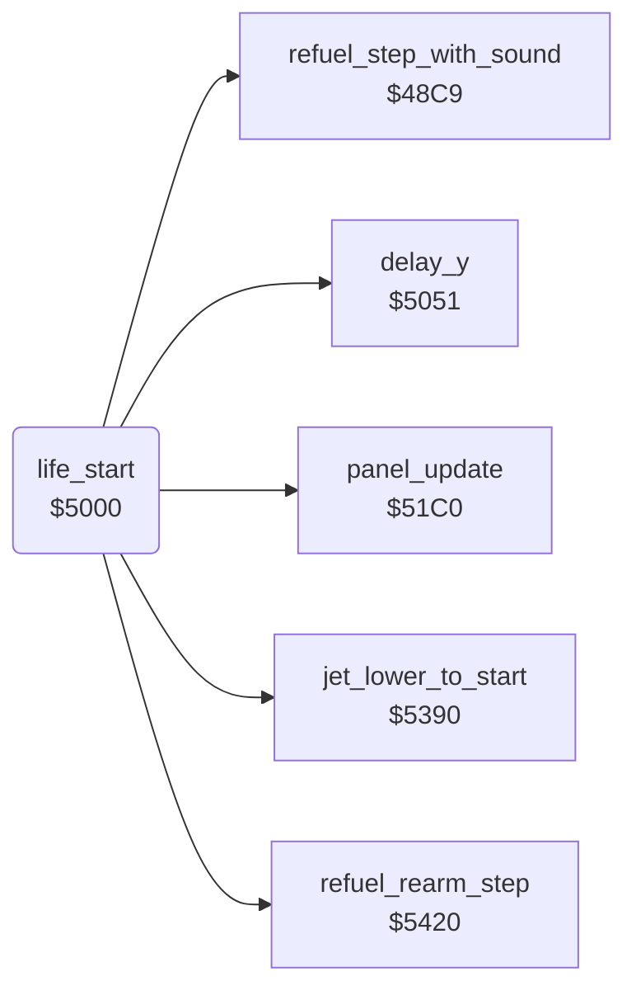

<!-- Generated by c64-docs from knowledge revision 20261024T103119.179-vx1fei and .c64-re-tools/local/generated/src/source-map.json. Do not edit: change the knowledge, generate the source again, then run docs.ts generate. -->
# player/life_start.asm: Start of a life: lower the jet and refuel

Range `$5000-$501F`. Source: [player/life_start.asm](../../../../src/player/life_start.asm). Index: [the reference](../../index.md).

## Call graph

A solid arrow is a call, a thick arrow a table entry, a dotted arrow a jump. Rounded nodes are in this file.

## Names

### [`life_start`](../../../../src/player/life_start.asm#L6) `$5000`

*routine*

Starts a life. Writes character $1e over X bytes from $04ab, lowers the jet, then refuels until the GAS hundreds digit $17 is 9.
The caller $4970 leaves X = $19: this erases the PRESS FIRE TO START text.

- **Called from:** [`$4182`](../../../../src/game/main_loop.asm#L52)
- **Calls:** [`jet_lower_to_start`](jet_start.md#jet_lower_to_start), [`refuel_step_with_sound`](../sound/sound_update_48c9.md#refuel_step_with_sound), [`refuel_rearm_step`](refuel.md#refuel_rearm_step), [`panel_update`](../panel/panel_update.md#panel_update), [`delay_y`](../game/delay_5051.md#delay_y)
- **Reads:** [`gas_count`](../../memory-map.md#gas_count)
- **Writes:** [`VICSCN+170`](../../memory-map.md#VICSCN)

### [`life_start_erase_text`](../../../../src/player/life_start.asm#L8) `$5002`

*label*

- **Jumped to from:** [`life_start`](life_start.md#life_start) [`$5006`](../../../../src/player/life_start.asm#L11)

### [`life_start_refuel_loop`](../../../../src/player/life_start.asm#L13) `$500B`

*label*

Delay, sound and one refuel step.

- **Jumped to from:** [`life_start`](life_start.md#life_start) [`$501D`](../../../../src/player/life_start.asm#L21)
