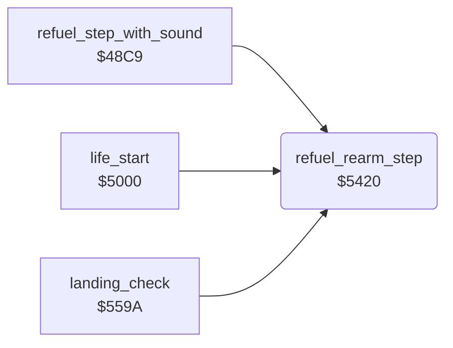

<!-- Generated by c64-docs from knowledge revision 20261025T214607.441-00m56k and .c64-re-tools/local/generated/src/source-map.json. Do not edit: change the knowledge, generate the source again, then run docs.ts generate. -->
# player/refuel.asm: Refuel and rearm

Range `$5420-$546F`. Source: [player/refuel.asm](../../../../src/player/refuel.asm). Index: [the reference](../../index.md).

## Routines

| Routine | Address | Reached from | Summary |
|---|---|---|---|
| [`refuel_rearm_step`](refuel.md#refuel_rearm_step) | `$5420` | [`refuel_step_with_sound`](../sound/sound_update_48c9.md#refuel_step_with_sound), [`life_start`](life_start.md#life_start), [`landing_check`](landing.md#landing_check) | One refuel step: GAS digits $17-$19 + 1 until $17 = 9. |

## Call graph

A solid arrow is a call, a thick arrow a table entry. Rounded nodes are in this file.

## Details

### [`refuel_rearm_step`](../../../../src/player/refuel.asm#L6) `$5420`

*routine*

One refuel step: GAS digits $17-$19 + 1 until $17 = 9. On every 8th tick, AAM + 1 until $1a = 1. Clears jet_state bit 7.

- **Called from:** [`refuel_step_with_sound`](../sound/sound_update_48c9.md#refuel_step_with_sound), [`life_start`](life_start.md#life_start), [`landing_check`](landing.md#landing_check)
- **Reads:** [`tick`](../../memory-map.md#tick), [`gas_count`](../../memory-map.md#gas_count), [`aam_count`](../../memory-map.md#aam_count), [`jet_state`](../../memory-map.md#jet_state)
- **Writes:** [`gas_count`](../../memory-map.md#gas_count), [`aam_count`](../../memory-map.md#aam_count), [`jet_state`](../../memory-map.md#jet_state)

| Label | Address | Comment |
|---|---|---|
| [`rearm_step`](../../../../src/player/refuel.asm#L26) | `$5445` |  |
| [`refuel_rearm_done`](../../../../src/player/refuel.asm#L44) | `$5466` |  |
