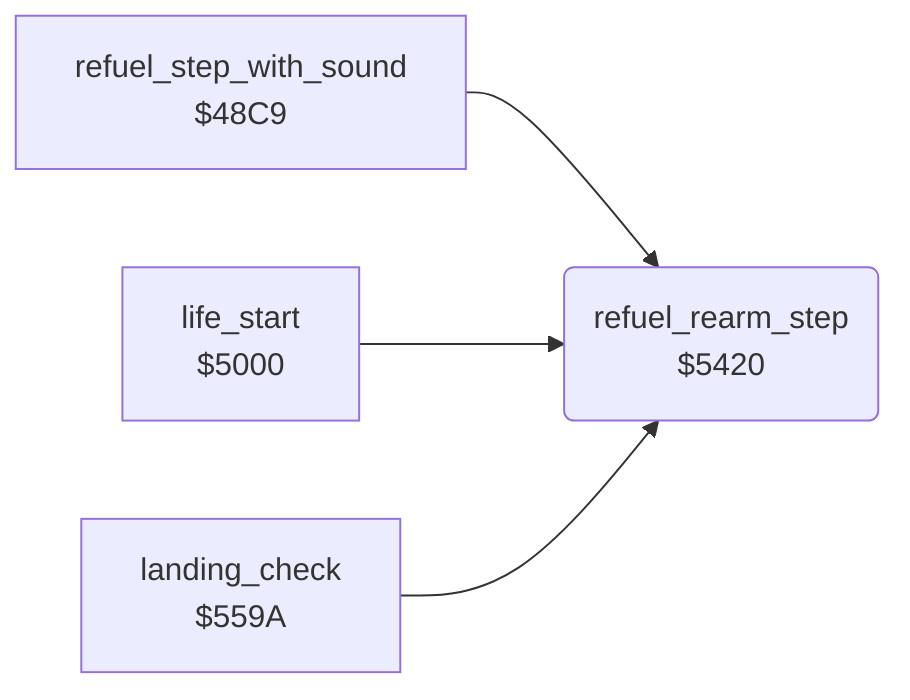

<!-- Generated by c64-docs from knowledge revision 20261024T103119.179-vx1fei and .c64-re-tools/local/generated/src/source-map.json. Do not edit: change the knowledge, generate the source again, then run docs.ts generate. -->
# player/refuel.asm: Refuel and rearm

Range `$5420-$546F`. Source: [player/refuel.asm](../../../../src/player/refuel.asm). Index: [the reference](../../index.md).

## Call graph

A solid arrow is a call, a thick arrow a table entry, a dotted arrow a jump. Rounded nodes are in this file.

## Names

### [`refuel_rearm_step`](../../../../src/player/refuel.asm#L6) `$5420`

*routine*

One refuel step: GAS digits $17-$19 + 1 until $17 = 9. On every 8th tick, AAM + 1 until $1a = 1. Clears jet_state bit 7.

- **Called from:** [`refuel_step_with_sound`](../sound/sound_update_48c9.md#refuel_step_with_sound) [`$48D6`](../../../../src/sound/sound_update_48c9.asm#L16), [`life_start`](life_start.md#life_start) [`$500E`](../../../../src/player/life_start.asm#L15), [`landing_check`](landing.md#landing_check) [`$55D3`](../../../../src/player/landing.asm#L37), [`landing_check`](landing.md#landing_check) [`$55D6`](../../../../src/player/landing.asm#L38)
- **Reads:** [`tick`](../../memory-map.md#tick), [`gas_count`](../../memory-map.md#gas_count), [`gas_count+2`](../../memory-map.md#gas_count), [`gas_count+1`](../../memory-map.md#gas_count), [`aam_count`](../../memory-map.md#aam_count), [`aam_count+2`](../../memory-map.md#aam_count), [`aam_count+1`](../../memory-map.md#aam_count), [`jet_state`](../../memory-map.md#jet_state)
- **Writes:** [`gas_count+2`](../../memory-map.md#gas_count), [`gas_count+1`](../../memory-map.md#gas_count), [`gas_count`](../../memory-map.md#gas_count), [`aam_count+2`](../../memory-map.md#aam_count), [`aam_count+1`](../../memory-map.md#aam_count), [`aam_count`](../../memory-map.md#aam_count), [`jet_state`](../../memory-map.md#jet_state)

### [`rearm_step`](../../../../src/player/refuel.asm#L26) `$5445`

*label*

- **Jumped to from:** [`refuel_rearm_step`](refuel.md#refuel_rearm_step) [`$5424`](../../../../src/player/refuel.asm#L9), [`refuel_rearm_step`](refuel.md#refuel_rearm_step) [`$542D`](../../../../src/player/refuel.asm#L14), [`refuel_rearm_step`](refuel.md#refuel_rearm_step) [`$5435`](../../../../src/player/refuel.asm#L18), [`refuel_rearm_step`](refuel.md#refuel_rearm_step) [`$543F`](../../../../src/player/refuel.asm#L23)

### [`refuel_rearm_done`](../../../../src/player/refuel.asm#L44) `$5466`

*label*

- **Jumped to from:** [`refuel_rearm_step`](refuel.md#refuel_rearm_step) [`$5449`](../../../../src/player/refuel.asm#L29), [`refuel_rearm_step`](refuel.md#refuel_rearm_step) [`$544E`](../../../../src/player/refuel.asm#L32), [`refuel_rearm_step`](refuel.md#refuel_rearm_step) [`$5456`](../../../../src/player/refuel.asm#L36), [`refuel_rearm_step`](refuel.md#refuel_rearm_step) [`$5460`](../../../../src/player/refuel.asm#L41)
