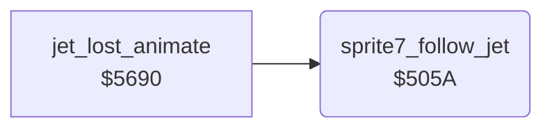

<!-- Generated by c64-docs from knowledge revision 20261025T214607.441-00m56k and .c64-re-tools/local/generated/src/source-map.json. Do not edit: change the knowledge, generate the source again, then run docs.ts generate. -->
# player/sprite7_follow.asm: Sprite 7 follows the jet

Range `$505A-$507F`. Source: [player/sprite7_follow.asm](../../../../src/player/sprite7_follow.asm). Index: [the reference](../../index.md).

## Routines

| Routine | Address | Reached from | Summary |
|---|---|---|---|
| [`sprite7_follow_jet`](sprite7_follow.md#sprite7_follow_jet) | `$505A` | [`jet_lost_animate`](jet_lost_animation.md#jet_lost_animate) | Puts sprite 7 at the jet position. |

## Call graph

A solid arrow is a call, a thick arrow a table entry. Rounded nodes are in this file.

## Details

### [`sprite7_follow_jet`](../../../../src/player/sprite7_follow.asm#L6) `$505A`

*routine*

Puts sprite 7 at the jet position. Then moves it 8 pixels left when jet_speed_x > 0, or 8 pixels right when jet_speed_x < 0.

- **Called from:** [`jet_lost_animate`](jet_lost_animation.md#jet_lost_animate)
- **Reads:** [`SP0X`](../../memory-map.md#SP0X), [`SP0Y`](../../memory-map.md#SP0Y), [`jet_speed_x`](../../memory-map.md#jet_speed_x), [`SP7X`](../../memory-map.md#SP7X)
- **Writes:** [`SP7X`](../../memory-map.md#SP7X), [`SP7Y`](../../memory-map.md#SP7Y)

| Label | Address | Comment |
|---|---|---|
| [`sprite7_shift_right`](../../../../src/player/sprite7_follow.asm#L15) | `$506E` |  |
| [`sprite7_shift_left`](../../../../src/player/sprite7_follow.asm#L20) | `$5076` |  |
| [`sprite7_follow_done`](../../../../src/player/sprite7_follow.asm#L27) | `$507F` |  |
