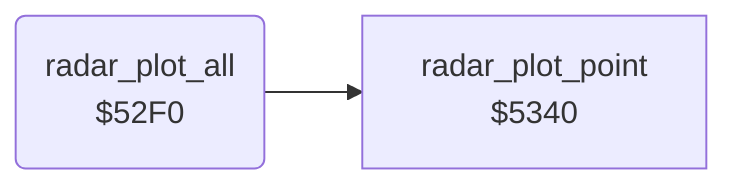

<!-- Generated by c64-docs from knowledge revision 20261025T214607.441-00m56k and .c64-re-tools/local/generated/src/source-map.json. Do not edit: change the knowledge, generate the source again, then run docs.ts generate. -->
# radar/radar_52f0.asm

Range `$52F0-$532E`. Source: [radar/radar_52f0.asm](../../../../src/radar/radar_52f0.asm). Index: [the reference](../../index.md).

## Routines

| Routine | Address | Reached from | Summary |
|---|---|---|---|
| [`radar_plot_all`](radar_52f0.md#radar_plot_all) | `$52F0` | [`$415C`](../../../../src/game/main_loop.asm#L19), [`$4196`](../../../../src/game/main_loop.asm#L62) | Plots the radar: each tile $16 in map row 0 at radar row 11, then each enemy with enemy_state <> 0. |

## Call graph

A solid arrow is a call, a thick arrow a table entry. Rounded nodes are in this file.

## Details

### [`radar_plot_all`](../../../../src/radar/radar_52f0.asm#L6) `$52F0`

*routine*

Plots the radar: each tile $16 in map row 0 at radar row 11, then each enemy with enemy_state <> 0. Sets $11 = $0d - $6c.

- **Called from:** [`$415C`](../../../../src/game/main_loop.asm#L19), [`$4196`](../../../../src/game/main_loop.asm#L62)
- **Calls:** [`radar_plot_point`](radar_5340.md#radar_plot_point)
- **Reads:** [`map_column`](../../memory-map.md#map_column), [`landscape_map`](../data/map.md#landscape_map), [`enemy_state`](../../memory-map.md#enemy_state), [`enemy_row`](../../memory-map.md#enemy_row), [`enemy_col`](../../memory-map.md#enemy_col)
- **Writes:** [`radar_offset`](../../memory-map.md#radar_offset), [`radar_col`](../../memory-map.md#radar_col), [`radar_row`](../../memory-map.md#radar_row)

| Label | Address | Comment |
|---|---|---|
| [`radar_find_pads_loop`](../../../../src/radar/radar_52f0.asm#L12) | `$52F9` |  |
| [`radar_find_pads_next`](../../../../src/radar/radar_52f0.asm#L28) | `$5313` |  |
| [`radar_plot_enemies`](../../../../src/radar/radar_52f0.asm#L31) | `$5316` |  |
| [`radar_plot_enemies_loop`](../../../../src/radar/radar_52f0.asm#L33) | `$5318` |  |
| [`radar_plot_enemies_next`](../../../../src/radar/radar_52f0.asm#L45) | `$532B` |  |
