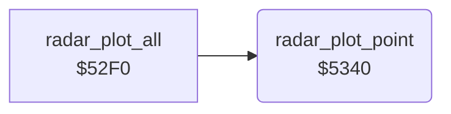

<!-- Generated by c64-docs from knowledge revision 20261025T214607.441-00m56k and .c64-re-tools/local/generated/src/source-map.json. Do not edit: change the knowledge, generate the source again, then run docs.ts generate. -->
# radar/radar_5340.asm

Range `$5340-$5384`. Source: [radar/radar_5340.asm](../../../../src/radar/radar_5340.asm). Index: [the reference](../../index.md).

## Routines

| Routine | Address | Reached from | Summary |
|---|---|---|---|
| [`radar_plot_point`](radar_5340.md#radar_plot_point) | `$5340` | [`radar_plot_all`](radar_52f0.md#radar_plot_all) | Sets one radar pixel to colour RAM colour. |

## Call graph

A solid arrow is a call, a thick arrow a table entry. Rounded nodes are in this file.

## Details

### [`radar_plot_point`](../../../../src/radar/radar_5340.asm#L6) `$5340`

*routine*

Sets one radar pixel to colour RAM colour. Input: $20 pixel row 0-15, $21 map column. Pixel column = ($21 - $11) / 4, 64 pixels wide.

- **Called from:** [`radar_plot_all`](radar_52f0.md#radar_plot_all)
- **Reads:** [`radar_row`](../../memory-map.md#radar_row), [`radar_col`](../../memory-map.md#radar_col), [`radar_offset`](../../memory-map.md#radar_offset), [`radar_ptr`](../../memory-map.md#radar_ptr)
- **Writes:** [`radar_ptr`](../../memory-map.md#radar_ptr), [`radar_ptr_hi`](../../memory-map.md#radar_ptr_hi), [`radar_col`](../../memory-map.md#radar_col), [`radar_row`](../../memory-map.md#radar_row)
- **Refers to:** [`radar_chars`](../data/charset.md#radar_chars)

| Label | Address | Comment |
|---|---|---|
| [`radar_plot_upper_row`](../../../../src/radar/radar_5340.asm#L14) | `$534E` | Rows 0-7: characters $d0-$df at $3680. |
| [`radar_plot_set_base`](../../../../src/radar/radar_5340.asm#L18) | `$5354` |  |
| [`radar_plot_shift_mask`](../../../../src/radar/radar_5340.asm#L43) | `$5373` |  |
| [`radar_plot_store`](../../../../src/radar/radar_5340.asm#L49) | `$537A` |  |
