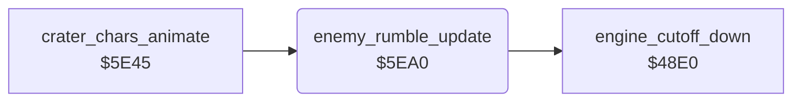

<!-- Generated by c64-docs from knowledge revision 20261024T103119.179-vx1fei and .c64-re-tools/local/generated/src/source-map.json. Do not edit: change the knowledge, generate the source again, then run docs.ts generate. -->
# sound/enemy_rumble.asm: Rumble sound of the enemies

Range `$5EA0-$5EFB`. Source: [sound/enemy_rumble.asm](../../../../src/sound/enemy_rumble.asm). Index: [the reference](../../index.md).

## Call graph

A solid arrow is a call, a thick arrow a table entry, a dotted arrow a jump. Rounded nodes are in this file.

## Names

### [`enemy_rumble_update`](../../../../src/sound/enemy_rumble.asm#L6) `$5EA0`

*routine*

Turns the noise of SID voice 3 on while an enemy is active ($23 = $81), else off. It sets the filter cutoff $d416 from the column distance of an enemy. Without an active enemy, it calls $48e0, which lowers the cutoff to $10.

- **Called from:** [`crater_chars_animate`](../graphics/crater_chars_animate.md#crater_chars_animate) [`$5E61`](../../../../src/graphics/crater_chars_animate.asm#L23)
- **Calls:** [`engine_cutoff_down`](sound_update_48e0.md#engine_cutoff_down)
- **Reads:** [`jet_state`](../../memory-map.md#jet_state), [`enemy_sound_on`](../../memory-map.md#enemy_sound_on), [`enemy_state+1`](../../memory-map.md#enemy_state), [`wave_launched`](../../memory-map.md#wave_launched), [`map_column`](../../memory-map.md#map_column), [`enemy_col+1`](../../memory-map.md#enemy_col)
- **Writes:** [`VCREG3`](../../memory-map.md#VCREG3), [`enemy_sound_on`](../../memory-map.md#enemy_sound_on), [`CUTHI`](../../memory-map.md#CUTHI), [`filter_cutoff`](../../memory-map.md#filter_cutoff)

### [`enemy_rumble_find_loop`](../../../../src/sound/enemy_rumble.asm#L13) `$5EAC`

*label*

- **Jumped to from:** [`enemy_rumble_update`](enemy_rumble.md#enemy_rumble_update) [`$5EB5`](../../../../src/sound/enemy_rumble.asm#L20)

### [`enemy_rumble_find_next`](../../../../src/sound/enemy_rumble.asm#L18) `$5EB4`

*label*

- **Jumped to from:** [`enemy_rumble_update`](enemy_rumble.md#enemy_rumble_update) [`$5EAE`](../../../../src/sound/enemy_rumble.asm#L15)

### [`enemy_rumble_gate_on`](../../../../src/sound/enemy_rumble.asm#L22) `$5EB9`

*label*

- **Jumped to from:** [`enemy_rumble_update`](enemy_rumble.md#enemy_rumble_update) [`$5EB2`](../../../../src/sound/enemy_rumble.asm#L17)

### [`enemy_rumble_playing`](../../../../src/sound/enemy_rumble.asm#L27) `$5EC2`

*label*

$65 = 0: no enemy of the wave has started.

- **Jumped to from:** [`enemy_rumble_update`](enemy_rumble.md#enemy_rumble_update) [`$5EA8`](../../../../src/sound/enemy_rumble.asm#L11)

### [`enemy_rumble_check_loop`](../../../../src/sound/enemy_rumble.asm#L31) `$5EC8`

*label*

- **Jumped to from:** [`enemy_rumble_update`](enemy_rumble.md#enemy_rumble_update) [`$5ED1`](../../../../src/sound/enemy_rumble.asm#L38)

### [`enemy_rumble_check_next`](../../../../src/sound/enemy_rumble.asm#L36) `$5ED0`

*label*

- **Jumped to from:** [`enemy_rumble_update`](enemy_rumble.md#enemy_rumble_update) [`$5ECA`](../../../../src/sound/enemy_rumble.asm#L33)

### [`enemy_rumble_set_cutoff`](../../../../src/sound/enemy_rumble.asm#L44) `$5EDE`

*label*

A = $0d + $93 - map column of the enemy, made positive.

- **Jumped to from:** [`enemy_rumble_update`](enemy_rumble.md#enemy_rumble_update) [`$5EC0`](../../../../src/sound/enemy_rumble.asm#L26), [`enemy_rumble_update`](enemy_rumble.md#enemy_rumble_update) [`$5ECE`](../../../../src/sound/enemy_rumble.asm#L35)

### [`enemy_rumble_limit`](../../../../src/sound/enemy_rumble.asm#L52) `$5EEA`

*label*

At most $6d.

- **Jumped to from:** [`enemy_rumble_update`](enemy_rumble.md#enemy_rumble_update) [`$5EE6`](../../../../src/sound/enemy_rumble.asm#L50)

### [`enemy_rumble_store`](../../../../src/sound/enemy_rumble.asm#L56) `$5EF0`

*label*

- **Jumped to from:** [`enemy_rumble_update`](enemy_rumble.md#enemy_rumble_update) [`$5EEC`](../../../../src/sound/enemy_rumble.asm#L54)

### [`enemy_rumble_fade`](../../../../src/sound/enemy_rumble.asm#L61) `$5EF8`

*label*

- **Jumped to from:** [`enemy_rumble_update`](enemy_rumble.md#enemy_rumble_update) [`$5EB7`](../../../../src/sound/enemy_rumble.asm#L21), [`enemy_rumble_update`](enemy_rumble.md#enemy_rumble_update) [`$5EC4`](../../../../src/sound/enemy_rumble.asm#L29), [`enemy_rumble_update`](enemy_rumble.md#enemy_rumble_update) [`$5EDC`](../../../../src/sound/enemy_rumble.asm#L43)

### [`enemy_rumble_done`](../../../../src/sound/enemy_rumble.asm#L63) `$5EFB`

*label*

- **Jumped to from:** [`enemy_rumble_update`](enemy_rumble.md#enemy_rumble_update) [`$5EA4`](../../../../src/sound/enemy_rumble.asm#L9), [`enemy_rumble_update`](enemy_rumble.md#enemy_rumble_update) [`$5EF6`](../../../../src/sound/enemy_rumble.asm#L60)
