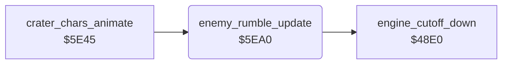

<!-- Generated by c64-docs from knowledge revision 20261025T214607.441-00m56k and .c64-re-tools/local/generated/src/source-map.json. Do not edit: change the knowledge, generate the source again, then run docs.ts generate. -->
# sound/enemy_rumble.asm: Rumble sound of the enemies

Range `$5EA0-$5EFB`. Source: [sound/enemy_rumble.asm](../../../../src/sound/enemy_rumble.asm). Index: [the reference](../../index.md).

## Routines

| Routine | Address | Reached from | Summary |
|---|---|---|---|
| [`enemy_rumble_update`](enemy_rumble.md#enemy_rumble_update) | `$5EA0` | [`crater_chars_animate`](../graphics/crater_chars_animate.md#crater_chars_animate) | Turns the noise of SID voice 3 on while an enemy is active ($23 = $81), else off. |

## Call graph

A solid arrow is a call, a thick arrow a table entry. Rounded nodes are in this file.

## Details

### [`enemy_rumble_update`](../../../../src/sound/enemy_rumble.asm#L6) `$5EA0`

*routine*

Turns the noise of SID voice 3 on while an enemy is active ($23 = $81), else off. It sets the filter cutoff $d416 from the column distance of an enemy. Without an active enemy, it calls $48e0, which lowers the cutoff to $10.

- **Called from:** [`crater_chars_animate`](../graphics/crater_chars_animate.md#crater_chars_animate)
- **Calls:** [`engine_cutoff_down`](sound_update_48e0.md#engine_cutoff_down)
- **Reads:** [`jet_state`](../../memory-map.md#jet_state), [`enemy_sound_on`](../../memory-map.md#enemy_sound_on), [`enemy_state`](../../memory-map.md#enemy_state), [`wave_launched`](../../memory-map.md#wave_launched), [`map_column`](../../memory-map.md#map_column), [`enemy_col`](../../memory-map.md#enemy_col)
- **Writes:** [`VCREG3`](../../memory-map.md#VCREG3), [`enemy_sound_on`](../../memory-map.md#enemy_sound_on), [`CUTHI`](../../memory-map.md#CUTHI), [`filter_cutoff`](../../memory-map.md#filter_cutoff)

| Label | Address | Comment |
|---|---|---|
| [`enemy_rumble_find_loop`](../../../../src/sound/enemy_rumble.asm#L13) | `$5EAC` |  |
| [`enemy_rumble_find_next`](../../../../src/sound/enemy_rumble.asm#L18) | `$5EB4` |  |
| [`enemy_rumble_gate_on`](../../../../src/sound/enemy_rumble.asm#L22) | `$5EB9` |  |
| [`enemy_rumble_playing`](../../../../src/sound/enemy_rumble.asm#L27) | `$5EC2` | $65 = 0: no enemy of the wave has started. |
| [`enemy_rumble_check_loop`](../../../../src/sound/enemy_rumble.asm#L31) | `$5EC8` |  |
| [`enemy_rumble_check_next`](../../../../src/sound/enemy_rumble.asm#L36) | `$5ED0` |  |
| [`enemy_rumble_set_cutoff`](../../../../src/sound/enemy_rumble.asm#L44) | `$5EDE` | A = $0d + $93 - map column of the enemy, made positive. |
| [`enemy_rumble_limit`](../../../../src/sound/enemy_rumble.asm#L52) | `$5EEA` | At most $6d. |
| [`enemy_rumble_store`](../../../../src/sound/enemy_rumble.asm#L56) | `$5EF0` |  |
| [`enemy_rumble_fade`](../../../../src/sound/enemy_rumble.asm#L61) | `$5EF8` |  |
| [`enemy_rumble_done`](../../../../src/sound/enemy_rumble.asm#L63) | `$5EFB` |  |
