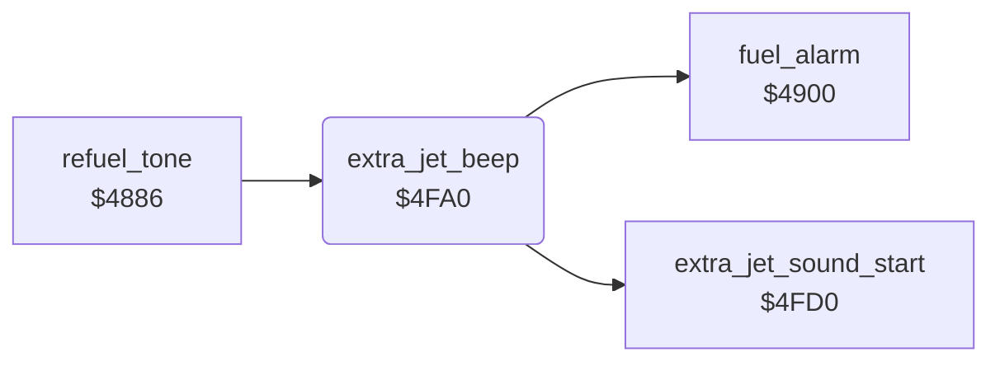

<!-- Generated by c64-docs from knowledge revision 20261024T103119.179-vx1fei and .c64-re-tools/local/generated/src/source-map.json. Do not edit: change the knowledge, generate the source again, then run docs.ts generate. -->
# sound/extra_jet_beep.asm: Extra-jet beep

Range `$4FA0-$4FC3`. Source: [sound/extra_jet_beep.asm](../../../../src/sound/extra_jet_beep.asm). Index: [the reference](../../index.md).

## Call graph

A solid arrow is a call, a thick arrow a table entry, a dotted arrow a jump. Rounded nodes are in this file.

## Names

### [`extra_jet_beep`](../../../../src/sound/extra_jet_beep.asm#L6) `$4FA0`

*routine*

Plays the extra-jet beep while $67 is $30-$7f: $67 counts up each call, voice 2 pulses on and off every 8 counts. When $67 is 0 or from $80, it calls the fuel alarm ($4900).

- **Called from:** [`refuel_tone`](sound_update_4880.md#refuel_tone) [`$48BC`](../../../../src/sound/sound_update_4880.asm#L42)
- **Calls:** [`extra_jet_sound_start`](extra_jet_beep_4fd0.md#extra_jet_sound_start), [`fuel_alarm`](fuel_alarm.md#fuel_alarm)
- **Reads:** [`bonus_jet_flag`](../../memory-map.md#bonus_jet_flag)
- **Writes:** [`VCREG2`](../../memory-map.md#VCREG2), [`bonus_jet_flag`](../../memory-map.md#bonus_jet_flag)

### [`extra_jet_beep_gate`](../../../../src/sound/extra_jet_beep.asm#L14) `$4FAD`

*label*

- **Jumped to from:** [`extra_jet_beep`](extra_jet_beep.md#extra_jet_beep) [`$4FA8`](../../../../src/sound/extra_jet_beep.asm#L12)

### [`extra_jet_beep_gate_off`](../../../../src/sound/extra_jet_beep.asm#L20) `$4FB7`

*label*

- **Jumped to from:** [`extra_jet_beep`](extra_jet_beep.md#extra_jet_beep) [`$4FB1`](../../../../src/sound/extra_jet_beep.asm#L17)

### [`extra_jet_beep_set_gate`](../../../../src/sound/extra_jet_beep.asm#L22) `$4FB9`

*label*

- **Jumped to from:** [`extra_jet_beep`](extra_jet_beep.md#extra_jet_beep) [`$4FB5`](../../../../src/sound/extra_jet_beep.asm#L19)

### [`extra_jet_beep_idle`](../../../../src/sound/extra_jet_beep.asm#L26) `$4FC0`

*label*

- **Jumped to from:** [`extra_jet_beep`](extra_jet_beep.md#extra_jet_beep) [`$4FA2`](../../../../src/sound/extra_jet_beep.asm#L8), [`extra_jet_beep`](extra_jet_beep.md#extra_jet_beep) [`$4FA4`](../../../../src/sound/extra_jet_beep.asm#L10)

### [`extra_jet_beep_done`](../../../../src/sound/extra_jet_beep.asm#L28) `$4FC3`

*label*

- **Jumped to from:** [`extra_jet_beep`](extra_jet_beep.md#extra_jet_beep) [`$4FBE`](../../../../src/sound/extra_jet_beep.asm#L25)
