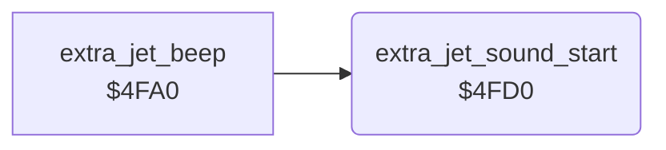

<!-- Generated by c64-docs from knowledge revision 20261025T214607.441-00m56k and .c64-re-tools/local/generated/src/source-map.json. Do not edit: change the knowledge, generate the source again, then run docs.ts generate. -->
# sound/extra_jet_beep_4fd0.asm

Range `$4FD0-$4FE6`. Source: [sound/extra_jet_beep_4fd0.asm](../../../../src/sound/extra_jet_beep_4fd0.asm). Index: [the reference](../../index.md).

## Routines

| Routine | Address | Reached from | Summary |
|---|---|---|---|
| [`extra_jet_sound_start`](extra_jet_beep_4fd0.md#extra_jet_sound_start) | `$4FD0` | [`extra_jet_beep`](extra_jet_beep.md#extra_jet_beep) | Loads the extra-jet beep into voice 2: copies the 7 bytes at $4fe0 to $d407-$d40d. |

## Data

| Range | Type | Name | Read by | Written by |
|---|---|---|---|---|
| [`$4FE0`](../../../../src/sound/extra_jet_beep_4fd0.asm#L19)-`$4FE6` | bytes | [`voice2_extra_jet_preset`](../../../../src/sound/extra_jet_beep_4fd0.asm#L18) | [`extra_jet_sound_start`](extra_jet_beep_4fd0.md#extra_jet_sound_start) |  |

## Call graph

A solid arrow is a call, a thick arrow a table entry. Rounded nodes are in this file.

## Details

### [`extra_jet_sound_start`](../../../../src/sound/extra_jet_beep_4fd0.asm#L6) `$4FD0`

*routine*

Loads the extra-jet beep into voice 2: copies the 7 bytes at $4fe0 to $d407-$d40d. Sets $27 = 0 (voice 2 is not in its reset state).

- **Called from:** [`extra_jet_beep`](extra_jet_beep.md#extra_jet_beep)
- **Writes:** [`FRELO2`](../../memory-map.md#FRELO2), [`voice2_idle`](../../memory-map.md#voice2_idle)

| Label | Address | Comment |
|---|---|---|
| [`extra_jet_sound_copy`](../../../../src/sound/extra_jet_beep_4fd0.asm#L9) | `$4FD2` |  |

### [`voice2_extra_jet_preset`](../../../../src/sound/extra_jet_beep_4fd0.asm#L18) `$4FE0-$4FE6`

*data*

Voice 2 registers $d407-$d40d of the extra-jet beep. $4fd0 copies them.

- **Read by:** [`extra_jet_sound_start`](extra_jet_beep_4fd0.md#extra_jet_sound_start)
