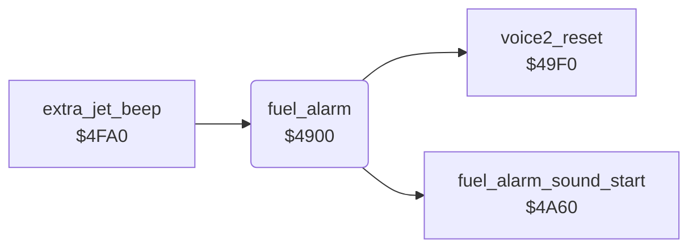

<!-- Generated by c64-docs from knowledge revision 20261024T103119.179-vx1fei and .c64-re-tools/local/generated/src/source-map.json. Do not edit: change the knowledge, generate the source again, then run docs.ts generate. -->
# sound/fuel_alarm.asm: Low-fuel alarm

Range `$4900-$4965`. Source: [sound/fuel_alarm.asm](../../../../src/sound/fuel_alarm.asm). Index: [the reference](../../index.md).

## Call graph

A solid arrow is a call, a thick arrow a table entry, a dotted arrow a jump. Rounded nodes are in this file.

## Names

### [`fuel_alarm`](../../../../src/sound/fuel_alarm.asm#L6) `$4900`

*routine*

Plays the fuel alarm on voice 2 when jet_state bit 6 (low fuel) or bit 7 (no fuel) is set. It sweeps the pitch up and flashes the GAS gauge red and white. When the fuel is good, it resets voice 2 once ($49f0).

- **Called from:** [`extra_jet_beep`](extra_jet_beep.md#extra_jet_beep) [`$4FC0`](../../../../src/sound/extra_jet_beep.asm#L27)
- **Calls:** [`fuel_alarm_sound_start`](sound_start_4a60.md#fuel_alarm_sound_start), [`voice2_reset`](sound_start_49f0.md#voice2_reset)
- **Reads:** [`jet_state`](../../memory-map.md#jet_state), [`alarm_pitch`](../../memory-map.md#alarm_pitch), [`alarm_phase`](../../memory-map.md#alarm_phase), [`voice2_idle`](../../memory-map.md#voice2_idle)
- **Writes:** [`voice2_idle`](../../memory-map.md#voice2_idle), [`alarm_pitch`](../../memory-map.md#alarm_pitch), [`FREHI2`](../../memory-map.md#FREHI2), [`alarm_phase`](../../memory-map.md#alarm_phase), [`VCREG2`](../../memory-map.md#VCREG2), [`gauge_colour`](../../memory-map.md#gauge_colour)

### [`fuel_alarm_rise`](../../../../src/sound/fuel_alarm.asm#L18) `$4915`

*label*

- **Jumped to from:** [`fuel_alarm`](fuel_alarm.md#fuel_alarm) [`$4910`](../../../../src/sound/fuel_alarm.asm#L16)

### [`fuel_alarm_off_phase`](../../../../src/sound/fuel_alarm.asm#L31) `$492D`

*label*

- **Jumped to from:** [`fuel_alarm`](fuel_alarm.md#fuel_alarm) [`$490C`](../../../../src/sound/fuel_alarm.asm#L14)

### [`fuel_alarm_off_step`](../../../../src/sound/fuel_alarm.asm#L39) `$493D`

*label*

- **Jumped to from:** [`fuel_alarm`](fuel_alarm.md#fuel_alarm) [`$492F`](../../../../src/sound/fuel_alarm.asm#L33)

### [`fuel_alarm_none`](../../../../src/sound/fuel_alarm.asm#L48) `$494D`

*label*

$27 = 0: voice 2 is not reset yet.

- **Jumped to from:** [`fuel_alarm`](fuel_alarm.md#fuel_alarm) [`$4904`](../../../../src/sound/fuel_alarm.asm#L9)

### [`fuel_alarm_ok_done`](../../../../src/sound/fuel_alarm.asm#L52) `$4954`

*label*

Always branches.

- **Jumped to from:** [`fuel_alarm`](fuel_alarm.md#fuel_alarm) [`$494F`](../../../../src/sound/fuel_alarm.asm#L50)

### [`fuel_alarm_flash_gauge`](../../../../src/sound/fuel_alarm.asm#L56) `$4957`

*label*

Sets the GAS gauge colour $2e from bit 2 of $29: 2 (red) or 1 (white).

- **Jumped to from:** [`fuel_alarm`](fuel_alarm.md#fuel_alarm) [`$4921`](../../../../src/sound/fuel_alarm.asm#L25), [`fuel_alarm`](fuel_alarm.md#fuel_alarm) [`$492B`](../../../../src/sound/fuel_alarm.asm#L30), [`fuel_alarm`](fuel_alarm.md#fuel_alarm) [`$4941`](../../../../src/sound/fuel_alarm.asm#L42), [`fuel_alarm`](fuel_alarm.md#fuel_alarm) [`$494B`](../../../../src/sound/fuel_alarm.asm#L47)

### [`fuel_alarm_gauge_white`](../../../../src/sound/fuel_alarm.asm#L63) `$4961`

*label*

- **Jumped to from:** [`fuel_alarm`](fuel_alarm.md#fuel_alarm) [`$495B`](../../../../src/sound/fuel_alarm.asm#L60)

### [`fuel_alarm_set_gauge_colour`](../../../../src/sound/fuel_alarm.asm#L65) `$4963`

*label*

- **Jumped to from:** [`fuel_alarm`](fuel_alarm.md#fuel_alarm) [`$495F`](../../../../src/sound/fuel_alarm.asm#L62)

### [`fuel_alarm_done`](../../../../src/sound/fuel_alarm.asm#L67) `$4965`

*label*

- **Jumped to from:** [`fuel_alarm`](fuel_alarm.md#fuel_alarm) [`$4955`](../../../../src/sound/fuel_alarm.asm#L54)
