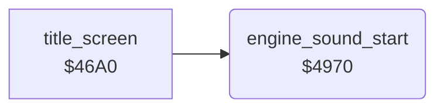

<!-- Generated by c64-docs from knowledge revision 20261024T103119.179-vx1fei and .c64-re-tools/local/generated/src/source-map.json. Do not edit: change the knowledge, generate the source again, then run docs.ts generate. -->
# sound/sound_start.asm: Start of the engine, crash, refuel and alarm sounds

Range `$4970-$4986`. Source: [sound/sound_start.asm](../../../../src/sound/sound_start.asm). Index: [the reference](../../index.md).

## Call graph

A solid arrow is a call, a thick arrow a table entry, a dotted arrow a jump. Rounded nodes are in this file.

## Names

### [`engine_sound_start`](../../../../src/sound/sound_start.asm#L6) `$4970`

*routine*

Starts the engine sound: copies the SID image at $4f00 to $d400-$d418, gates voice 1 (noise) and sets the cutoff $ac to $10. Called at the start of each life and at the end of the title screen.

- **Called from:** [`$4173`](../../../../src/game/main_loop.asm#L32), [`title_screen`](../title/title_screen.md#title_screen) [`$4728`](../../../../src/title/title_screen.asm#L88)
- **Reads:** [`sid_engine_preset`](../data/sid_presets.md#sid_engine_preset)
- **Writes:** [`FRELO1`](../../memory-map.md#FRELO1), [`VCREG1`](../../memory-map.md#VCREG1), [`filter_cutoff`](../../memory-map.md#filter_cutoff)

### [`engine_sound_copy`](../../../../src/sound/sound_start.asm#L8) `$4972`

*label*

- **Jumped to from:** [`engine_sound_start`](sound_start.md#engine_sound_start) [`$497B`](../../../../src/sound/sound_start.asm#L13)
