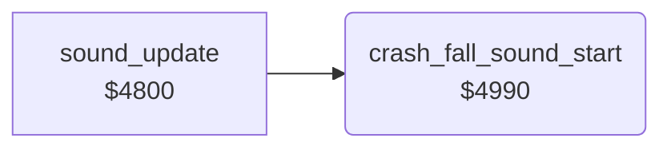

<!-- Generated by c64-docs from knowledge revision 20261025T214607.441-00m56k and .c64-re-tools/local/generated/src/source-map.json. Do not edit: change the knowledge, generate the source again, then run docs.ts generate. -->
# sound/sound_start_4990.asm

Range `$4990-$49BA`. Source: [sound/sound_start_4990.asm](../../../../src/sound/sound_start_4990.asm). Index: [the reference](../../index.md).

## Routines

| Routine | Address | Reached from | Summary |
|---|---|---|---|
| [`crash_fall_sound_start`](sound_start_4990.md#crash_fall_sound_start) | `$4990` | [`sound_update`](sound_update.md#sound_update) | Starts the crash sound while the jet falls: copies the SID image at $4f19 to $d400-$d418. |

## Call graph

A solid arrow is a call, a thick arrow a table entry. Rounded nodes are in this file.

## Details

### [`crash_fall_sound_start`](../../../../src/sound/sound_start_4990.asm#L6) `$4990`

*routine*

Starts the crash sound while the jet falls: copies the SID image at $4f19 to $d400-$d418. Sets $24 = $20, cutoff $ac = $20, $ad = $0e, $ae = $04 and gates voices 1, 2 and 3.

- **Called from:** [`sound_update`](sound_update.md#sound_update)
- **Reads:** [`sid_crash_fall_preset`](../data/sid_presets.md#sid_crash_fall_preset)
- **Writes:** [`FRELO1`](../../memory-map.md#FRELO1), [`crash_stage`](../../memory-map.md#crash_stage), [`filter_cutoff`](../../memory-map.md#filter_cutoff), [`sound_pitch`](../../memory-map.md#sound_pitch), [`crash_pitch`](../../memory-map.md#crash_pitch), [`VCREG3`](../../memory-map.md#VCREG3), [`VCREG1`](../../memory-map.md#VCREG1), [`VCREG2`](../../memory-map.md#VCREG2)

| Label | Address | Comment |
|---|---|---|
| [`crash_fall_sound_copy`](../../../../src/sound/sound_start_4990.asm#L8) | `$4992` |  |
