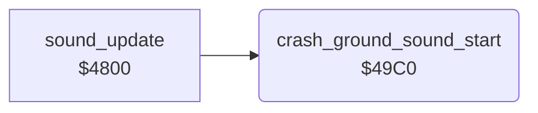

<!-- Generated by c64-docs from knowledge revision 20261024T103119.179-vx1fei and .c64-re-tools/local/generated/src/source-map.json. Do not edit: change the knowledge, generate the source again, then run docs.ts generate. -->
# sound/sound_start_49c0.asm

Range `$49C0-$49E5`. Source: [sound/sound_start_49c0.asm](../../../../src/sound/sound_start_49c0.asm). Index: [the reference](../../index.md).

## Call graph

A solid arrow is a call, a thick arrow a table entry, a dotted arrow a jump. Rounded nodes are in this file.

## Names

### [`crash_ground_sound_start`](../../../../src/sound/sound_start_49c0.asm#L6) `$49C0`

*routine*

Starts the crash sound on the ground: copies the SID image at $4f32 to $d400-$d418. Sets $24 = $ff, $ad = $0e, $ae = $04, cutoff $ac = $60 and gates voices 1 and 2 (noise).

- **Called from:** [`sound_update`](sound_update.md#sound_update) [`$484D`](../../../../src/sound/sound_update.asm#L53)
- **Reads:** [`sid_crash_ground_preset`](../data/sid_presets.md#sid_crash_ground_preset)
- **Writes:** [`FRELO1`](../../memory-map.md#FRELO1), [`crash_stage`](../../memory-map.md#crash_stage), [`sound_pitch`](../../memory-map.md#sound_pitch), [`crash_pitch`](../../memory-map.md#crash_pitch), [`VCREG1`](../../memory-map.md#VCREG1), [`VCREG2`](../../memory-map.md#VCREG2), [`filter_cutoff`](../../memory-map.md#filter_cutoff)

### [`crash_ground_sound_copy`](../../../../src/sound/sound_start_49c0.asm#L8) `$49C2`

*label*

- **Jumped to from:** [`crash_ground_sound_start`](sound_start_49c0.md#crash_ground_sound_start) [`$49CB`](../../../../src/sound/sound_start_49c0.asm#L13)
