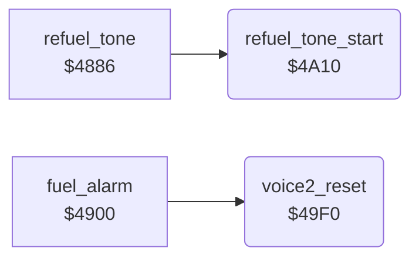

<!-- Generated by c64-docs from knowledge revision 20261025T214607.441-00m56k and .c64-re-tools/local/generated/src/source-map.json. Do not edit: change the knowledge, generate the source again, then run docs.ts generate. -->
# sound/sound_start_49f0.asm

Range `$49F0-$4A5D`. Source: [sound/sound_start_49f0.asm](../../../../src/sound/sound_start_49f0.asm). Index: [the reference](../../index.md).

## Routines

| Routine | Address | Reached from | Summary |
|---|---|---|---|
| [`voice2_reset`](sound_start_49f0.md#voice2_reset) | `$49F0` | [`fuel_alarm`](fuel_alarm.md#fuel_alarm) | Resets voice 2: copies the 7 bytes at $4f4b to $d407-$d40d (gate off). |
| [`refuel_tone_start`](sound_start_49f0.md#refuel_tone_start) | `$4A10` | [`refuel_tone`](sound_update_4880.md#refuel_tone) | Starts one beep of the refuel tone: copies the 7 bytes at $4f52 to voice 2 and gates it (triangle, ring modulation). |

## Data

| Range | Type | Name | Read by | Written by |
|---|---|---|---|---|
| [`$4A0A`](../../../../src/sound/sound_start_49f0.asm#L22)-`$4A0F` | unused |  |  |  |

## Call graph

A solid arrow is a call, a thick arrow a table entry. Rounded nodes are in this file.

## Details

### [`voice2_reset`](../../../../src/sound/sound_start_49f0.asm#L6) `$49F0`

*routine*

Resets voice 2: copies the 7 bytes at $4f4b to $d407-$d40d (gate off). Sets $27 = 1 (reset done), clears $26 and $28 and sets the GAS gauge colour $2e to 2 (red).

- **Called from:** [`fuel_alarm`](fuel_alarm.md#fuel_alarm)
- **Reads:** [`voice2_reset_preset`](../data/sid_presets.md#voice2_reset_preset), [`voice2_idle`](../../memory-map.md#voice2_idle)
- **Writes:** [`FRELO2`](../../memory-map.md#FRELO2), [`voice2_idle`](../../memory-map.md#voice2_idle), [`refuel_sound_step`](../../memory-map.md#refuel_sound_step), [`alarm_phase`](../../memory-map.md#alarm_phase), [`gauge_colour`](../../memory-map.md#gauge_colour)

| Label | Address | Comment |
|---|---|---|
| [`voice2_reset_copy`](../../../../src/sound/sound_start_49f0.asm#L8) | `$49F2` |  |

### [`refuel_tone_start`](../../../../src/sound/sound_start_49f0.asm#L24) `$4A10`

*routine*

Starts one beep of the refuel tone: copies the 7 bytes at $4f52 to voice 2 and gates it (triangle, ring modulation). Sets $25 = $7c. The pitch $ad rises by 1 with each beep.

- **Called from:** [`refuel_tone`](sound_update_4880.md#refuel_tone)
- **Reads:** [`voice2_refuel_preset`](../data/sid_presets.md#voice2_refuel_preset), [`refuel_sound_step`](../../memory-map.md#refuel_sound_step), [`voice2_idle`](../../memory-map.md#voice2_idle), [`gas_count`](../../memory-map.md#gas_count), [`sound_pitch`](../../memory-map.md#sound_pitch)
- **Writes:** [`FRELO2`](../../memory-map.md#FRELO2), [`refuel_sound_step`](../../memory-map.md#refuel_sound_step), [`VCREG2`](../../memory-map.md#VCREG2), [`refuel_sound_timer`](../../memory-map.md#refuel_sound_timer), [`voice2_idle`](../../memory-map.md#voice2_idle), [`sound_pitch`](../../memory-map.md#sound_pitch), [`ATDCY2`](../../memory-map.md#ATDCY2), [`FREHI2`](../../memory-map.md#FREHI2)

| Label | Address | Comment |
|---|---|---|
| [`refuel_tone_start_copy`](../../../../src/sound/sound_start_49f0.asm#L26) | `$4A12` |  |
| [`refuel_tone_pitch_from_fuel`](../../../../src/sound/sound_start_49f0.asm#L40) | `$4A2C` | Calculates the start pitch from the GAS digits: $ad = 7 * $17 + $18 / 2. |
| [`refuel_tone_pitch_x7`](../../../../src/sound/sound_start_49f0.asm#L45) | `$4A34` |  |
| [`refuel_tone_pitch_store`](../../../../src/sound/sound_start_49f0.asm#L50) | `$4A3A` |  |
| [`refuel_tone_pitch_half_loop`](../../../../src/sound/sound_start_49f0.asm#L53) | `$4A3E` |  |
| [`refuel_tone_pitch_done`](../../../../src/sound/sound_start_49f0.asm#L59) | `$4A46` | Always branches. |
| [`refuel_tone_next_pitch`](../../../../src/sound/sound_start_49f0.asm#L62) | `$4A49` | GAS hundreds digit 9: the tank is full. |
| [`refuel_tone_pitch_up`](../../../../src/sound/sound_start_49f0.asm#L69) | `$4A56` |  |
| [`refuel_tone_set_freq`](../../../../src/sound/sound_start_49f0.asm#L71) | `$4A58` |  |
