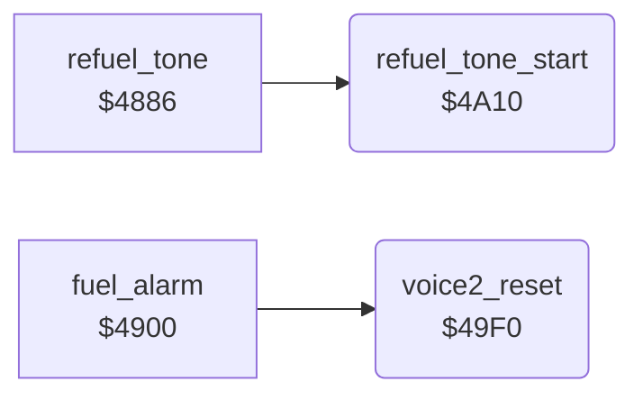

<!-- Generated by c64-docs from knowledge revision 20261024T103119.179-vx1fei and .c64-re-tools/local/generated/src/source-map.json. Do not edit: change the knowledge, generate the source again, then run docs.ts generate. -->
# sound/sound_start_49f0.asm

Range `$49F0-$4A5D`. Source: [sound/sound_start_49f0.asm](../../../../src/sound/sound_start_49f0.asm). Index: [the reference](../../index.md).

## Call graph

A solid arrow is a call, a thick arrow a table entry, a dotted arrow a jump. Rounded nodes are in this file.

## Data

| Range | Type | Name | Read by | Written by |
|---|---|---|---|---|
| [`$4A0A`](../../../../src/sound/sound_start_49f0.asm#L22)-`$4A0F` | unused |  |  |  |

## Names

### [`voice2_reset`](../../../../src/sound/sound_start_49f0.asm#L6) `$49F0`

*routine*

Resets voice 2: copies the 7 bytes at $4f4b to $d407-$d40d (gate off). Sets $27 = 1 (reset done), clears $26 and $28 and sets the GAS gauge colour $2e to 2 (red).

- **Called from:** [`fuel_alarm`](fuel_alarm.md#fuel_alarm) [`$4951`](../../../../src/sound/fuel_alarm.asm#L51)
- **Reads:** [`voice2_reset_preset`](../data/sid_presets.md#voice2_reset_preset), [`voice2_idle`](../../memory-map.md#voice2_idle)
- **Writes:** [`FRELO2`](../../memory-map.md#FRELO2), [`voice2_idle`](../../memory-map.md#voice2_idle), [`refuel_sound_step`](../../memory-map.md#refuel_sound_step), [`alarm_phase`](../../memory-map.md#alarm_phase), [`gauge_colour`](../../memory-map.md#gauge_colour)

### [`voice2_reset_copy`](../../../../src/sound/sound_start_49f0.asm#L8) `$49F2`

*label*

- **Jumped to from:** [`voice2_reset`](sound_start_49f0.md#voice2_reset) [`$49FB`](../../../../src/sound/sound_start_49f0.asm#L13)

### [`refuel_tone_start`](../../../../src/sound/sound_start_49f0.asm#L24) `$4A10`

*routine*

Starts one beep of the refuel tone: copies the 7 bytes at $4f52 to voice 2 and gates it (triangle, ring modulation). Sets $25 = $7c. The pitch $ad rises by 1 with each beep.

- **Called from:** [`refuel_tone`](sound_update_4880.md#refuel_tone) [`$488E`](../../../../src/sound/sound_update_4880.asm#L16)
- **Reads:** [`voice2_refuel_preset`](../data/sid_presets.md#voice2_refuel_preset), [`refuel_sound_step`](../../memory-map.md#refuel_sound_step), [`voice2_idle`](../../memory-map.md#voice2_idle), [`gas_count`](../../memory-map.md#gas_count), [`gas_count+1`](../../memory-map.md#gas_count), [`sound_pitch`](../../memory-map.md#sound_pitch)
- **Writes:** [`FRELO2`](../../memory-map.md#FRELO2), [`refuel_sound_step`](../../memory-map.md#refuel_sound_step), [`VCREG2`](../../memory-map.md#VCREG2), [`refuel_sound_timer`](../../memory-map.md#refuel_sound_timer), [`voice2_idle`](../../memory-map.md#voice2_idle), [`sound_pitch`](../../memory-map.md#sound_pitch), [`ATDCY2`](../../memory-map.md#ATDCY2), [`FREHI2`](../../memory-map.md#FREHI2)

### [`refuel_tone_start_copy`](../../../../src/sound/sound_start_49f0.asm#L26) `$4A12`

*label*

- **Jumped to from:** [`refuel_tone_start`](sound_start_49f0.md#refuel_tone_start) [`$4A1B`](../../../../src/sound/sound_start_49f0.asm#L31)

### [`refuel_tone_pitch_from_fuel`](../../../../src/sound/sound_start_49f0.asm#L40) `$4A2C`

*label*

Calculates the start pitch from the GAS digits: $ad = 7 * $17 + $18 / 2.

- **Jumped to from:** [`refuel_tone_start`](sound_start_49f0.md#refuel_tone_start) [`$4A54`](../../../../src/sound/sound_start_49f0.asm#L68)

### [`refuel_tone_pitch_x7`](../../../../src/sound/sound_start_49f0.asm#L45) `$4A34`

*label*

- **Jumped to from:** [`refuel_tone_start`](sound_start_49f0.md#refuel_tone_start) [`$4A38`](../../../../src/sound/sound_start_49f0.asm#L49)

### [`refuel_tone_pitch_store`](../../../../src/sound/sound_start_49f0.asm#L50) `$4A3A`

*label*

- **Jumped to from:** [`refuel_tone_start`](sound_start_49f0.md#refuel_tone_start) [`$4A32`](../../../../src/sound/sound_start_49f0.asm#L44)

### [`refuel_tone_pitch_half_loop`](../../../../src/sound/sound_start_49f0.asm#L53) `$4A3E`

*label*

- **Jumped to from:** [`refuel_tone_start`](sound_start_49f0.md#refuel_tone_start) [`$4A44`](../../../../src/sound/sound_start_49f0.asm#L58)

### [`refuel_tone_pitch_done`](../../../../src/sound/sound_start_49f0.asm#L59) `$4A46`

*label*

Always branches.

- **Jumped to from:** [`refuel_tone_start`](sound_start_49f0.md#refuel_tone_start) [`$4A40`](../../../../src/sound/sound_start_49f0.asm#L56)

### [`refuel_tone_next_pitch`](../../../../src/sound/sound_start_49f0.asm#L62) `$4A49`

*label*

GAS hundreds digit 9: the tank is full.

- **Jumped to from:** [`refuel_tone_start`](sound_start_49f0.md#refuel_tone_start) [`$4A2A`](../../../../src/sound/sound_start_49f0.asm#L38)

### [`refuel_tone_pitch_up`](../../../../src/sound/sound_start_49f0.asm#L69) `$4A56`

*label*

- **Jumped to from:** [`refuel_tone_start`](sound_start_49f0.md#refuel_tone_start) [`$4A4D`](../../../../src/sound/sound_start_49f0.asm#L65)

### [`refuel_tone_set_freq`](../../../../src/sound/sound_start_49f0.asm#L71) `$4A58`

*label*

- **Jumped to from:** [`refuel_tone_start`](sound_start_49f0.md#refuel_tone_start) [`$4A47`](../../../../src/sound/sound_start_49f0.asm#L61)
