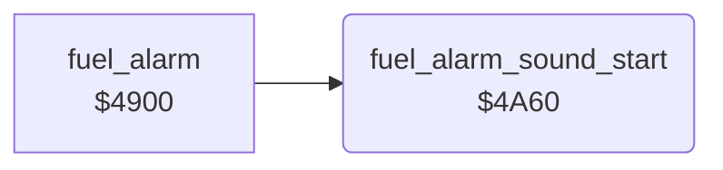

<!-- Generated by c64-docs from knowledge revision 20261024T103119.179-vx1fei and .c64-re-tools/local/generated/src/source-map.json. Do not edit: change the knowledge, generate the source again, then run docs.ts generate. -->
# sound/sound_start_4a60.asm

Range `$4A60-$4A78`. Source: [sound/sound_start_4a60.asm](../../../../src/sound/sound_start_4a60.asm). Index: [the reference](../../index.md).

## Call graph

A solid arrow is a call, a thick arrow a table entry, a dotted arrow a jump. Rounded nodes are in this file.

## Names

### [`fuel_alarm_sound_start`](../../../../src/sound/sound_start_4a60.asm#L6) `$4A60`

*routine*

Loads the alarm sound into voice 2: copies the 7 bytes at $4f59 to $d407-$d40d. Sets the alarm pitch $29 and the flag $28 to $10 and gates voice 2 (pulse).

- **Called from:** [`fuel_alarm`](fuel_alarm.md#fuel_alarm) [`$4912`](../../../../src/sound/fuel_alarm.asm#L17)
- **Reads:** [`voice2_alarm_preset`](../data/sid_presets.md#voice2_alarm_preset)
- **Writes:** [`FRELO2`](../../memory-map.md#FRELO2), [`alarm_pitch`](../../memory-map.md#alarm_pitch), [`alarm_phase`](../../memory-map.md#alarm_phase), [`VCREG2`](../../memory-map.md#VCREG2)

### [`fuel_alarm_sound_copy`](../../../../src/sound/sound_start_4a60.asm#L9) `$4A62`

*label*

- **Jumped to from:** [`fuel_alarm_sound_start`](sound_start_4a60.md#fuel_alarm_sound_start) [`$4A6B`](../../../../src/sound/sound_start_4a60.asm#L14)
