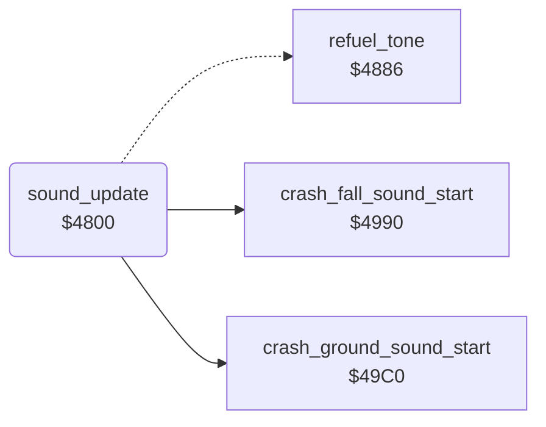

<!-- Generated by c64-docs from knowledge revision 20261024T103119.179-vx1fei and .c64-re-tools/local/generated/src/source-map.json. Do not edit: change the knowledge, generate the source again, then run docs.ts generate. -->
# sound/sound_update.asm: Sound update of each frame: crash sound and refuel tone

Range `$4800-$487C`. Source: [sound/sound_update.asm](../../../../src/sound/sound_update.asm). Index: [the reference](../../index.md).

## Call graph

A solid arrow is a call, a thick arrow a table entry, a dotted arrow a jump. Rounded nodes are in this file.

## Names

### [`sound_update`](../../../../src/sound/sound_update.asm#L6) `$4800`

*routine*

Updates the sound once in each frame (main loop). When jet_state bit 3 is set (the jet is lost), it plays the crash sound. Otherwise it continues at $4880.

- **Called from:** [`$41BD`](../../../../src/game/main_loop.asm#L75)
- **Calls:** [`crash_fall_sound_start`](sound_start_4990.md#crash_fall_sound_start), [`crash_ground_sound_start`](sound_start_49c0.md#crash_ground_sound_start)
- **Jumps to:** [`sound_update_alarms`](sound_update_4880.md#sound_update_alarms)
- **Reads:** [`jet_state`](../../memory-map.md#jet_state), [`crash_stage`](../../memory-map.md#crash_stage), [`jet_climb`](../../memory-map.md#jet_climb), [`sound_pitch`](../../memory-map.md#sound_pitch), [`crash_pitch`](../../memory-map.md#crash_pitch), [`filter_cutoff`](../../memory-map.md#filter_cutoff), [`SP0Y`](../../memory-map.md#SP0Y)
- **Writes:** [`sound_pitch`](../../memory-map.md#sound_pitch), [`FREHI1`](../../memory-map.md#FREHI1), [`crash_pitch`](../../memory-map.md#crash_pitch), [`FREHI3`](../../memory-map.md#FREHI3), [`CUTHI`](../../memory-map.md#CUTHI), [`filter_cutoff`](../../memory-map.md#filter_cutoff), [`VCREG1`](../../memory-map.md#VCREG1), [`VCREG2`](../../memory-map.md#VCREG2), [`VCREG3`](../../memory-map.md#VCREG3), [`crash_stage`](../../memory-map.md#crash_stage), [`tick`](../../memory-map.md#tick), [`SPRPTR`](../../memory-map.md#SPRPTR)
- **Refers to:** [`explosion_sprites`](../data/sprites_2200.md#explosion_sprites)

### [`crash_sound_check_climb`](../../../../src/sound/sound_update.asm#L14) `$480D`

*label*

While jet_climb is not 0, or the jet is above Y $7f, the crash sound rises in pitch.

- **Jumped to from:** [`sound_update`](sound_update.md#sound_update) [`$4808`](../../../../src/sound/sound_update.asm#L11)

### [`crash_sound_rise`](../../../../src/sound/sound_update.asm#L17) `$4811`

*label*

$ad = voice 1 frequency high byte.

- **Jumped to from:** [`sound_update`](sound_update.md#sound_update) [`$4847`](../../../../src/sound/sound_update.asm#L50)

### [`crash_sound_set_v1_freq`](../../../../src/sound/sound_update.asm#L25) `$481D`

*label*

- **Jumped to from:** [`sound_update`](sound_update.md#sound_update) [`$4817`](../../../../src/sound/sound_update.asm#L21)

### [`crash_sound_set_v3_freq`](../../../../src/sound/sound_update.asm#L34) `$482C`

*label*

- **Jumped to from:** [`sound_update`](sound_update.md#sound_update) [`$4826`](../../../../src/sound/sound_update.asm#L30)

### [`crash_sound_set_cutoff`](../../../../src/sound/sound_update.asm#L42) `$483A`

*label*

- **Jumped to from:** [`sound_update`](sound_update.md#sound_update) [`$4836`](../../../../src/sound/sound_update.asm#L40)

### [`crash_sound_check_height`](../../../../src/sound/sound_update.asm#L47) `$4842`

*label*

- **Jumped to from:** [`sound_update`](sound_update.md#sound_update) [`$480F`](../../../../src/sound/sound_update.asm#L16)

### [`crash_sound_fade`](../../../../src/sound/sound_update.asm#L55) `$4850`

*label*

On the ground the filter cutoff falls by 1 each frame to $3f.

- **Jumped to from:** [`sound_update`](sound_update.md#sound_update) [`$484B`](../../../../src/sound/sound_update.asm#L52)

### [`crash_sound_check_done`](../../../../src/sound/sound_update.asm#L65) `$4860`

*label*

When the cutoff is below $40, the code stops all three voices once and sets the end phase $90.

- **Jumped to from:** [`sound_update`](sound_update.md#sound_update) [`$4854`](../../../../src/sound/sound_update.asm#L58)

### [`sound_update_done`](../../../../src/sound/sound_update.asm#L78) `$487C`

*label*

- **Jumped to from:** [`sound_update`](sound_update.md#sound_update) [`$4840`](../../../../src/sound/sound_update.asm#L46), [`sound_update`](sound_update.md#sound_update) [`$485E`](../../../../src/sound/sound_update.asm#L63), [`sound_update`](sound_update.md#sound_update) [`$4864`](../../../../src/sound/sound_update.asm#L68)
