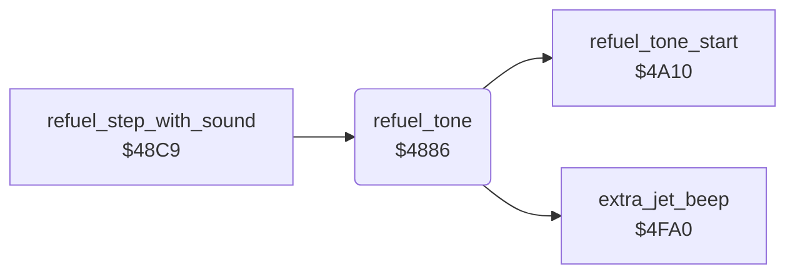

<!-- Generated by c64-docs from knowledge revision 20261025T214607.441-00m56k and .c64-re-tools/local/generated/src/source-map.json. Do not edit: change the knowledge, generate the source again, then run docs.ts generate. -->
# sound/sound_update_4880.asm

Range `$4880-$48BF`. Source: [sound/sound_update_4880.asm](../../../../src/sound/sound_update_4880.asm). Index: [the reference](../../index.md).

## Routines

| Routine | Address | Reached from | Summary |
|---|---|---|---|
| [`sound_update_landed`](sound_update_4880.md#sound_update_landed) | `$4880` | [`sound_update`](sound_update.md#sound_update) | When jet_state bit 1 is set (the jet is on the landing pad), it plays the refuel tone. |
| [`refuel_tone`](sound_update_4880.md#refuel_tone) | `$4886` | [`refuel_step_with_sound`](sound_update_48c9.md#refuel_step_with_sound) | Plays the refuel tone on voice 2: 4 frames on and 4 frames off. |

## Call graph

A solid arrow is a call, a thick arrow a table entry. Rounded nodes are in this file.

## Details

### [`sound_update_landed`](../../../../src/sound/sound_update_4880.asm#L6) `$4880`

*label*

When jet_state bit 1 is set (the jet is on the landing pad), it plays the refuel tone. Otherwise it plays the extra-jet beep or the fuel alarm ($4fa0).

- **Jumped to from:** [`sound_update`](sound_update.md#sound_update)

### [`refuel_tone`](../../../../src/sound/sound_update_4880.asm#L11) `$4886`

*routine*

Plays the refuel tone on voice 2: 4 frames on and 4 frames off. $25 counts the frames ($7c-$7f on, $fc-$ff off). $26 = 0 starts a new beep. At the end it sets $2e (GAS gauge colour) to 2.

- **Called from:** [`refuel_step_with_sound`](sound_update_48c9.md#refuel_step_with_sound)
- **Calls:** [`refuel_tone_start`](sound_start_49f0.md#refuel_tone_start), [`extra_jet_beep`](extra_jet_beep.md#extra_jet_beep)
- **Reads:** [`refuel_sound_timer`](../../memory-map.md#refuel_sound_timer), [`refuel_sound_step`](../../memory-map.md#refuel_sound_step)
- **Writes:** [`refuel_sound_timer`](../../memory-map.md#refuel_sound_timer), [`refuel_sound_step`](../../memory-map.md#refuel_sound_step), [`VCREG2`](../../memory-map.md#VCREG2), [`gauge_colour`](../../memory-map.md#gauge_colour)

| Label | Address | Comment |
|---|---|---|
| [`refuel_tone_on_step`](../../../../src/sound/sound_update_4880.asm#L17) | `$4891` |  |
| [`refuel_tone_off_phase`](../../../../src/sound/sound_update_4880.asm#L26) | `$48A1` |  |
| [`refuel_tone_off_step`](../../../../src/sound/sound_update_4880.asm#L32) | `$48AC` |  |
| [`sound_update_alarms`](../../../../src/sound/sound_update_4880.asm#L41) | `$48BC` |  |
| [`refuel_tone_done`](../../../../src/sound/sound_update_4880.asm#L43) | `$48BF` |  |
