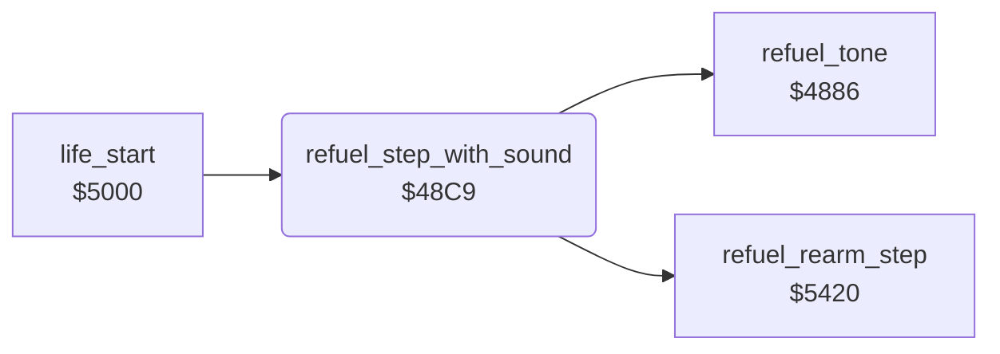

<!-- Generated by c64-docs from knowledge revision 20261024T103119.179-vx1fei and .c64-re-tools/local/generated/src/source-map.json. Do not edit: change the knowledge, generate the source again, then run docs.ts generate. -->
# sound/sound_update_48c9.asm

Range `$48C9-$48D9`. Source: [sound/sound_update_48c9.asm](../../../../src/sound/sound_update_48c9.asm). Index: [the reference](../../index.md).

## Call graph

A solid arrow is a call, a thick arrow a table entry, a dotted arrow a jump. Rounded nodes are in this file.

## Names

### [`refuel_step_with_sound`](../../../../src/sound/sound_update_48c9.asm#L6) `$48C9`

*routine*

Waits for a short time, plays one step of the refuel tone and adds one unit to the GAS digits ($5420). The fill loop of the tank at $500b calls it.

- **Called from:** [`life_start`](../player/life_start.md#life_start) [`$500B`](../../../../src/player/life_start.asm#L14)
- **Calls:** [`refuel_tone`](sound_update_4880.md#refuel_tone), [`refuel_rearm_step`](../player/refuel.md#refuel_rearm_step)

### [`refuel_step_delay_outer`](../../../../src/sound/sound_update_48c9.asm#L8) `$48CB`

*label*

- **Jumped to from:** [`refuel_step_with_sound`](sound_update_48c9.md#refuel_step_with_sound) [`$48D1`](../../../../src/sound/sound_update_48c9.asm#L14)

### [`refuel_step_delay_inner`](../../../../src/sound/sound_update_48c9.asm#L10) `$48CD`

*label*

- **Jumped to from:** [`refuel_step_with_sound`](sound_update_48c9.md#refuel_step_with_sound) [`$48CE`](../../../../src/sound/sound_update_48c9.asm#L12)
