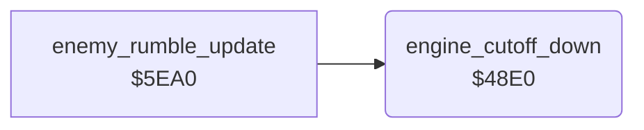

<!-- Generated by c64-docs from knowledge revision 20261025T214607.441-00m56k and .c64-re-tools/local/generated/src/source-map.json. Do not edit: change the knowledge, generate the source again, then run docs.ts generate. -->
# sound/sound_update_48e0.asm

Range `$48E0-$48F0`. Source: [sound/sound_update_48e0.asm](../../../../src/sound/sound_update_48e0.asm). Index: [the reference](../../index.md).

## Routines

| Routine | Address | Reached from | Summary |
|---|---|---|---|
| [`engine_cutoff_down`](sound_update_48e0.md#engine_cutoff_down) | `$48E0` | [`enemy_rumble_update`](enemy_rumble.md#enemy_rumble_update) | Lowers the filter cutoff of the engine sound ($ac, $d416) by 1, to at least $10. |

## Call graph

A solid arrow is a call, a thick arrow a table entry. Rounded nodes are in this file.

## Details

### [`engine_cutoff_down`](../../../../src/sound/sound_update_48e0.asm#L6) `$48E0`

*routine*

Lowers the filter cutoff of the engine sound ($ac, $d416) by 1, to at least $10. The enemy sound code at $5ef8 calls it.

- **Called from:** [`enemy_rumble_update`](enemy_rumble.md#enemy_rumble_update)
- **Reads:** [`filter_cutoff`](../../memory-map.md#filter_cutoff)
- **Writes:** [`filter_cutoff`](../../memory-map.md#filter_cutoff), [`CUTHI`](../../memory-map.md#CUTHI)

| Label | Address | Comment |
|---|---|---|
| [`engine_cutoff_store`](../../../../src/sound/sound_update_48e0.asm#L13) | `$48EB` |  |
