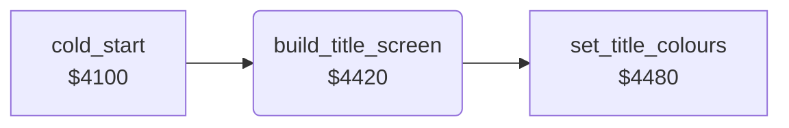

<!-- Generated by c64-docs from knowledge revision 20261025T214607.441-00m56k and .c64-re-tools/local/generated/src/source-map.json. Do not edit: change the knowledge, generate the source again, then run docs.ts generate. -->
# title/title_layout.asm: Title screen layout

Range `$4420-$447E`. Source: [title/title_layout.asm](../../../../src/title/title_layout.asm). Index: [the reference](../../index.md).

## Routines

| Routine | Address | Reached from | Summary |
|---|---|---|---|
| [`build_title_screen`](title_layout.md#build_title_screen) | `$4420` | [`cold_start`](../init/cold_start.md#cold_start) | Writes the title screen at $0800: spaces, the row numbers 1-5 and zero scores of the high-score table, the letter row and the colours. |

## Call graph

A solid arrow is a call, a thick arrow a table entry. Rounded nodes are in this file.

## Details

### [`build_title_screen`](../../../../src/title/title_layout.asm#L6) `$4420`

*routine*

Writes the title screen at $0800: spaces, the row numbers 1-5 and zero scores of the high-score table, the letter row and the colours.

- **Called from:** [`cold_start`](../init/cold_start.md#cold_start)
- **Calls:** [`set_title_colours`](title_layout_4480.md#set_title_colours)
- **Writes:** [`smoke_sprite_ptr`](../../memory-map.md#smoke_sprite_ptr), [`hiscore_table`](../../memory-map.md#hiscore_table), `$09F3`, [`name_entry_text`](../../memory-map.md#name_entry_text), [`hiscore_rank`](../../memory-map.md#hiscore_rank), `$0A0F`, `$0A10`, `$0A12`, [`letter_row`](../../memory-map.md#letter_row)

| Label | Address | Comment |
|---|---|---|
| [`build_title_clear_loop`](../../../../src/title/title_layout.asm#L9) | `$4424` | Fills $0800-$0be7 with spaces. |
| [`build_title_zero_scores`](../../../../src/title/title_layout.asm#L34) | `$445D` | Five score digits 0 in each table row, from $08d2. |
| [`build_title_letter_loop`](../../../../src/title/title_layout.asm#L44) | `$4473` |  |
