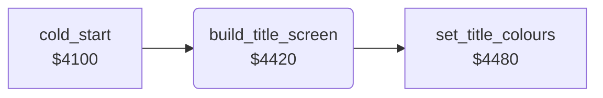

<!-- Generated by c64-docs from knowledge revision 20261024T103119.179-vx1fei and .c64-re-tools/local/generated/src/source-map.json. Do not edit: change the knowledge, generate the source again, then run docs.ts generate. -->
# title/title_layout.asm: Title screen layout

Range `$4420-$447E`. Source: [title/title_layout.asm](../../../../src/title/title_layout.asm). Index: [the reference](../../index.md).

## Call graph

A solid arrow is a call, a thick arrow a table entry, a dotted arrow a jump. Rounded nodes are in this file.

## Names

### [`build_title_screen`](../../../../src/title/title_layout.asm#L6) `$4420`

*routine*

Writes the title screen at $0800: spaces, the row numbers 1-5 and zero scores of the high-score table, the letter row and the colours.

- **Called from:** [`cold_start`](../init/cold_start.md#cold_start) [`$4138`](../../../../src/init/cold_start.asm#L36)
- **Calls:** [`set_title_colours`](title_layout_4480.md#set_title_colours)
- **Writes:** [`smoke_sprite_ptr`](../../memory-map.md#smoke_sprite_ptr), [`hiscore_table+39`](../../memory-map.md#hiscore_table), `$09F3`, [`name_entry_text+57`](../../memory-map.md#name_entry_text), [`hiscore_rank`](../../memory-map.md#hiscore_rank), [`hiscore_table+77`](../../memory-map.md#hiscore_table), [`hiscore_table+157`](../../memory-map.md#hiscore_table), [`hiscore_table+237`](../../memory-map.md#hiscore_table), `$0A0F`, [`hiscore_rank+1`](../../memory-map.md#hiscore_rank), [`hiscore_table+78`](../../memory-map.md#hiscore_table), [`hiscore_table+158`](../../memory-map.md#hiscore_table), [`hiscore_table+238`](../../memory-map.md#hiscore_table), `$0A10`, [`hiscore_table`](../../memory-map.md#hiscore_table), [`hiscore_table+80`](../../memory-map.md#hiscore_table), [`hiscore_table+160`](../../memory-map.md#hiscore_table), [`hiscore_table+240`](../../memory-map.md#hiscore_table), `$0A12`, [`letter_row`](../../memory-map.md#letter_row)

### [`build_title_clear_loop`](../../../../src/title/title_layout.asm#L9) `$4424`

*label*

Fills $0800-$0be7 with spaces.

- **Jumped to from:** [`build_title_screen`](title_layout.md#build_title_screen) [`$4431`](../../../../src/title/title_layout.asm#L15)

### [`build_title_zero_scores`](../../../../src/title/title_layout.asm#L34) `$445D`

*label*

Five score digits 0 in each table row, from $08d2.

- **Jumped to from:** [`build_title_screen`](title_layout.md#build_title_screen) [`$446D`](../../../../src/title/title_layout.asm#L41)

### [`build_title_letter_loop`](../../../../src/title/title_layout.asm#L44) `$4473`

*label*

- **Jumped to from:** [`build_title_screen`](title_layout.md#build_title_screen) [`$4479`](../../../../src/title/title_layout.asm#L49)
