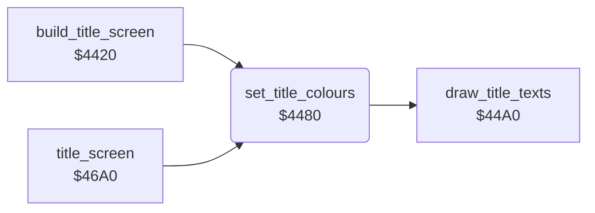

<!-- Generated by c64-docs from knowledge revision 20261025T214607.441-00m56k and .c64-re-tools/local/generated/src/source-map.json. Do not edit: change the knowledge, generate the source again, then run docs.ts generate. -->
# title/title_layout_4480.asm

Range `$4480-$4496`. Source: [title/title_layout_4480.asm](../../../../src/title/title_layout_4480.asm). Index: [the reference](../../index.md).

## Routines

| Routine | Address | Reached from | Summary |
|---|---|---|---|
| [`set_title_colours`](title_layout_4480.md#set_title_colours) | `$4480` | [`build_title_screen`](title_layout.md#build_title_screen), [`title_screen`](title_screen.md#title_screen) | Fills the colour RAM $d800-$dbe7 with 4 (purple). |

## Call graph

A solid arrow is a call, a thick arrow a table entry. Rounded nodes are in this file.

## Details

### [`set_title_colours`](../../../../src/title/title_layout_4480.asm#L6) `$4480`

*routine*

Fills the colour RAM $d800-$dbe7 with 4 (purple). Then draw_title_texts writes the heading and the credit line.

- **Called from:** [`build_title_screen`](title_layout.md#build_title_screen), [`title_screen`](title_screen.md#title_screen)
- **Calls:** [`draw_title_texts`](title_layout_44a0.md#draw_title_texts)
- **Writes:** `$D7FF`, `$D8F9`, `$D9F3`, `$DAED`

| Label | Address | Comment |
|---|---|---|
| [`set_title_colours_loop`](../../../../src/title/title_layout_4480.asm#L9) | `$4484` |  |
