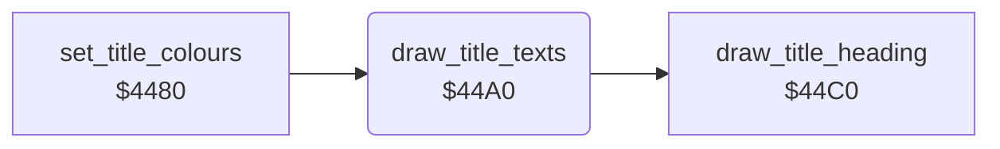

<!-- Generated by c64-docs from knowledge revision 20261024T103119.179-vx1fei and .c64-re-tools/local/generated/src/source-map.json. Do not edit: change the knowledge, generate the source again, then run docs.ts generate. -->
# title/title_layout_44a0.asm

Range `$44A0-$44B3`. Source: [title/title_layout_44a0.asm](../../../../src/title/title_layout_44a0.asm). Index: [the reference](../../index.md).

## Call graph

A solid arrow is a call, a thick arrow a table entry, a dotted arrow a jump. Rounded nodes are in this file.

## Names

### [`draw_title_texts`](../../../../src/title/title_layout_44a0.asm#L6) `$44A0`

*routine*

Writes the title heading, then copies the 40 characters of the credit line at $2f80 to the bottom row $0bc0 in colour $0f.

- **Called from:** [`set_title_colours`](title_layout_4480.md#set_title_colours) [`$4493`](../../../../src/title/title_layout_4480.asm#L16)
- **Calls:** [`draw_title_heading`](title_layout_44c0.md#draw_title_heading)
- **Reads:** [`credit_text`](../data/texts.md#credit_text)
- **Writes:** [`credit_line`](../../memory-map.md#credit_line), `$DBC0`

### [`draw_title_credit_loop`](../../../../src/title/title_layout_44a0.asm#L9) `$44A5`

*label*

- **Jumped to from:** [`draw_title_texts`](title_layout_44a0.md#draw_title_texts) [`$44B1`](../../../../src/title/title_layout_44a0.asm#L15)
