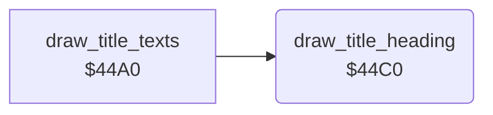

<!-- Generated by c64-docs from knowledge revision 20261025T214607.441-00m56k and .c64-re-tools/local/generated/src/source-map.json. Do not edit: change the knowledge, generate the source again, then run docs.ts generate. -->
# title/title_layout_44c0.asm

Range `$44C0-$44E0`. Source: [title/title_layout_44c0.asm](../../../../src/title/title_layout_44c0.asm). Index: [the reference](../../index.md).

## Routines

| Routine | Address | Reached from | Summary |
|---|---|---|---|
| [`draw_title_heading`](title_layout_44c0.md#draw_title_heading) | `$44C0` | [`draw_title_texts`](title_layout_44a0.md#draw_title_texts) | Colours the screen rows 0 (yellow) and 1 (green). |

## Call graph

A solid arrow is a call, a thick arrow a table entry. Rounded nodes are in this file.

## Details

### [`draw_title_heading`](../../../../src/title/title_layout_44c0.asm#L6) `$44C0`

*routine*

Colours the screen rows 0 (yellow) and 1 (green). It copies the 16 characters at $5b80 and $5b90 to the rows 0 and 1 at column 12.

- **Called from:** [`draw_title_texts`](title_layout_44a0.md#draw_title_texts)
- **Reads:** [`title_logo_upper`](title_logo_rows.md#title_logo_upper), [`title_logo_lower`](title_logo_rows.md#title_logo_lower)
- **Writes:** `$D800`, `$D828`, [`title_logo`](../../memory-map.md#title_logo)

| Label | Address | Comment |
|---|---|---|
| [`draw_title_heading_colours`](../../../../src/title/title_layout_44c0.asm#L8) | `$44C2` |  |
| [`draw_title_heading_copy`](../../../../src/title/title_layout_44c0.asm#L16) | `$44D1` |  |
