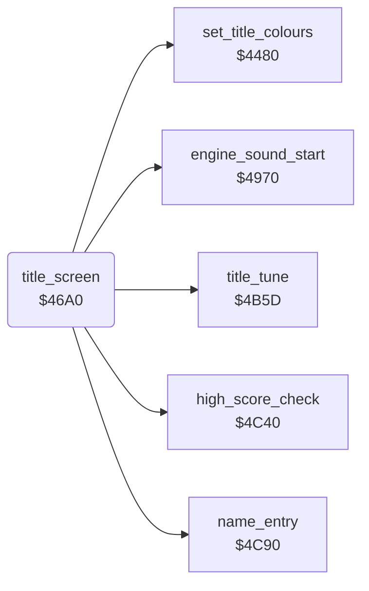

<!-- Generated by c64-docs from knowledge revision 20261025T214607.441-00m56k and .c64-re-tools/local/generated/src/source-map.json. Do not edit: change the knowledge, generate the source again, then run docs.ts generate. -->
# title/title_screen.asm: Title screen and high-score entry

Range `$46A0-$472B`. Source: [title/title_screen.asm](../../../../src/title/title_screen.asm). Index: [the reference](../../index.md).

## Routines

| Routine | Address | Reached from | Summary |
|---|---|---|---|
| [`title_screen`](title_screen.md#title_screen) | `$46A0` | [`$41E3`](../../../../src/game/main_loop.asm#L96) | Shows the title screen at $0800. |

## Call graph

A solid arrow is a call, a thick arrow a table entry. Rounded nodes are in this file.

## Details

### [`title_screen`](../../../../src/title/title_screen.asm#L6) `$46A0`

*routine*

Shows the title screen at $0800. A new high score starts the name entry. Then it plays the title tune until FIRE and sets the game screen.
$4c40: Y = table row 1-5 of a new high score, else 0.

- **Called from:** [`$41E3`](../../../../src/game/main_loop.asm#L96)
- **Calls:** [`high_score_check`](../highscore/high_score_check.md#high_score_check), [`set_title_colours`](title_layout_4480.md#set_title_colours), [`name_entry`](../highscore/name_entry.md#name_entry), [`title_tune`](title_tune.md#title_tune), [`engine_sound_start`](../sound/sound_start.md#engine_sound_start)
- **Reads:** [`SCROLX`](../../memory-map.md#SCROLX), [`press_fire_text`](../game/wait_fire.md#press_fire_text)
- **Writes:** [`BGCOL0`](../../memory-map.md#BGCOL0), [`EXTCOL`](../../memory-map.md#EXTCOL), [`title_prompt`](../../memory-map.md#title_prompt), [`VMCSB`](../../memory-map.md#VMCSB), [`SCROLX`](../../memory-map.md#SCROLX), [`SPENA`](../../memory-map.md#SPENA), [`fire_pressed`](../../memory-map.md#fire_pressed), [`start_wait_timer`](../../memory-map.md#start_wait_timer), `$DAB2`, [`tune_index`](../../memory-map.md#tune_index)

| Label | Address | Comment |
|---|---|---|
| [`title_clear_prompt`](../../../../src/title/title_screen.asm#L16) | `$46B3` | Clears 19 characters of row 17 at $0ab2. |
| [`title_after_entry`](../../../../src/title/title_screen.asm#L45) | `$46E2` |  |
| [`title_prompt_loop`](../../../../src/title/title_screen.asm#L51) | `$46EC` | PRESS FIRE TO START from $53d0 at row 17, colour 3 (cyan). |
| [`title_delay_outer`](../../../../src/title/title_screen.asm#L61) | `$46FF` |  |
| [`title_delay_inner`](../../../../src/title/title_screen.asm#L63) | `$4701` |  |
| [`title_tune_from_start`](../../../../src/title/title_screen.asm#L71) | `$470D` | $9d = 0: the title tune starts at step 0. |
| [`title_play_tune`](../../../../src/title/title_screen.asm#L76) | `$4713` | $4b5d plays the title tune and waits for FIRE. |
