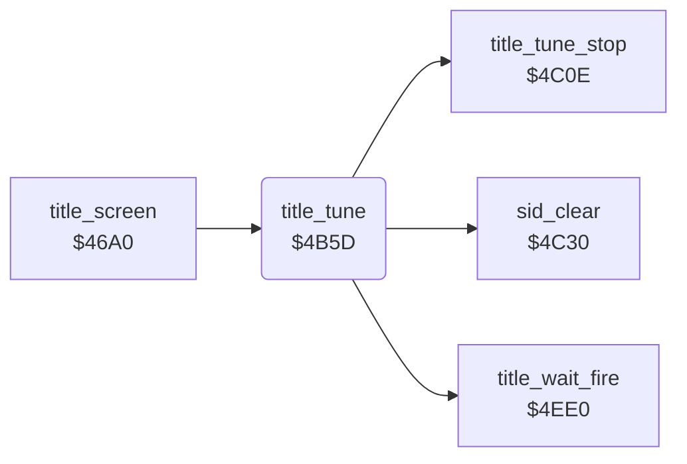

<!-- Generated by c64-docs from knowledge revision 20261025T214607.441-00m56k and .c64-re-tools/local/generated/src/source-map.json. Do not edit: change the knowledge, generate the source again, then run docs.ts generate. -->
# title/title_tune.asm: Title tune and the wait for FIRE

Range `$4B5D-$4C09`. Source: [title/title_tune.asm](../../../../src/title/title_tune.asm). Index: [the reference](../../index.md).

## Routines

| Routine | Address | Reached from | Summary |
|---|---|---|---|
| [`title_tune`](title_tune.md#title_tune) | `$4B5D` | [`title_screen`](title_screen.md#title_screen) | Plays the title tune from note $9d to note $1c and stops when FIRE is pressed. |

## Call graph

A solid arrow is a call, a thick arrow a table entry. Rounded nodes are in this file.

## Details

### [`title_tune`](../../../../src/title/title_tune.asm#L6) `$4B5D`

*routine*

Plays the title tune from note $9d to note $1c and stops when FIRE is pressed. Then it waits for FIRE ($4ee0). Output: $b2 is not 0 when FIRE was pressed.

- **Called from:** [`title_screen`](title_screen.md#title_screen)
- **Calls:** [`sid_clear`](title_tune_4c30.md#sid_clear), [`title_tune_stop`](title_tune_4c0e.md#title_tune_stop), [`title_wait_fire`](title_wait_fire.md#title_wait_fire)
- **Reads:** [`title_sid_setup`](../data/title_tune.md#title_sid_setup), [`tune_index`](../../memory-map.md#tune_index), [`tune_v1_freq_hi`](../data/title_tune.md#tune_v1_freq_hi), [`tune_v1_freq_lo`](../data/title_tune.md#tune_v1_freq_lo), [`tune_v2_freq_hi`](../data/title_tune.md#tune_v2_freq_hi), [`tune_v2_freq_lo`](../data/title_tune.md#tune_v2_freq_lo), [`tune_v3_freq_hi`](../data/title_tune.md#tune_v3_freq_hi), [`tune_v3_freq_lo`](../data/title_tune.md#tune_v3_freq_lo), [`tune_duration`](../../memory-map.md#tune_duration), [`CIAPRB`](../../memory-map.md#CIAPRB), [`tune_durations`](../data/title_tune_2ae0.md#tune_durations)
- **Writes:** [`FRELO1`](../../memory-map.md#FRELO1), [`FREHI1`](../../memory-map.md#FREHI1), [`FREHI2`](../../memory-map.md#FREHI2), [`FRELO2`](../../memory-map.md#FRELO2), [`FREHI3`](../../memory-map.md#FREHI3), [`FRELO3`](../../memory-map.md#FRELO3), [`VCREG2`](../../memory-map.md#VCREG2), [`VCREG3`](../../memory-map.md#VCREG3), [`VCREG1`](../../memory-map.md#VCREG1), [`tune_duration`](../../memory-map.md#tune_duration)

| Label | Address | Comment |
|---|---|---|
| [`title_tune_copy_sid`](../../../../src/title/title_tune.asm#L9) | `$4B62` | Copies the SID image $2ac0-$2ad8 to $d400-$d418. |
| [`title_tune_note`](../../../../src/title/title_tune.asm#L16) | `$4B6D` | Sets the frequencies of the three voices for note X from the tables $2a00-$2abf. |
| [`title_tune_chord_test`](../../../../src/title/title_tune.asm#L33) | `$4B97` |  |
| [`title_tune_chord_on`](../../../../src/title/title_tune.asm#L40) | `$4BA2` | Voice 2 sawtooth and voice 3 pulse, gate on. |
| [`title_tune_gate_v1`](../../../../src/title/title_tune.asm#L45) | `$4BAC` | Voice 1 sawtooth, gate on. |
| [`title_tune_hold_outer`](../../../../src/title/title_tune.asm#L49) | `$4BB3` | $9c = note length. |
| [`title_tune_hold_inner`](../../../../src/title/title_tune.asm#L54) | `$4BBC` |  |
| [`title_tune_release_test`](../../../../src/title/title_tune.asm#L63) | `$4BC8` |  |
| [`title_tune_chord_off`](../../../../src/title/title_tune.asm#L70) | `$4BD3` |  |
| [`title_tune_release_v1`](../../../../src/title/title_tune.asm#L75) | `$4BDD` |  |
| [`title_tune_gap_outer`](../../../../src/title/title_tune.asm#L79) | `$4BE4` |  |
| [`title_tune_gap_inner`](../../../../src/title/title_tune.asm#L84) | `$4BED` |  |
| [`title_tune_fire`](../../../../src/title/title_tune.asm#L97) | `$4C02` |  |
| [`title_tune_end`](../../../../src/title/title_tune.asm#L100) | `$4C06` |  |
