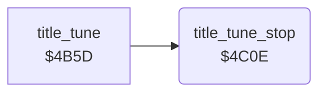

<!-- Generated by c64-docs from knowledge revision 20261024T103119.179-vx1fei and .c64-re-tools/local/generated/src/source-map.json. Do not edit: change the knowledge, generate the source again, then run docs.ts generate. -->
# title/title_tune_4c0e.asm

Range `$4C0E-$4C27`. Source: [title/title_tune_4c0e.asm](../../../../src/title/title_tune_4c0e.asm). Index: [the reference](../../index.md).

## Call graph

A solid arrow is a call, a thick arrow a table entry, a dotted arrow a jump. Rounded nodes are in this file.

## Names

### [`title_tune_stop`](../../../../src/title/title_tune_4c0e.asm#L6) `$4C0E`

*routine*

Sets $b2 (FIRE pressed on the title), gates off the three voices and waits for a short time.

- **Called from:** [`title_tune`](title_tune.md#title_tune) [`$4C03`](../../../../src/title/title_tune.asm#L99)
- **Reads:** [`fire_pressed`](../../memory-map.md#fire_pressed)
- **Writes:** [`fire_pressed`](../../memory-map.md#fire_pressed), [`VCREG1`](../../memory-map.md#VCREG1), [`VCREG2`](../../memory-map.md#VCREG2), [`VCREG3`](../../memory-map.md#VCREG3)

### [`title_tune_stop_delay_outer`](../../../../src/title/title_tune_4c0e.asm#L14) `$4C1F`

*label*

- **Jumped to from:** [`title_tune_stop`](title_tune_4c0e.md#title_tune_stop) [`$4C25`](../../../../src/title/title_tune_4c0e.asm#L20)

### [`title_tune_stop_delay_inner`](../../../../src/title/title_tune_4c0e.asm#L16) `$4C21`

*label*

- **Jumped to from:** [`title_tune_stop`](title_tune_4c0e.md#title_tune_stop) [`$4C22`](../../../../src/title/title_tune_4c0e.asm#L18)
