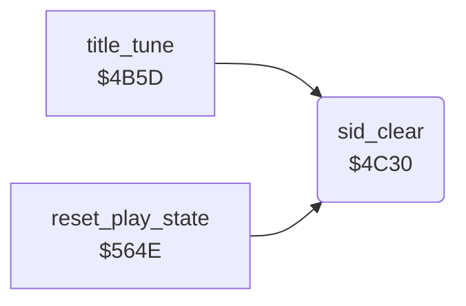

<!-- Generated by c64-docs from knowledge revision 20261025T214607.441-00m56k and .c64-re-tools/local/generated/src/source-map.json. Do not edit: change the knowledge, generate the source again, then run docs.ts generate. -->
# title/title_tune_4c30.asm

Range `$4C30-$4C3E`. Source: [title/title_tune_4c30.asm](../../../../src/title/title_tune_4c30.asm). Index: [the reference](../../index.md).

## Routines

| Routine | Address | Reached from | Summary |
|---|---|---|---|
| [`sid_clear`](title_tune_4c30.md#sid_clear) | `$4C30` | [`title_tune`](title_tune.md#title_tune), [`reset_play_state`](../game/jet_lost.md#reset_play_state) | Writes 0 to the SID registers $d401-$d419 ($d400 stays) and sets the note length $9c of the title tune to $bf. |

## Call graph

A solid arrow is a call, a thick arrow a table entry. Rounded nodes are in this file.

## Details

### [`sid_clear`](../../../../src/title/title_tune_4c30.asm#L6) `$4C30`

*routine*

Writes 0 to the SID registers $d401-$d419 ($d400 stays) and sets the note length $9c of the title tune to $bf.

- **Called from:** [`title_tune`](title_tune.md#title_tune), [`reset_play_state`](../game/jet_lost.md#reset_play_state)
- **Writes:** [`FRELO1`](../../memory-map.md#FRELO1), [`tune_duration`](../../memory-map.md#tune_duration)

| Label | Address | Comment |
|---|---|---|
| [`sid_clear_loop`](../../../../src/title/title_tune_4c30.asm#L8) | `$4C32` |  |
