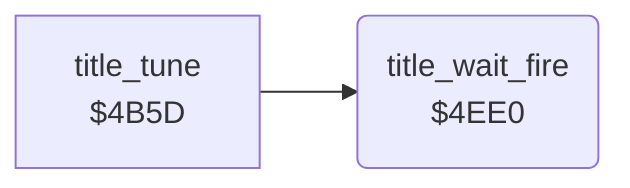

<!-- Generated by c64-docs from knowledge revision 20261025T214607.441-00m56k and .c64-re-tools/local/generated/src/source-map.json. Do not edit: change the knowledge, generate the source again, then run docs.ts generate. -->
# title/title_wait_fire.asm: Wait for FIRE after the title tune

Range `$4EE0-$4EFF`. Source: [title/title_wait_fire.asm](../../../../src/title/title_wait_fire.asm). Index: [the reference](../../index.md).

## Routines

| Routine | Address | Reached from | Summary |
|---|---|---|---|
| [`title_wait_fire`](title_wait_fire.md#title_wait_fire) | `$4EE0` | [`title_tune`](title_tune.md#title_tune) | When FIRE was not pressed ($b2 = 0), waits for FIRE with a time limit. |

## Call graph

A solid arrow is a call, a thick arrow a table entry. Rounded nodes are in this file.

## Details

### [`title_wait_fire`](../../../../src/title/title_wait_fire.asm#L6) `$4EE0`

*routine*

When FIRE was not pressed ($b2 = 0), waits for FIRE with a time limit. $9d counts up to $80. FIRE sets $b2. Output: $b2 = 0 when the time ran out.

- **Called from:** [`title_tune`](title_tune.md#title_tune)
- **Reads:** [`fire_pressed`](../../memory-map.md#fire_pressed), [`CIAPRB`](../../memory-map.md#CIAPRB), [`tune_index`](../../memory-map.md#tune_index)
- **Writes:** [`fire_pressed`](../../memory-map.md#fire_pressed), [`tune_index`](../../memory-map.md#tune_index)

| Label | Address | Comment |
|---|---|---|
| [`title_wait_fire_outer`](../../../../src/title/title_wait_fire.asm#L9) | `$4EE4` |  |
| [`title_wait_fire_middle`](../../../../src/title/title_wait_fire.asm#L11) | `$4EE6` |  |
| [`title_wait_fire_poll`](../../../../src/title/title_wait_fire.asm#L13) | `$4EE8` |  |
| [`title_wait_fire_next`](../../../../src/title/title_wait_fire.asm#L20) | `$4EF3` |  |
| [`title_wait_fire_done`](../../../../src/title/title_wait_fire.asm#L28) | `$4EFF` |  |
