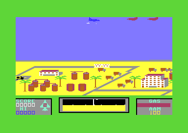

# The sound

The game uses all three SID voices for its sound effects. Voice 1 plays the noise of the jet engine and the explosion of a kill. Voice 2 plays the short sounds of the player: the missile shot, the refuel beeps, the low-fuel alarm and the extra-jet beep. Voice 3 plays the rumble of the enemy jets. The filter makes this rumble bright when an enemy is near and dark when it is far. Thus the player can hear an enemy before it comes on the screen. The manual of the game tells the same: the rumble changes with the distance to the enemy. When the jet is lost, three voices together play the crash.

**Conventions.**
- Addresses are C64 addresses. Names are the names of the knowledge.
- A *pass* is one run of the main loop. A pass takes about 33000 cycles, thus the game makes about 30 passes each second (**Conclusion** from the timer of the main loop).
- A *SID image* is a block of 25 bytes that the code copies to `$D400-$D418` in one loop. A *voice-2 preset* is a block of 7 bytes that the code copies to `$D407-$D40D`.
- *Gate on* and *gate off* are the values of bit 0 of a voice control register. A gate on starts the attack of the envelope. A gate off starts the release.
- The times of the envelopes are the times of the SID data sheet. The frequencies in Hz are for a PAL C64 (985248 Hz).
- **Observed** marks a fact that a run showed. **Code** marks a fact from the code only. **Conclusion** marks an interpretation.

## How it works

The sound has no music driver and no interrupt. The main loop calls two sound routines in each pass, one at the start and one at the end. Each sound is a small piece of state in zero page, a counter or a flag. The routines change only the registers of the sound that runs, and the SID holds the rest.

~~~mermaid
flowchart TB
  A["Start of a pass: crater chars"] --> B["Enemy rumble: voice 3 and filter cutoff"]
  B --> C["Game routines: input, missiles, enemies, collisions"]
  C --> D{"Sound update"}
  D -->|"jet lost"| E["Crash: voices 1, 2, 3"]
  D -->|"jet on a pad"| F["Refuel tone: voice 2"]
  D -->|"in the air"| G{"Extra jet given?"}
  G -->|"beep timer $30-$7F"| H["Extra-jet beep: voice 2"]
  G -->|"else"| I["Low-fuel alarm or voice 2 reset"]
~~~

[`crater_chars_animate` `$5E45`](../src/graphics/crater_chars_animate.asm#L6) starts each pass. It ends with a call to `enemy_rumble_update`. The missile shot and the kill test run in the middle of the pass and restart one voice each. [`sound_update` `$4800`](../src/sound/sound_update.asm#L6) runs last, before the main loop waits for its timer. The engine sound starts at the start of each jet, before `life_start` lowers the jet to the pad (**Code**).

## Which voice does what

The table gives each sound of the game, the routine that starts or plays it, and the event that starts it.

| Voice | Sound | Routine | Trigger |
|---|---|---|---|
| 1 | Jet engine: filtered noise | `engine_sound_start` | The start of each jet, and the end of the title screen |
| 1 | Kill explosion: the engine noise restarts | `enemy_kill` | A missile kills an enemy |
| 1 | Crash noise, the pitch rises while the jet falls | `crash_fall_sound_start`, `sound_update` | The jet is lost (`jet_state` bit 3) |
| 1 | Crash noise on the ground | `crash_ground_sound_start` | The lost jet is on the ground |
| 1 | Title tune, melody | `title_tune` | The title screen |
| 1 | Letter notes and clicks of the name entry | `letter_note`, `name_entry_click` | A letter of the high-score name |
| 2 | Missile shot: noise | `missile_launch` | A missile leaves the jet |
| 2 | Refuel beeps, the pitch rises with the GAS | `refuel_tone` | The jet is on a pad, and the slow refuel of a new jet |
| 2 | Extra-jet beep: 10 short pulse notes | `extra_jet_beep` | The extra jet at 3000 points, after the jet leaves the pad |
| 2 | Low-fuel alarm: a rising pulse sweep | `fuel_alarm` | GAS below 100 (`jet_state` bit 6 or bit 7) |
| 2 | Crash noise, synchronized to voice 1 | `crash_fall_sound_start` | The jet is lost |
| 2, 3 | Title tune, chords | `title_tune` | The title screen |
| 3 | Enemy engine rumble: filtered noise | `enemy_rumble_update` | An enemy flies (state `$01-$CF`) |
| 3 | Crash: triangle with ring modulation, the pitch rises | `crash_fall_sound_start`, `sound_update` | The jet is lost |

Voice 1 and voice 3 go through the low-pass filter in the engine image. Thus the cutoff of the enemy rumble also changes the engine noise of the player. When an enemy comes near, the whole engine sound becomes brighter (**Conclusion** from the filter routing `$D417` = `$F5`). The title tune and the name entry write their own SID setup. This page does not explain them.

## The data

### The whole-SID images

Three SID images of 25 bytes are at `$4F00`, `$4F19` and `$4F32`. [`engine_sound_start` `$4970`](../src/sound/sound_start.asm#L6), [`crash_fall_sound_start` `$4990`](../src/sound/sound_start_4990.asm#L6) and [`crash_ground_sound_start` `$49C0`](../src/sound/sound_start_49c0.asm#L6) copy them with a loop from index 0 to 24. Each image writes the control register of each voice with the gate off. The start routine then writes the gate on for the voices that the sound needs. This order restarts the envelope of each voice (**Code**).

Each image has the layout of the SID registers:

| Bytes | Register | Meaning |
|---|---|---|
| 0-1 | `$D400-$D401` | Voice 1 frequency, low byte then high byte |
| 2-3 | `$D402-$D403` | Voice 1 pulse width, 12 bits |
| 4 | `$D404` | Voice 1 control: waveform, ring, sync, gate |
| 5 | `$D405` | Voice 1 attack (high nibble) and decay (low nibble) |
| 6 | `$D406` | Voice 1 sustain (high nibble) and release (low nibble) |
| 7-13 | `$D407-$D40D` | Voice 2, the same layout |
| 14-20 | `$D40E-$D414` | Voice 3, the same layout |
| 21-22 | `$D415-$D416` | Filter cutoff, 11 bits (3 low bits, then the high byte) |
| 23 | `$D417` | Resonance (high nibble) and the filtered voices (bits 0-2) |
| 24 | `$D418` | Filter mode (bits 4-6) and volume (low nibble) |

The three images, decoded. The gate column gives the control value that the start routine writes after the copy.

| Image | Voice | Frequency | Pulse | Control in the image | Gate after the copy | Attack, decay | Sustain, release |
|---|---|---|---|---|---|---|---|
| Engine `$4F00` | 1 | `$22DA`, 524 Hz | `$0FF` | `$80` noise | `$81` noise on | 2 ms, 9 s | 6, 1.5 s |
| | 2 | `$17BE`, 357 Hz | `$7F0` | `$80` noise | none | 8 ms, 2.4 s | 0, 6 ms |
| | 3 | `$419B`, 986 Hz | `$FFF` | `$80` noise | none (the rumble gates it) | 2 ms, 6 ms | 7, 24 s |
| | filter | cutoff `$10` | | | | res 15, voices 1 and 3 | low-pass, volume 15 |
| Crash fall `$4F19` | 1 | `$0EDA`, 223 Hz | `$8FF` | `$80` noise | `$81` noise on | 2 ms, 9 s | 10, 24 s |
| | 2 | `$419B`, 986 Hz | `$0FF` | `$80` noise | `$83` noise, sync, on | 2 ms, 1.5 s | 11, 24 s |
| | 3 | `$0407`, 60 Hz | `$8FF` | `$80` noise | `$15` triangle, ring, on | 2 ms, 1.5 s | 10, 6 ms |
| | filter | cutoff `$20` | | | | res 15, voices 2 and 3 | low-pass, volume 15 |
| Crash ground `$4F32` | 1 | `$22DA`, 524 Hz | `$8FF` | `$80` noise | `$81` noise on | 2 ms, 6 ms | 15, 9 s |
| | 2 | `$089B`, 129 Hz | `$0FF` | `$80` noise | `$81` noise on | 2 ms, 6 ms | 0, 6 ms |
| | 3 | `$0407`, 60 Hz | `$8FF` | `$10` triangle, gate off | none | 2 ms, 1.5 s | 15, 9 s |
| | filter | cutoff `$20` | | | | res 15, voices 1, 2 and 3 | low-pass, volume 15 |

For a noise voice, the frequency sets the rate of the noise, not a note. Voice 2 of the engine image has the same bytes as the voice-2 reset preset, but for the control byte (**Code**). The image of the crash on the ground writes the gate off to voice 3. Thus the triangle of the fall dies away with a release of 9 s (**Conclusion**).

### The voice-2 presets

Four presets of 7 bytes set voice 2 for one sound each. Their layout is bytes 7-13 of a SID image. The bytes are the frequency (low, high), the pulse width (low, high), the control, the attack and decay, and the sustain and release. [`voice2_reset` `$49F0`](../src/sound/sound_start_49f0.asm#L6), [`refuel_tone_start` `$4A10`](../src/sound/sound_start_49f0.asm#L24), `fuel_alarm_sound_start` and `extra_jet_sound_start` copy them.

| Preset | Address | Bytes | Frequency | Pulse | Control | Attack, decay | Sustain, release | Gate written after |
|---|---|---|---|---|---|---|---|---|
| Reset | `$4F4B` | `BE 17 F0 07 14 1B 00` | `$17BE`, 357 Hz | `$7F0` | `$14` triangle, ring, off | 8 ms, 2.4 s | 0, 6 ms | none |
| Refuel | `$4F52` | `00 00 FF 00 14 44 44` | 0, then the pitch in the high byte | `$0FF` | `$14` triangle, ring, off | 38 ms, 114 ms | 4, 114 ms | `$15` triangle, ring, on |
| Alarm | `$4F59` | `00 00 F0 02 20 58 DF` | 0, then the sweep in the high byte | `$2F0`, 18 % | `$20` sawtooth, off | 56 ms, 300 ms | 13, 24 s | `$41` pulse, on |
| Extra jet | `$4FE0` | `BE 22 F0 07 10 88 05` | `$22BE`, 522 Hz | `$7F0`, 50 % | `$10` triangle, off | 100 ms, 300 ms | 0, 168 ms | `$41` pulse, on, then `$20` |

The first three presets are in one block with the SID images, at `$4F4B-$4F5F`. The extra-jet preset is apart, after its own copy routine (**Code**).

The refuel tone uses ring modulation with voice 1. Voice 1 then plays the engine noise at `$22DA`, and ring modulation takes only the top bit of the voice 1 oscillator. Thus the beep sounds like a bell more than a clean triangle (**Conclusion**).

## The per-pass sound update

[`sound_update` `$4800`](../src/sound/sound_update.asm#L6) selects one sound for voice 2, or the crash for all voices. It looks at `jet_state` in this order:

1. Bit 3 set (the jet is lost): play the crash and return.
2. Bit 1 set (the jet is on a pad): play one step of the refuel tone and return.
3. Else call `extra_jet_beep`. It plays the extra-jet beep while its timer runs, or it calls `fuel_alarm`.
4. `fuel_alarm` plays the alarm when bit 6 or bit 7 of `jet_state` is 1. When the fuel is good, it loads the reset preset into voice 2 one time.

Thus one sound at a time owns voice 2. The alarm cannot sound on a pad or during the extra-jet beep (**Code**).

### The crash

When the jet is lost, the crash plays in two parts. While the jet falls, voice 1 noise and the voice 3 triangle rise in pitch. On the ground, a loud noise falls dark with the filter. The variable `crash_stage` holds the part. `reset_play_state` sets it to 0 again for the next jet (**Code**).


A hit jet falls with the smoke sprite behind it (**Observed** in the exploration runs).

While `jet_climb` is not 0, or the jet sprite is above Y `$7F`, [`crash_sound_rise` `$4811`](../src/sound/sound_update.asm#L17) runs once in each pass:

1. The voice 1 frequency high byte `sound_pitch` rises by 1, from `$0E` to at most `$E0`. That is 210 Hz to 3.4 kHz of noise rate.
2. The voice 3 frequency high byte `crash_pitch` rises by 1, from `$04` to at most `$E0`.
3. The filter cutoff rises by 2, from `$20` to at most `$6D`.

The caps at `$E0` never ran in the runs, thus no fall took 210 passes (**Observed**: the coverage marks the two caps as not executed). When the jet is on the ground, `crash_ground_sound_start` loads its image one time and sets the cutoff to `$60`. Then the cutoff falls by 1 in each pass. When the cutoff is below `$40`, the code writes `$80` (noise, gate off) to the three voices and sets `crash_stage` to `$90`. This takes 33 passes, about 1.1 seconds (**Code**).

The end of the crash sound also changes the game. [`crash_sound_check_done` `$4860`](../src/sound/sound_update.asm#L65) sets `tick` to `$90` and the jet sprite pointer to `$88`, the first explosion frame. Before this, `jet_lost_animate` shows random wreck frames `$88-$8F`. After it, the frame rises by 1 on each 8th tick up to `$90`. `jet_lost_wait` waits for frame `$90` and tick `$4F` before the next jet. Thus the end of the crash sound starts the last part of the wreck sequence (**Code**).

~~~mermaid
stateDiagram-v2
  state "No crash ($00)" as None
  state "Falling ($20)" as Fall
  state "On the ground ($FF)" as Ground
  state "Done ($90)" as Done
  [*] --> None
  None --> Fall: jet lost
  Fall --> Ground: climb 0 and Y >= $7F
  Ground --> Done: cutoff below $40
  Done --> None: next jet
~~~

| State | Condition | Next state | Code |
|---|---|---|---|
| No crash `$00` | `jet_state` bit 3 set | Falling `$20` | `crash_fall_sound_start` |
| Falling `$20` | `jet_climb` = 0 and sprite Y >= `$7F` | On the ground `$FF` | `crash_ground_sound_start` |
| On the ground `$FF` | filter cutoff below `$40` | Done `$90` | `crash_sound_check_done` |
| Done `$90` | the wreck sequence ends | No crash `$00` | `reset_play_state` |

A jet can be lost on the ground. Then the crash goes through two states in one pass: falling, then on the ground (**Conclusion**).

### The refuel tone

On a pad, [`refuel_tone` `$4886`](../src/sound/sound_update_4880.asm#L11) plays short beeps on voice 2. Each beep is 4 passes with the gate on and 4 passes with the gate off. The counter `refuel_sound_timer` runs from `$7C` to `$7F` for the sound and from `$FC` to `$FF` for the silence. At the start of each beep, `refuel_tone_start` loads the refuel preset and writes the pitch to `$D408`. At the end of each silence, the code sets the GAS gauge colour to red (**Code**).

The pitch follows the GAS gauge. The first beep after a reset of voice 2 calculates the pitch from the GAS digits: pitch = 7 × hundreds + tens / 2. Each next beep adds 1 to the pitch. The refuel adds 2 units of GAS in each pass, thus 16 units in each beep. The pitch then rises about as fast as the digits (**Code**).

- A jet that lands with 450 units of GAS starts at pitch 7 × 4 + 2 = 30, `$1E00`, about 450 Hz.
- A full tank gives pitch 63, `$3F00`, about 947 Hz.
- When the hundreds digit is 9, each beep calculates the pitch again and writes attack 500 ms to `$D40C`. Thus the beeps stay at one pitch and sound softer (**Code**).


A new jet refuels on the pad, and the GAS gauge fills (**Observed** in the title recording).

A new jet uses the same tone. `life_start` calls [`refuel_step_with_sound` `$48C9`](../src/sound/sound_update_48c9.asm#L6) in a loop: a delay, one step of the tone and two units of GAS. The reset of the play state clears the pitch and the flag of voice 2. Thus the refuel of a new jet starts at pitch 1, about 15 Hz, and climbs by 1 with each beep (**Code**).

### The extra-jet beep

At 3000 points, `landing_check` gives one extra jet and sets `bonus_jet_flag` to `$30`. The beep cannot play on the pad, because the refuel tone owns voice 2 there. It starts when the jet leaves the pad (**Conclusion** from the order in `sound_update`).

[`extra_jet_beep` `$4FA0`](../src/sound/extra_jet_beep.asm#L6) adds 1 to `bonus_jet_flag` in each pass while the value is `$30-$7F`. The first call loads the extra-jet preset. When the low 3 bits of the counter are 0, the code writes `$20` (gate off), else `$41` (pulse, gate on). This gives 10 beeps of 7 passes each with 1 pass of silence, about 2.7 seconds in all. At `$80` the beep stops, and the flag stays at `$80` for the rest of the game (**Code**).

No run reached 3000 points, so the beep never played (**Observed**: the coverage marks `$4FA4-$4FBF` as not executed).

### The low-fuel alarm

When GAS is below 100, [`fuel_alarm` `$4900`](../src/sound/fuel_alarm.asm#L6) plays a rising sweep on voice 2 and flashes the GAS gauge. The counter `alarm_pitch` drives the sweep:

1. `fuel_alarm_sound_start` loads the alarm preset, gates the pulse wave on and sets the counter to `$10`.
2. Each pass adds 2 and writes the counter to `$D408`. The pitch runs from `$1200` to `$5800`, 271 Hz to 1323 Hz, in 36 passes.
3. At `$58` the counter jumps to `$FD`. The code writes `$20` (sawtooth, gate off) and the high byte `$10`.
4. The counter counts `$FE`, `$FF` and `$00` in 3 passes. Then step 1 starts the next sweep.

One sweep takes 39 passes, about 1.3 seconds. Bit 2 of the counter sets the gauge colour: red or white, with a change every 2 passes (**Code**). The alarm preset has sustain 13 and release 24 s. Thus the gate off does not make silence. The 3 passes give a low sawtooth note at `$1000`, about 240 Hz (**Conclusion**).

The missile code makes no shot noise while bit 6 or bit 7 of `jet_state` is 1. Thus the shots do not cut the alarm (**Code**). No run let the GAS fall below 100 (**Observed**: the coverage marks `$4906-$494C` as not executed).

When the fuel is good, `fuel_alarm` calls `voice2_reset` one time. The flag `voice2_idle` remembers that voice 2 holds the reset preset. `voice2_reset` also sets the gauge colour to red, the normal colour (**Code**).

### The missile shot

[`missile_shot_sound` `$57E9`](../src/missile/missile_launch.asm#L65) writes `$80` and then `$81` to `$D40B`. This restarts voice 2 as noise with the frequency and the envelope that it holds. In the air this is the reset preset: noise at `$17BE` with a decay of 2.4 s to sustain 0. During the extra-jet beep, a shot uses the beep preset (**Code**).

## The enemy engine rumble

The rumble tells the player where the enemy wave is. [`enemy_rumble_update` `$5EA0`](../src/sound/enemy_rumble.asm#L6) runs at the start of each pass. It does nothing while the jet is lost, because the crash then owns the SID (**Code**).

1. When the rumble is off (`enemy_sound_on` = 0), the code looks for a flying enemy, index 4 down to 1. An enemy flies when its state is `$01-$CF`. When it finds one, it writes `$81` (noise, gate on) to `$D412` and to `enemy_sound_on`.
2. When the rumble is on, the code looks for a flying enemy again. When no enemy flies, it writes `$80` (gate off) to `$D412` and clears `enemy_sound_on`.
3. With a flying enemy, it sets the cutoff `$D416` from the column of that enemy.
4. Without one, or when `wave_launched` is 0, [`engine_cutoff_down` `$48E0`](../src/sound/sound_update_48e0.asm#L6) lowers the cutoff by 1, to `$10`.

The cutoff follows the flying enemy with the highest index. [`enemy_rumble_set_cutoff` `$5EDE`](../src/sound/enemy_rumble.asm#L44) calculates it as pseudo-code:

```text
a = map_column + $93 - enemy_col[x]     ; 8 bits, $93 = $80 + 19
if a >= $80 then a = a XOR $FF
if a >= $6D then a = $6D
$D416 = a
filter_cutoff = a
```

Map column `map_column` + 19 is the column under the jet. Let *k* be the number of map columns from the jet to the enemy. The map has 256 columns and wraps, so *k* is at most 128. The result is 128 − *k* for an enemy to the right, and 127 − *k* for an enemy to the left. The cap `$6D` (109) holds for *k* up to 19. The screen shows 19 to 20 columns on each side of the jet. Thus an enemy on the screen gives the brightest rumble. An enemy off the screen gives a darker rumble with each column of distance (**Conclusion** from the code).

| Enemy position | *k* | Cutoff high byte |
|---|---|---|
| On the screen | 0-19 | `$6D` |
| 40 columns to the right | 40 | `$58` |
| 100 columns to the left | 100 | `$1B` |
| The other side of the map | 128 | `$00` |

After the gate off, voice 3 has a release of 24 s. The noise then fades mostly through the filter: the cutoff falls from `$6D` to `$10` in 93 passes, about 3 seconds (**Conclusion**). When `wave_launched` is 0 and the rumble is on, the gate stays on and only the cutoff falls (**Code**).



An enemy wave of 2 jets comes in at the top right. The rumble is then at its brightest (**Observed** for the wave, **Conclusion** for the sound).

## Voice 3 as the random source

The game reads its random numbers from `RANDOM`, the voice 3 oscillator output at `$D41B`. The enemy waves, the steering of the enemies and the wreck frames read it. The oscillator runs also when the gate is off. The engine image selects noise for voice 3, so the value is random while the rumble is off (**Code**).

The crash changes this source. The crash images select a triangle for voice 3 at `$0407`, with a rising pitch during the fall. Thus the random wreck frames on the ground come from a triangle wave, not from noise (**Conclusion**). A test that sets the SID state can make the random values repeat (**Conclusion**).

## The kill explosion

[`enemy_kill` `$5E6A`](../src/enemy/enemy_kill.asm#L6) restarts the noise of voice 1 when a missile kills an enemy. It writes `$80` and then `$81` to `$D404`. Voice 1 still holds the engine setting: attack 2 ms, decay 9 s, sustain 6. Thus the engine noise jumps to full volume and falls back to its normal level in some seconds. The explosion is a loud engine, through the same filter as the rumble (**Conclusion** from the code).

The counter `kill_sound_timer` blocks a new explosion for 6 passes, about 0.2 seconds. [`collisions_sound_timer` `$42D1`](../src/game/collisions.asm#L153) lowers it by 1 in each pass, to 0. The counter does not turn the sound off. No explosion plays while the jet is lost, but the score still rises (**Code**). No scripted run shot an enemy down, so the explosion never played (**Observed**).

## The SID clear routine

[`sid_clear` `$4C30`](../src/title/title_tune_4c30.asm#L6) silences the SID. `title_tune` calls it before the tune, and `reset_play_state` calls it after a lost jet. It writes 0 to `$D401-$D419` with X from `$19` down to `$01`, and it sets the note length `tune_duration` to `$BF` (**Code**).

Two addresses of the loop are not the addresses of the images:

- **`$D419` gets a write.** `$D419` is POTX, the paddle X value. The CPU can only read the register, so the write does nothing.
- **`$D400` gets no write.** The loop stops when X is 0, before the write to `$D400`. The low byte of the voice 1 frequency keeps its last value.

Neither address changes the sound. The volume in `$D418` is 0, so the SID is silent. The next SID image or the title setup writes `$D400` again before a sound plays. The loop index starts one too high: the image loops copy index 0 to 24, but `sid_clear` writes index 1 to 25 (**Conclusion**).

The copy loop of `engine_sound_start` also has a second task. It ends with X = `$19`, and `life_start` uses this X as a count. It writes character `$1E` to the 25 cells `$04AC-$04C4`, over the text PRESS FIRE TO START (**Code**).

## Worked example: the engine image

The engine image `sid_engine_preset` at `$4F00` holds these 25 bytes:

```text
$4F00: DA 22 FF 00 80 0D 6A BE
$4F08: 17 F0 07 80 1B 00 9B 41
$4F10: FF 0F 80 00 7F 00 10 F5
$4F18: 1F
```

`engine_sound_start` copies byte *n* to `$D400` + *n*. Then it writes `$81` to `$D404` and `$10` to `filter_cutoff`.

| Byte | Register | Value | Decoded |
|---|---|---|---|
| 0 | `$D400` | `$DA` | Voice 1 frequency low byte |
| 1 | `$D401` | `$22` | Voice 1 frequency high byte: `$22DA` = 8922, 8922 × 985248 / 16777216 = 524 Hz |
| 2 | `$D402` | `$FF` | Voice 1 pulse width low byte |
| 3 | `$D403` | `$00` | Voice 1 pulse width high nibble: `$0FF`. Noise does not use it. |
| 4 | `$D404` | `$80` | Voice 1 noise, gate off. The code then writes `$81`: noise, gate on. |
| 5 | `$D405` | `$0D` | Voice 1 attack 0 (2 ms), decay 13 (9 s) |
| 6 | `$D406` | `$6A` | Voice 1 sustain 6 of 15, release 10 (1.5 s) |
| 7 | `$D407` | `$BE` | Voice 2 frequency low byte |
| 8 | `$D408` | `$17` | Voice 2 frequency high byte: `$17BE`, 357 Hz |
| 9 | `$D409` | `$F0` | Voice 2 pulse width low byte |
| 10 | `$D40A` | `$07` | Voice 2 pulse width: `$7F0`, 50 % |
| 11 | `$D40B` | `$80` | Voice 2 noise, gate off. A missile shot gates it on. |
| 12 | `$D40C` | `$1B` | Voice 2 attack 1 (8 ms), decay 11 (2.4 s) |
| 13 | `$D40D` | `$00` | Voice 2 sustain 0, release 0 (6 ms) |
| 14 | `$D40E` | `$9B` | Voice 3 frequency low byte |
| 15 | `$D40F` | `$41` | Voice 3 frequency high byte: `$419B`, 986 Hz |
| 16 | `$D410` | `$FF` | Voice 3 pulse width low byte |
| 17 | `$D411` | `$0F` | Voice 3 pulse width: `$FFF` |
| 18 | `$D412` | `$80` | Voice 3 noise, gate off. The rumble gates it on. |
| 19 | `$D413` | `$00` | Voice 3 attack 0 (2 ms), decay 0 (6 ms) |
| 20 | `$D414` | `$7F` | Voice 3 sustain 7 of 15, release 15 (24 s) |
| 21 | `$D415` | `$00` | Filter cutoff, low 3 bits: 0 |
| 22 | `$D416` | `$10` | Filter cutoff high byte: 11-bit cutoff `$080`, very low |
| 23 | `$D417` | `$F5` | Resonance 15. Bits 0 and 2: voice 1 and voice 3 go through the filter. |
| 24 | `$D418` | `$1F` | Bit 4: low-pass. Volume 15. Voice 3 is not off (bit 7 = 0). |

The result is a deep and steady noise on voice 1 behind a closed low-pass filter with full resonance. Voice 3 waits with the same filter for an enemy. Voice 2 waits for a shot. The rumble opens the cutoff from `$10` to at most `$6D`, an 11-bit cutoff from `$080` to `$368` (**Conclusion**).

## Still open

- How the sounds sound on a real SID. The 6581 filter has no linear cutoff curve, so the brightness of the rumble at each distance is not known. A capture of the SID output in an emulator with the 6581 model can show it.
- The kill explosion, the extra-jet beep and the low-fuel alarm never ran. A run with a test hook can start each one. The hooks are an enemy at a missile row, a score of 3000 before a landing, and GAS 099.
- Whether the author wanted the off-phase of the alarm to be silent. The long release of the preset gives a low note in its place. Only a listen to the original can tell what the player hears.

The reference lists each routine and table of the sound: [reference/index.md](reference/index.md).
