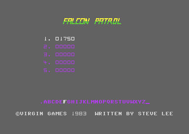
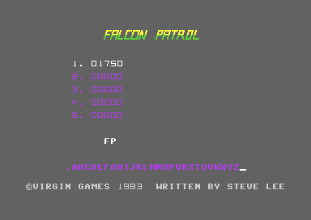

# The title screen, the high scores and the name entry

The title screen shows the logo, the five best scores with their names, a row of letters and the credit line. It plays a short tune and waits for FIRE. After a game, a high score gets a place in the table. The player then selects a name from the letter row with the joystick. The game has no disk save. The table is only a part of the title screen RAM, so it stays until the next power-off or the next load of the game.

**Conventions.**
- Addresses are C64 addresses. Names are the names of the knowledge.
- A *table row* is one of the 5 entries of the high-score table. Row 0 is the best score, row 4 is the lowest. The screen shows them with the ranks 1-5.
- A *symbol* is one of the 28 cells of the letter row. Its *index* is 0-27.
- A *note* is one step of the title tune, index `$00-$1C`.
- A *frame* is one PAL frame of 19656 cycles. A text screen takes about 1000 of these cycles for its bad lines, so about 18650 cycles stay for the CPU.
- **Observed** marks a fact that a run showed. **Code** marks a fact from the code only. **Conclusion** marks an interpretation.

## How it works

The title code runs with the interrupts off. `cold_start` arrives at the title with the `SEI` of its start. [`game_over` `$41DD`](../src/game/main_loop.asm#L91) executes `SEI` and writes 0 to `$D01A`. Thus each wait on the title is a CPU delay loop, and its time comes only from its cycle count (**Code**).

~~~mermaid
flowchart TD
  A["Game over or cold start (game_over)"] --> B["Compare the score with the table (high_score_check)"]
  B --> C["Show the title screen at $0800"]
  C -->|new high score| D["Name entry (name_entry)"]
  C -->|no entry| E["PRESS FIRE TO START"]
  D --> E
  E --> F["Title tune (title_tune)"]
  F --> G["Wait for FIRE with a time limit (title_wait_fire)"]
  G --> H["Game screen at $0400, new game"]
~~~

[`title_screen` `$46A0`](../src/title/title_screen.asm#L6) does these steps in this order (**Code**):

1. It calls `high_score_check`. The result in Y is 5-1 for the table rows 0-4, or 0 for no entry. The routine pushes Y on the stack for later.
2. It sets the border and the background to dark grey (`$0B`).
3. It clears 19 cells of screen row 17 at `$0AB2`. This removes the old PRESS FIRE TO START, because the name entry uses the same row.
4. It writes `$2C` to `$D018`: the screen at `$0800`, the characters at `$3000`. It sets the multicolour bit of `$D016` to 0. The title uses the game charset in hires mode.
5. It colours the screen: all cells purple (4), row 0 yellow, row 1 green, the credit line light grey. This step also copies the logo and the credit line again.
6. It sets all sprites off.
7. When Y is not 0, it calls `name_entry` for that table row.
8. It sets `fire_pressed` to 0 and `start_wait_timer` to `$E8`. It writes PRESS FIRE TO START to row 17 in cyan.
9. After a name entry, a delay loop of about 0.35 seconds runs, and the tune starts at note `$17`. Else the tune starts at note 0.
10. It calls `title_tune`, which plays the tune and then waits for FIRE.
11. It writes `$1C` to `$D018` (the game screen at `$0400`), sets the multicolour bit and calls `engine_sound_start`.

After the return, [`show_title` `$41DE`](../src/game/main_loop.asm#L93) sets the raster interrupt on, executes `CLI`, writes 0 to `bonus_jet_flag` and jumps to `game_start` (**Code**).

## The title screen


The title screen shows the empty table after the load (**Observed**).

[`build_title_screen` `$4420`](../src/title/title_layout.asm#L6) writes the title screen one time, from `cold_start`. No other code clears `$0800-$0BE7`. The game screen is at `$0400`, so a game does not change the title screen RAM (**Code**). These are the parts of the screen:

| Screen row | Address | Content | Colour |
|---|---|---|---|
| 0, 1 | `$080C`, `$0834` | The logo: 2 rows of 16 characters from `$5B80` and `$5B90`, at column 12 | yellow, green |
| 5, 7, 9, 11, 13 | `$08CF` + 80 × row | The 5 table rows | purple |
| 17 | `$0AB2` | PRESS FIRE TO START, 19 cells. During the name entry: the name at `$0AB4` | cyan |
| 21 | `$0B4E` | The letter row: the 28 symbols `$80-$9B` at the columns 6-33 | purple |
| 24 | `$0BC0` | The credit line, 40 cells from `credit_text` | light grey |

The table has no copy in another part of memory. Two other parts of the game read it (**Code**):

- [`panel_update` `$51C0`](../src/panel/panel_update.asm#L6) copies the 5 digits of row 0 to the panel of the game screen in each pass. This is the best score on the panel.
- [`sprite_cell_under` `$5DA0`](../src/game/sprite_cell.asm#L6) reads `$08D8` and the 2 cells after it for an enemy at the top of the screen. These are cells 6-8 of table row 0, which hold spaces. Thus that enemy cannot be shot (see the enemy page).

The 16 KB game file holds no table. A new load of the game shows 5 rows of `00000` again (**Conclusion**).

### The table row

Each table row has 26 cells. A row starts 3 cells before its score. The score of row 0 is at `hiscore_table` = `$08D2`, and each next row is `$50` bytes (2 screen rows) lower. The layout of one row is:

| Column | Offset from the score | Content |
|---|---|---|
| 7 | -3 | The rank, a digit `$01-$05` |
| 8 | -2 | Character `$9C`, the dot after the rank |
| 9 | -1 | A space `$20` |
| 10-14 | 0-4 | The 5 score digits, screen codes `$00-$09` |
| 15-20 | 5-10 | Spaces |
| 21-32 | 11-22 | The name: 12 cells, each a symbol `$80-$9B` or a space |

A score digit has the same value as the digit in the zero page `score` (`$12-$16`). The characters `$00-$09` of the game charset are the digits, so the code copies the bytes without a change (**Code**).

## The title tune

The tune has 29 notes. Voice 1 plays the melody with a sawtooth wave. Voices 2 and 3 add a chord on some notes. [`title_tune` `$4B5D`](../src/title/title_tune.asm#L6) reads the notes from these tables (**Code**):

| Table | Address | Content |
|---|---|---|
| `tune_v1_freq_hi`, `tune_v1_freq_lo` | `$2A00`, `$2A20` | Voice 1 frequency of each note |
| `tune_v2_freq_hi`, `tune_v2_freq_lo` | `$2A40`, `$2A60` | Voice 2 frequency of each note |
| `tune_v3_freq_hi`, `tune_v3_freq_lo` | `$2A80`, `$2AA0` | Voice 3 frequency of each note |
| `title_sid_setup` | `$2AC0` | 25 bytes for `$D400-$D418` |
| `tune_durations` | `$2AE0` | The length of each note, 30 bytes |

Each frequency table has 32 bytes. The bytes 29-31 are `$EA` and the code does not read them. The notes `$05`, `$0B`, `$11` and `$17` have the voice 1 frequency 0, so they are rests (**Code**).

### How the code plays a note

1. `sid_clear` writes 0 to `$D401-$D419` and sets the length `tune_duration` to `$BF`. Then the code copies the 25 bytes of `title_sid_setup` to the SID. Voice 1 gets attack/decay `$58` and sustain/release `$EB`. Voices 2 and 3 get `$58` and `$7C`. The volume is 15.
2. [`title_tune_note` `$4B6D`](../src/title/title_tune.asm#L16) writes the three frequencies of note X.
3. On a chord note, it sets the gate of voice 2 (sawtooth, `$21`) and voice 3 (pulse, `$41`). It always sets the gate of voice 1 (`$21`).
4. A hold loop runs 255 times. Each time it counts Y down from the length, and it reads FIRE.
5. The code clears the gates of the voices that it started. A gap loop runs 95 times with the same length and also reads FIRE.
6. X increases by 1. The code reads the length of the next note from `tune_durations` + X. At X = `$1D` the tune ends.

The chord notes are 4, 10, 16 and 22, and all notes from 24. The code finds them with a loop that subtracts 6 until the result is 4 or negative (**Code**):

```
chord = (X >= $18) or (X in 4, 10, 16, 22)
```

The code writes the frequencies of voices 2 and 3 on each note, also when it does not set their gate. Their release is long (`$C`), so the chord continues to sound at the new frequencies of the next notes (**Conclusion**).

### The lengths

A length of `$AF` gives about 0.24 seconds of hold and 0.09 seconds of gap. The full tune from note 0 takes about 10 seconds (**Conclusion**, from the cycle count).

The length of a note is in `tune_durations` at the index of the note. But the code reads it only at step 6, for the next note. The first note always gets the length `$BF` from `sid_clear`. Thus the code never reads the first byte `$AF` at `$2AE0`. After the last note, it reads the byte `$EA` at index `$1D` and does not use it (**Code**).

### FIRE and the start at note $17

The hold loop and the gap loop read `$DC01` bit 4, the FIRE line of joystick port 1. FIRE stops the tune at once. [`title_tune_stop` `$4C0E`](../src/title/title_tune_4c0e.asm#L6) increments `fire_pressed`, clears the three gates and waits for about 0.09 seconds (**Code**). SPACE is on the same line of the keyboard matrix, so SPACE also starts the game (**Observed**).

After a name entry, `title_screen` starts the tune at note `$17`. Note `$17` is a rest without a chord, so the player hears only the notes `$18-$1C`, the last phrase. This start takes about 2.7 seconds (**Code**, the time is a **Conclusion**).

The frequency values match the equal-tempered scale for the NTSC clock of 1.023 MHz. For example, `$10C3` gives 261.6 Hz, the note C4. On a PAL machine, the tune sounds about 4% lower (**Conclusion**).

## The wait for FIRE

[`title_wait_fire` `$4EE0`](../src/title/title_wait_fire.asm#L6) runs after the tune, also after a stop by FIRE. When `fire_pressed` is not 0, it returns at once. Else it reads FIRE in a loop of 47 × 127 reads. After each loop, it increments `tune_index`. When `tune_index` gets to `$80`, the wait ends with `fire_pressed` = 0 (**Code**).

The tune loop counts in X and does not change `tune_index`. Thus the count starts at the first note of the tune:

| Start of the tune | Loops of the wait | Time of the wait |
|---|---|---|
| Note 0 | 128 | about 11.5 seconds |
| Note `$17`, after a name entry | 105 | about 9.4 seconds |

The times are a **Conclusion** from the cycle count. FIRE during this wait did not occur in the runs. The code at `$4EEF`, which sets `fire_pressed`, did not execute (**Observed**).

### After the wait

The title gives control to `game_start`. The game draws the screen of the first jet and calls [`wait_fire_to_start` `$53E3`](../src/game/wait_fire.asm#L15). The value of `fire_pressed` selects the path (**Code**):

- **FIRE on the title.** `fire_pressed` is not 0. `wait_fire_to_start` clears the score and returns at once. `start_wait_timer` still holds `$E8` from `title_screen`, so the first jet starts.
- **No FIRE on the title.** The game screen shows PRESS FIRE TO START and waits again, with its own time limit of about 26 seconds (**Conclusion**). FIRE starts the jet. At the time limit, the routine clears the score, `start_wait_timer` is 0, and the game returns to the title through `game_over`.

The high-score run took the second path after its name entry (**Observed**). The score is 0 when the title returns, so the title does not start a second name entry (**Code**). Without a player, the game thus changes between the title and the game screen with the prompt (**Conclusion**).

## The high-score check

[`high_score_check` `$4C40`](../src/highscore/high_score_check.asm#L6) finds the table row for the score. A score of 0 never gets a row. Else the routine compares the 5 digits with each table row, from row 0 to row 4. The first different digit decides (**Code**):

```
if score = 00000: return Y = 0
for X = 5 down to 1 (table row 5 - X):
    for d = 0 to 4:
        if score[d] > row[d]: goto insert
        if score[d] < row[d]: next table row
    goto insert                 ; all 5 digits are equal
return Y = 0
insert: Y = X, move the lower rows, return Y
```

An equal score gets the row of the old score. The old entry moves one row lower, so the new score is above it. A score that is lower than row 4 gets no row (**Code**).

[`high_score_shift_rows` `$4D80`](../src/highscore/high_score_shift.asm#L6) makes the room. For Y = 5, it copies row 3 to row 4 and row 2 to row 3. Then it copies row 1 to row 2 and row 0 to row 1. A lower Y does fewer copies, and Y = 1 does no copy. The old row 4 drops out of the table. Each copy has 23 bytes, the offsets 0-22: the score, the spaces and the name. The rank digits do not move (**Code**).

Only the high-score run had a score above 0, and the table held only zeros. The path to the next table row (`$4C71-$4C8E`) did not execute (**Observed**).

## The name entry



The score 01750 is in the first row of the table. The white letter in the letter row is the cursor (**Observed**).



The new score 01750 is in table row 0 in white. The letters F and P are in the name buffer on row 17, and the cursor is on the end mark `_` (**Observed**).

[`name_entry` `$4C90`](../src/highscore/name_entry.asm#L6) gets the table row in Y. It prepares the row, lets the player select up to 12 symbols, and then writes the name into the row (**Code**):

1. It calculates the address of the row from `$0A12` (row 4) minus `$50` for each step.
2. It copies the 5 score digits into the row and writes spaces to the offsets 9-22.
3. It colours the 26 cells of the row white.
4. It sets the cursor to symbol 0 and the name length to 0.
5. It loops: it shows the cursor and waits, then it reads the joystick one time (see below).
6. FIRE on the end mark, or the twelfth symbol, ends the loop.
7. [`name_entry_store_name` `$4D2F`](../src/highscore/name_entry.asm#L106) copies the 12 cells of the name buffer to the offsets 11-22 of the row. For each symbol that is not a space, it plays the note of the symbol for about 0.56 seconds with a falling filter cutoff.
8. It clears the name buffer, moves the cursor out of the letter row and waits until the player releases FIRE.

The wait in step 8 is necessary. The tune reads FIRE, and a FIRE that is still pressed would stop the tune at once (**Conclusion**).

### The symbols

The letter row holds the 28 screen codes `$80-$9B`. The screen code of a symbol is `$80` + its index (**Code**):

| Index | Screen code | Symbol |
|---|---|---|
| 0 | `$80` | `.` |
| 1-26 | `$81-$9A` | `A` to `Z` |
| 27 | `$9B` | `_`, the end mark |

LEFT moves the cursor one symbol to the left, and RIGHT moves it one symbol to the right. The cursor wraps from symbol 0 to symbol 27 and back. FIRE writes the screen code to the name buffer at `name_entry_text` = `$0AB4` and makes the cell white. Then the routine waits until the player releases FIRE, so that each press gives one symbol. FIRE on symbol 27 ends the entry and does not write a symbol (**Code**).

The runs used only RIGHT. The paths for LEFT and for the wrap (`$4CF1-$4CF7` and `$4D03-$4D06`) did not execute (**Observed**).

### The stick and the speed of the cursor

[`name_entry_select` `$4CDF`](../src/highscore/name_entry.asm#L54) reads `$DC01` one time in each pass of its loop. It does not use the masks of `read_input`. Before the read, [`name_entry_highlight` `$4DC0`](../src/highscore/name_entry_helpers.asm#L6) waits 63 × 256 increments of `tick`, about 7 frames. Thus a held stick moves the cursor about 7 symbols each second. A walk from symbol 0 to the end mark takes about 4 seconds (**Code**, the times are a **Conclusion**).

### The notes of the symbols

The click of a new symbol plays on voice 1 with a triangle wave. In step 7, [`letter_note` `$4E30`](../src/highscore/name_entry_helpers_4e30.asm#L6) plays the symbol with the index as a pointer into `letter_pitch_lo` (`$2FE0`) and `letter_pitch_hi` (`$2FC0`). Each table has 32 bytes: the same 8 values four times. They are 8 notes a semitone apart, from C4 to G4 with the NTSC clock. Thus a symbol plays the note of its index modulo 8. For example, A (1) and I (9) play the same note (**Code**, the note names are a **Conclusion**).

### The write to $DC4D

The cursor routine sets the old symbol back to purple and the new symbol to white, in the colour RAM at `$DB4E` + index. The index of the old symbol is in `temp2`, and `name_entry` sets it to `$FF` before the first call. Thus the first call writes the value 4 to `$DB4E` + `$FF` = `$DC4D` (**Code**).

`$DC4D` is a mirror of `$DC0D`, the interrupt control register of CIA 1. In the value 4, bit 7 is 0, so the write clears the mask bit of the TOD alarm interrupt. `cold_start` set all CIA 1 interrupts off before, so the write has no effect (**Conclusion**).

At the end, the routine calls the cursor routine with the index `$20`. This puts the white colour on `$DB6E`, a space at column 38 of the letter row (**Code**).

## The state machine of the title

The title has no state variable. The state is the place of the CPU in the code, and two zero-page bytes carry the result. `fire_pressed` tells if FIRE came on the title. `start_wait_timer` tells if FIRE came at the prompt of the game screen (**Code**).

~~~mermaid
stateDiagram-v2
  state "Check the score" as Check
  state "Name entry" as Entry
  state "Tune from note 0" as Tune0
  state "Tune from note $17" as Tune17
  state "Wait for FIRE" as Wait
  state "Prompt on the game screen" as Prompt
  state "Game" as Game
  [*] --> Check: cold start
  Check --> Entry: score in the table
  Check --> Tune0: no entry
  Entry --> Tune17: end mark or 12 symbols
  Tune0 --> Wait: last note or FIRE
  Tune17 --> Wait: last note or FIRE
  Wait --> Game: fire_pressed not 0
  Wait --> Prompt: time limit
  Prompt --> Game: FIRE
  Prompt --> Check: time limit, score 0
  Game --> Check: last jet lost
~~~

| State | Condition | Next state | Code |
|---|---|---|---|
| Check the score | The score has a table row | Name entry | `high_score_check` |
| Check the score | Score 0, or lower than row 4 | Tune from note 0 | `title_screen` |
| Name entry | FIRE on symbol 27, or the twelfth symbol | Tune from note `$17` | `name_entry` |
| Tune | FIRE: `fire_pressed` + 1 | Wait for FIRE (returns at once) | `title_tune_stop` |
| Tune | Note `$1C` ends | Wait for FIRE | `title_tune` |
| Wait for FIRE | `fire_pressed` not 0 | Game | `title_wait_fire` |
| Wait for FIRE | `tune_index` = `$80` | Prompt on the game screen | `title_wait_fire` |
| Prompt on the game screen | FIRE | Game | `wait_fire_to_start` |
| Prompt on the game screen | `start_wait_timer` = 0, score cleared | Check the score | `game_new_life` |
| Game | `lives` = 0 after a lost jet | Check the score | `main_loop` |

## Worked example: the entry 01750 FP

The high-score run wrote the score 01750 and 0 lives with a test hook. The jet hit the ground, and the run entered the name FP (**Observed**). This example follows the bytes by hand (**Code**).

The score in the zero page is `$12-$16` = `$00 $01 $07 $05 $00`. `high_score_check` compares it with row 0 (`00000`). Digit 0 is equal, digit 1 is 1 > 0, so the score goes into row 0 with Y = 5. `high_score_shift_rows` copies rows 3, 2, 1 and 0 one row lower. All rows hold `00000`, so the screen does not change.

`name_entry` subtracts `$50` four times from `$0A12` and gets `$08D2`. The player moves the cursor 6 symbols to the right to F (index 6) and presses FIRE. The name buffer gets `$86`. Then 10 symbols more to P (index 16) give `$90`. Then 11 symbols more to the end mark end the entry. After `name_entry_store_name`, the 26 cells of row 0 are:

```
$08CF: 01 9C 20 00 01 07 05 00 20 20 20 20 20 20 86 90
$08DF: 20 20 20 20 20 20 20 20 20 20
```

| Address | Bytes | Meaning |
|---|---|---|
| `$08CF-$08D1` | `$01 $9C $20` | The rank 1, the dot, a space |
| `$08D2-$08D6` | `$00 $01 $07 $05 $00` | The score 01750 |
| `$08D7-$08DC` | `$20` × 6 | Spaces |
| `$08DD-$08DE` | `$86 $90` | F (`$80` + 6) and P (`$80` + 16) |
| `$08DF-$08E8` | `$20` × 10 | The rest of the 12 name cells |

The colour RAM `$D8CF-$D8E8` holds `$01` (white) for the 26 cells. F and P then play as notes 6 and 0 of the 8 letter pitches (6 modulo 8, 16 modulo 8). In the next game, the panel shows 01750 as the best score.

## Still open

- The author wrote `$AF` as the length of note 0 at `$2AE0`, but the code never reads it. It is not known if the first note was meant to have this length.
- The tuning suggests that the author wrote the tune on an NTSC machine. No run measured the pitch on PAL.
- The times on this page come from cycle counts. No run measured them with a clock.
