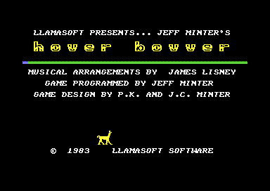

# Hover Bovver

*Hover Bovver* is a lawn-mowing game for the C64. Jeff Minter wrote it, and Llamasoft published it in 1983. Gordon Bennet borrows the Air-Mo mower of his neighbours Jim, Tom and Alf and mows their lawns. The neighbour chases him to get his mower back. Rover, the dog, can keep the neighbour away. This documentation is for the original MAIN block `$6000-$9FFF` in three cracked releases. The base release is the 1984 memory dump of The Friendly Programmer (TFP). The source in [src/](src/) assembles byte for byte to each release. The default build has no trainer and no crack change.

**Evidence.** **Observed** marks a fact that a run showed. **Code** marks a fact from the code only. **Conclusion** marks an interpretation.

The title screen of the default build: the mower drew the logo (**Observed**).

## The development

The game is one block of 16 KB, `$6000-$9FFF`. It holds the tune data, the charset, the sprites, the setup and high-score code, a copy routine and the game. At the cold start, [`copy_graphics` `$7E00`](src/init/copy_graphics.asm#L6) copies the charset to `$2000` and the sprites to `$3000` (**Code**). Thus Minter kept the graphics at their run-time addresses while he worked. For the file, he moved them into the free space of the block (**Conclusion**). The BASIC of the TFP dump still holds the end of an older line, `MAIN",1,1:`. The loader of the tape thus probably loaded a file with the name MAIN (**Conclusion**).

The upper half of the charset holds no graphics. `$6800-$6BFF` is a part of the memory of Minter's assembler (**Code**). It holds the error messages, for example "DUPLICATE SYMBOL" and "RAN OFF END OF CARD". It also holds the address table of the messages, a table of powers of ten and 6502 code that calls the KERNAL. The addresses in it fit the place `$2400-$27FF`, where the copy routine puts the bytes. The charset wrote over the start of the first message, "UNDEFINED SYMBOL" (**Code**). Thus the assembler was in memory when the charset came to `$2000`, and the save took the memory above the charset with it (**Conclusion**). The game shows only the characters 0-127, so the leftover does no harm.

The 64 bytes at `$63C0` are a part of the source text: `,3,3,6,6,9,$F6,31,3,6,6,9` and `; .BYTE $F6,0,16,40,1,4,$F6,10,7,20` (**Code**). These are the bytes of the layout of lawn 14 at `$8ED9-$8EED`. Thus Minter wrote the lawns as `.BYTE` lines, with the flower character in hex and the positions in decimal (**Conclusion**).

The note table of the tunes has NTSC values (**Code**). A PAL C64 thus plays the tunes about 0.65 semitone lower and at 5/6 of the NTSC tempo (**Conclusion**). The game uses JCM, the initials of Jeff C. Minter, as the fourth lender and as the first high-score name (**Code**).

The details, also the bugs below, are on [docs/development.md](docs/development.md).

## The copy protection

No release has a copy protection, and the block has no check (**Code**). All three releases are cracks, and the project has no original tape. TFP and KSX have NOPs around the call of `copy_graphics` at `$8000-$8009`. These NOPs can be the place of an older call, for example of a loader or a check. No release has other bytes there (**Conclusion**). The rebuild thus has no `PROTECTION` switch.

## Findings

- **The game does not get faster from lawn to lawn as the developer planned.** [`speed_by_lawn_number` `$9042`](src/actors/actor_speed_setup.asm#L23) loads the lawn number into X, but the next routine divides A, which is 0 (**Code**). Thus the DOG LOYALTY rate stays the same on lawns 1-16. A second error, an AND with 15, makes lawn 16 as slow as lawn 1 (**Code**). The actors get faster from lawn 1 to lawn 15, and only after lawn 16 does the game go to the maximum speed. A player sees an easy lawn 16. See [docs/actors.md](docs/actors.md).
- **A message never shows.** Message 10, "DAMNATION!! I'VE HIT THE DOG!", has a print call at `$977A`, but the loop before it jumps over the call (**Code**). No run executed it (**Observed**). The text is 41 bytes, one more than the row. See [docs/development.md](docs/development.md).
- **The tunes play flat on a PAL C64.** The note table is for the NTSC clock (**Code**). See [docs/music.md](docs/music.md).
- **The KSX release has a damaged table.** Kraksnax moved the assembler leftover as if it were code of the game. The relocation tool also took the bytes `$20 $2A $29` of [`scale_chars` `$922B`](src/status/scale_chars.asm#L6) for a `JSR $292A` and changed two of them (**Code**). The three scales of KSX thus show other characters at two of their eight steps (**Conclusion**). See [docs/releases.md](docs/releases.md).
- **The random numbers come from the raster line.** The actors read `$D012` at `$9585` and `$96B6` (**Code**). A test that replays a session must give these reads the values of the recording. The recordings of this project do this.
- **The joystick of player 1 is in port 1.** `joy_port` is 1 for player 1 (**Code**). The Atari docs that HF shows also say "Port 1". On the C64, port 1 shares its lines with the keyboard, so a key can look like a joystick move (**Conclusion**).
- **The high-score table has a free byte before it.** The game reads the table from `$4C01`. `$4C00` keeps the byte that was in RAM before (**Observed**: `$20` in the original, `$FF` in the default build). A test must compare the table from `$4C01`.

## How the program works

The start copies the graphics, sets the row tables of the screen, the high-score table and the interrupt. Then the attract sequence runs: the title with the mower that draws the logo, the llama walk and the high-score screen. Fire opens the setup screen, and F7 starts the game. Each lawn starts with the player intro and a scene in which Gordon borrows a mower. Then the main loop runs until the lawn is mown or the neighbour takes the mower.

~~~mermaid
flowchart TB
  S["Start: copy the graphics, init (cold_start)"] --> A["Attract: title, logo, high scores (attract_loop)"]
  A -->|fire| U["Setup screen: lawn, players, sticks (setup_screen)"]
  U -->|F7| P["Player intro and borrow scene"]
  P --> L["Lawn: draw or restore (setup_lawn)"]
  L --> M["Main loop: Gordon, mowing, scales, actors (main_loop)"]
  M -->|lawn mown| B["WELL DONE and bonus"] --> L
  M -->|mower lost| N["Next mower or other player"] --> P
  N -->|no mower left| H["Game over, high-score entry"] --> A
  I["Raster interrupt: tune player, message timer (irq_handler)"] -.-> M
~~~

1. **The start runs one time.** [`cold_start` `$8000`](src/init/cold_start.asm#L6) calls `copy_graphics` and goes to `game_init`, which builds the row tables and the high-score table and starts the interrupt (**Code**).
2. **The attract loop waits for fire.** [`attract_loop` `$9FA0`](src/title/attract_loop.asm#L6) shows the title and the high scores. Its delay loops read the joystick and jump to the setup screen on fire (**Code**).
3. **The main loop runs the game.** [`main_loop` `$9082`](src/game/main_loop.asm#L21) calls a delay, the movement of Gordon, the cooling of the mower, the key check and the actors, in this order (**Code**). See [docs/game.md](docs/game.md).
4. **The interrupt plays the tunes.** [`irq_handler` `$80C0`](src/irq/interrupts.asm#L44) runs at raster line 0. Every third frame it plays one step of the tune, and it clears the message row when its timer ends (**Code**). See [docs/music.md](docs/music.md).
5. **The lawns come from a data table.** [`setup_lawn` `$8AC2`](src/lawn/setup_lawn.asm#L6) fills the lawn with grass and draws the flower beds and hedges of the lawn number (**Code**). See [docs/lawns.md](docs/lawns.md).

## The pages

| Page | Content |
|---|---|
| [docs/development.md](docs/development.md) | **The development.** The block and its save, the assembler leftover, the source text of lawn 14, the bugs, the NTSC note table and the Atari instructions. |
| [docs/game.md](docs/game.md) | **The game.** The main loop, Gordon's movement, mowing, the score, the three scales, overheating, the end of a lawn and two players. |
| [docs/actors.md](docs/actors.md) | **The actors.** Rover, the neighbour and the gardener: their tables, modes, catches and speeds. |
| [docs/lawns.md](docs/lawns.md) | **The lawn layouts.** The record format of the 16 lawns, the grass count and a picture of each lawn. |
| [docs/screens.md](docs/screens.md) | **The screens.** The title, the high scores, the setup screen, the scenes, the status rows and the messages. |
| [docs/music.md](docs/music.md) | **The music and the sound.** The tune player, the tune data, the note table and the sound effects. |
| [docs/releases.md](docs/releases.md) | **The releases.** The three cracks, what each changed, and how the switches separate them. |
| [tests/README.md](tests/README.md) | **The tests.** The recordings and how to replay them on the rebuild. |

## The releases

| Label | File | SHA-256 |
|---|---|---|
| TFP | `original/friendly_programmer/Hover Bovver.t64` | `6e96ddbff253050d00bab42609a14c77ad41d7a6cba4c929cf12f78ef1fb5e80` |
| KSX | `original/kraksnax/HoverBovver-US-Canadian-Edition-ksx/HoverBovver-US-Canadian-Edition-ksx.d64` | `4c4ffaa0bae6f311e663328ab1599f8be0d8c81f3e3ac63a18ecd30ac87a8171` |
| HF | `original/hokuto_force/Hover Bovver+6D+HS.d64` | `792a88489f07e7d7918344766ae48795bf007b72ab65472bd0bf984c693d820d` |

- **TFP**, The Friendly Programmer, 1984: a memory dump of a C64 in one T64 file, with BASIC that starts `$8000`. The RAM below the block holds bytes of the dumping machine, for example a text adventure. No crack changed the block of TFP, so TFP is the base release.
- **KSX**, Kraksnax, 2022, "US/Canadian edition": a packed recrack of the TFP block. It changes the texts to Canadian slang, the lenders to Doc, Mo and Jo, and the high-score names. Its relocation of the assembler leftover damaged `scale_chars`, as the findings tell.
- **HF**, Hokuto Force, 2008: a packed crack with an intro, a docs viewer and a menu. The menu offers six trainers or a high-score saver that writes "-HOVERSCORES/HF-" to the disk. HF puts the graphics in place itself and fills the packed copies with `$FF`.

The details are on [docs/releases.md](docs/releases.md).

## The rebuild

The knowledge holds the TFP block `$6000-$9FFF` with the entry `$8000`, the state of the machine at the SYS of the TFP BASIC. The loader `build/clean_loader.prg` copies the block and the pages `$0002-$03FF` into place, sets the VIC-II and the CIA timers and jumps to `$8000`. Its check ran it to the jump and found the state of the capture (**Observed**). The game shows its own title at once, so the loader has no start screen.

| Switch | Kind | Default | Releases with the switch on |
|---|---|---|---|
| `CRACK_KSX_TEXTS` | crack | 0 | KSX |
| `CRACK_KSX_RELOCATE` | crack | 0 | KSX |
| `CRACK_HF` | crack | 0 | HF, HF_TRAINERS, HF_SCORES |
| `CRACK_HF_MENU` | crack | 0 | HF, HF_TRAINERS |
| `CRACK_HF_SCORES` | crack | 0 | HF_SCORES |
| `TRAINER_LIVES` | trainer | 0 | HF_TRAINERS |
| `TRAINER_INVINCIBLE` | trainer | 0 | HF_TRAINERS |
| `TRAINER_NO_OVERLOAD` | trainer | 0 | HF_TRAINERS |
| `TRAINER_HYPERSPEED` | trainer | 0 | HF_TRAINERS |
| `TRAINER_DOG_TOLERANCE` | trainer | 0 | HF_TRAINERS |
| `TRAINER_SKIP_LEVEL` | trainer | 0 | HF_TRAINERS |

The HF disk gives three captures, one for each answer of its menu, so the knowledge has the releases HF, HF_TRAINERS and HF_SCORES. `TRAINER_SKIP_LEVEL` calls a routine at `$2A00` of the HF trainer code, which is outside the block, so the switch alone does not work in the rebuild. `CRACK_HF_SCORES` needs `CRACK_HF`, which holds the saver code.

Build the default program with `build src main.asm` of the c64-assembler skill, and each release with `--release TFP`, `KSX`, `HF`, `HF_TRAINERS` or `HF_SCORES`. Each release build is identical to its capture (**Observed**). To turn a trainer on, set its value in `src/config.asm`.

The leftovers of the block stay in the source. The default build leaves out only the byte `$81C1`. The other leftovers ($63C0-$63FF, $7E63-$7FFF, message 10 and $9FD5-$9FFF) have a crack patch over them. The generator keeps each patched range in the build, so the default build has their TFP bytes (**Observed**).

The recordings in [tests/recordings/](tests/recordings/) play the game with scripted input. Each one replays on the original and on the default build. At each pass of the main loop, the replay compares the lawn, the grass count, the mower and the player (**Observed**). It also compares the three scales, Gordon's square, the score and the high-score table. [tests/README.md](tests/README.md) tells how.

## Still open

- Which assembler did Minter use? It has the directives `.MAC` and `.MND`. A comparison with the C64 assemblers of 1983 can tell.
- Were there other bytes at `$8000-$8004` in the original? An original tape can tell.
- Does the Atari 8-bit version have 18 lawns and the same speed bug? A disassembly of the Atari version can tell.

## The reference

The reference of each routine, table and variable is in [docs/reference/index.md](docs/reference/index.md).
