# The lawn layouts

Hover Bovver has 16 lawns. Each lawn is a field of 40 x 21 squares of grass with flower beds and hedges on it. The game keeps the lawns as short lists of shapes, not as screens. A list of 15 records or less draws a full lawn. This page gives the format of the records and the routine that draws them. Then it gives the grass count and the content of each lawn.

**Conventions.**
- Addresses are C64 addresses. Names are the names of the knowledge.
- A *square* is one character cell of the lawn. The lawn uses the screen rows 0-20 and the columns 0-39.
- A *record* is one shape in the layout: a rectangle or a hedge.
- A *lawn number* is the value of `lawn_number`. It starts at the entry lawn of the setup screen and increments after each finished lawn.
- The *grass counter* is `grass_count`, the 16-bit count of the squares that Gordon must still mow.
- **Observed** marks a fact that a run showed. **Code** marks a fact from the code only. **Conclusion** marks an interpretation.

## Where the data is

The layouts are at [`lawn_layouts` `$8C6E-$8F2F`](../src/data/lawn_layouts.asm#L6), 706 bytes. The data has no table of pointers. The byte at `$8C6E` is `$FF`, and each lawn ends with `$FF`. Thus lawn N starts after the N-th `$FF` (**Code**).

[`setup_lawn` `$8AC2`](../src/lawn/setup_lawn.asm#L6) prepares a new lawn. It fills the rows 0-20 with grass and sets the grass counter to 840, the count of all squares. Then it calls [`draw_lawn_layout` `$8BA8`](../src/lawn/lawn_layout_reader.asm#L6), which draws the records of the lawn. Each record subtracts its squares from the grass counter (**Code**).

`setup_lawn` draws the layout only when the grass counter is 0. When the neighbour takes the mower, `save_lawn_scroll_out` keeps the half-mown lawn in the memory of the player, at `$5000` or `$5400`. The next mower then gets that lawn back through `restore_lawn`, with its grass counter. Thus the layout data only gives the lawn at its start (**Code**).

The reader uses the lawn number AND 15. Lawn 17 thus gets the layout of lawn 1 again, but each mown square of lawn 17 gives 17 points. A run set the grass counter to 0 at the start of each lawn. The game then showed the 16 lawns in turn and continued with lawn 1 (**Observed**).

## The characters of the lawn

The lawn uses 8 characters of the charset at `$2000`. The game shows them in multicolour text mode. Background colour 1 is `$0D` and background colour 2 is 9 (**Code**).

| Character | Meaning | Grass counter |
|---|---|---|
| `$73` | Grass. Gordon mows it. | Counts 1 |
| `$7B` | Mown grass. | Not counted |
| `$76` | Flowers. Gordon can mow them, but the gardener comes. | Not counted |
| `$77` | Mown flowers. | Not counted |
| `$7C`, `$7D` | Vertical hedge, left and right half. Gordon cannot cross it. | Not counted |
| `$7E`, `$7F` | Horizontal hedge, upper and lower half. Gordon cannot cross it. | Not counted |

[`mow_square` `$920A`](../src/lawn/mow_square.asm#L6) changes each square that the mower enters. Grass becomes `$7B`. It decrements the grass counter, adds one step to MOWER OVERLOAD and adds the lawn number to the score. Flowers become `$77`. They add two steps to MOWER OVERLOAD, and `gardener_start` sends the gardener with message 7, "OI! OFF MY FLOWERS, YOU LUNATIC!". Mown squares do not change (**Code**).

[`gordon_move` `$909D`](../src/player/gordon_move.asm#L6) stops Gordon in front of the characters `$7C-$7F` and at the edges of the lawn. Flowers do not stop him (**Code**).

## The byte layout

A record starts with one byte that gives its kind. Three kinds exist (**Code**):

| First byte | Bytes | Fields | Shape |
|---|---|---|---|
| `$7C` | 4 | `$7C`, column, row, length | Vertical hedge: 2 columns wide, `length` rows high |
| `$7E` | 4 | `$7E`, column, row, length | Horizontal hedge: `length` columns wide, 2 rows high |
| `$FF` | 1 | | End of the lawn |
| other | 6 | character, column, row, width, height, colour | Rectangle |

The rectangle record has these fields (**Code**):

| Byte | Field | Meaning |
|---|---|---|
| 0 | character | Bits 0-6: the character. Bit 7 set: each square of the rectangle subtracts 1 from the grass counter. All layouts use `$F6`, flowers with bit 7. |
| 1 | column | The left column, 0-39. |
| 2 | row | The top row, 0-20. |
| 3 | width | The count of columns. |
| 4 | height | The count of rows. |
| 5 | colour | The colour of the squares. The routine writes colour OR 8 into the colour RAM. Colour 9 makes a ring bed. |

A hedge record draws `$7C` and `$7D` side by side on each row, or `$7E` above `$7F` on each column. It always uses colour `$0D`. Each step of the length subtracts 2 from the grass counter, one for each half (**Code**).

Colour 9 makes a bed of rings. After the outer rectangle, the routine clears bit 7 of the character. Then it draws a smaller rectangle in the next colour: one square in from each side. It repeats this until the width or the height gets to 0. The inner rings do not subtract again, because the outer rectangle already counted these squares (**Code**). Thus a 10 x 12 bed gives 5 rings in the colours 9 to 13.

The colour RAM gets colour OR 8, so each square shows in multicolour. The bits 0-2 select the colour of the pixels with value 3. A ring bed of colour 9 thus starts with white, then red, cyan, purple and green (**Conclusion**).

## The decoder

`draw_lawn_layout` finds the lawn, then reads one record at a time. `draw_lawn_rect`, `draw_hedge_column` and `draw_hedge_row` draw the shapes with `put_char`. `put_char` does not write in the columns 40-167, but the counter still counts these squares. No layout reaches column 40 (**Code**).

```text
p = $8C6E
n = ((lawn_number - 1) AND 15) + 1
repeat n times:                       ; find the n-th $FF
    while byte[p] <> $FF: p = p + 1
    p = p + 1
loop:
    b = byte[p]
    if b = $7C:                       ; vertical hedge
        col, row, len = byte[p+1..p+3]
        for i = 0 to len-1:
            put $7C at (col, row+i), $7D at (col+1, row+i), colour $0D
            grass = grass - 2
        p = p + 4
    else if b = $7E:                  ; horizontal hedge
        col, row, len = byte[p+1..p+3]
        for i = 0 to len-1:
            put $7E at (col+i, row), $7F at (col+i, row+1), colour $0D
            grass = grass - 2
        p = p + 4
    else if b = $FF:
        return
    else:                             ; rectangle
        col, row, w, h, c = byte[p+1..p+5]
        fill (col, row, w, h) with b AND $7F, colour c OR 8
        if b AND $80: grass = grass - w * h
        if c = 9:                     ; ring bed
            loop:
                c = c + 1
                w = w - 2, h = h - 2  ; stop when either gets to 0
                col = col + 1, row = row + 1
                fill (col, row, w, h) with b AND $7F, colour c OR 8
        p = p + 6
```

Two details of the code have no effect. A `CMP #$1B` at `$8BDD` gives the same branch for both results. The second `$FF` at `$8F2F` follows lawn 16, and no lawn number reaches it (**Code**). The increment of the high byte at `$8BCC` runs only when an end mark is at an address `$xxFF`. No end mark is there, and no run executed it (**Observed**).

## The grass count of a lawn

The game ends a lawn when the grass counter is 0 and Gordon is on a square. Then [`lawn_complete` `$99C5`](../src/lawn/lawn_complete.asm#L6) shows "WELL DONE!" (**Code**). The counter must thus agree with the grass on the screen. A square that two records subtract twice makes the lawn end too early. A square that no record subtracts makes the lawn endless.

The data agrees with this rule. Lawn 7 has a record with `$76` and no bit 7. It draws one blue flower square in a yellow line of flowers, and that square already counts once (**Code**). A simulation of `draw_lawn_layout` on all 16 lawns gives a counter that is equal to the count of `$73` squares on each lawn (**Code**).

The table of the 16 lawns gives the grass count. Each mown square gives the lawn number in points. Thus the full grass of a lawn gives the grass count times the lawn number. The canine fidelity bonus comes in addition (**Code**).

## A worked example

Lawn 1 starts at `$8C6F`, after the first `$FF` at `$8C6E`. These are its first record and its first hedge (**Code**):

| Address | Bytes | Field values | Result |
|---|---|---|---|
| `$8C6F` | `F6 01 01 06 13 04` | Flowers, counted. Column 1, row 1, 6 x 19, colour 4. | Flowers in columns 1-6, rows 1-19, colour RAM `$0C` (purple). The counter goes from 840 to 726. |
| `$8C75` | `F6 21 01 06 13 04` | Flowers, column 33, row 1, 6 x 19, colour 4. | The same bed on the right side, columns 33-38. Counter 612. |
| `$8C7B-$8C92` | 4 records | Flowers, 6 x 6, colour 7. | Four yellow beds beside the purple beds. Counter 468. |
| `$8C93` | `7C 0F 01 13` | Vertical hedge, column 15, row 1, length 19. | `$7C` in column 15 and `$7D` in column 16, rows 1-19. Counter 430. |

After all 10 records of lawn 1, the counter is 360. Lawn 1 has 360 grass squares, 404 flower squares and 76 hedge squares (**Code**).

The developer's source text survives for lawn 14. [`source_text_leftover` `$63C0`](../src/data/source_leftover.asm#L6) holds a fragment of an assembler line: `,3,3,6,6,9,$F6,31,3,6,6,9` and `; .BYTE $F6,0,16,40,1,4,$F6,10,7,20`. These are the bytes `$8ED9-$8EED` of lawn 14 in decimal. The first record is a ring bed at column 3, row 3, 6 x 6. The second is the same bed at column 31. Then a purple line of flowers crosses the full lawn at row 16 (**Code**). Thus Minter typed the lawns as `.BYTE` lines, with decimal numbers and `$F6` in hex (**Conclusion**).

## The 16 lawns

Each lawn ends with `$FF`. The colours are the colour bytes of the records (**Code**).

| Lawn | Start | Records | Grass | Flowers | Hedge | Full points | Content |
|---|---|---|---|---|---|---|---|
| 1 | `$8C6F` | 10 | 360 | 404 | 76 | 360 | Two tall purple beds at the sides, four yellow 6 x 6 beds, two long vertical hedges, two small cyan beds between the hedges |
| 2 | `$8CA8` | 4 | 570 | 240 | 30 | 1140 | Two ring beds of 10 x 12 with 5 rings, a vertical hedge in the centre with a gap at rows 8-13 |
| 3 | `$8CBD` | 10 | 696 | 72 | 72 | 2088 | Eight lines of 9 flowers that step down to the centre, a horizontal hedge across rows 9-10 with a gap at columns 18-21 |
| 4 | `$8CF6` | 15 | 444 | 296 | 100 | 1776 | Four 6 x 6 ring beds in the corners, a tall 8 x 19 ring bed in the centre, ten short vertical hedges |
| 5 | `$8D3D` | 5 | 518 | 264 | 58 | 2590 | A tall ring bed and two purple beds in the form of a cross, two horizontal hedges |
| 6 | `$8D58` | 5 | 426 | 414 | 0 | 2556 | Three tall beds (cyan, yellow, cyan) and two purple 6 x 6 beds, no hedges |
| 7 | `$8D77` | 11 | 765 | 75 | 0 | 5355 | Thin yellow lines of flowers that draw a llama, a blue eye, a small ring bed, no hedges |
| 8 | `$8DBA` | 10 | 452 | 334 | 54 | 3616 | Two purple 3 x 3 corner beds, two cyan 5 x 10 beds, a yellow 36 x 6 bed, five short horizontal hedges |
| 9 | `$8DED` | 8 | 666 | 114 | 60 | 5994 | Two yellow beds and two ring beds in a cross, four vertical hedges |
| 10 | `$8E16` | 7 | 536 | 264 | 40 | 5360 | Two cyan 36 x 2 lines at the top and the bottom, a yellow 24 x 5 bed in the centre, four short vertical hedges |
| 11 | `$8E39` | 10 | 638 | 162 | 40 | 7018 | A pattern with point symmetry: purple, cyan and blue beds, four vertical hedges in two gates |
| 12 | `$8E6E` | 10 | 592 | 228 | 20 | 7104 | Four purple lines, 2 squares wide, in a pinwheel, four 3 x 3 ring beds, two vertical hedges |
| 13 | `$8EA7` | 10 | 480 | 288 | 72 | 6240 | Four tall beds (white at the sides, blue inside), six horizontal hedges between them |
| 14 | `$8ED8` | 6 | 640 | 172 | 28 | 8960 | Two ring beds at the top, a yellow 20 x 3 bed, a purple line across row 16, two vertical hedges |
| 15 | `$8EF9` | 5 | 580 | 208 | 52 | 8700 | A 26 x 8 ring bed at the bottom, two vertical hedges above it, two horizontal hedges to the edges |
| 16 | `$8F10` | 7 | 784 | 12 | 44 | 12544 | Almost all grass: a white line of 12 flowers at row 20, six short hedges |

On some lawns Gordon must cross flowers to reach all grass. The purple line of lawn 14 cuts off the rows 17-20. On lawn 15 the ring bed and the two horizontal hedges close the lower corners (**Conclusion**). Each crossing brings the gardener and adds to MOWER OVERLOAD.

Lawn 7 is a picture. A vertical line at column 13 makes the neck. Two squares at the top make the head, and the blue square makes the eye. A block at rows 9-12 makes the body, with a tail and two legs. It is a llama, the mark of Llamasoft (**Conclusion**).

## The gallery

Each image shows a lawn at its start, before Gordon mows a square.

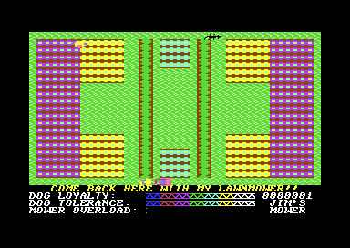

Lawn 1: the tall purple beds, the yellow beds and the two long hedges.

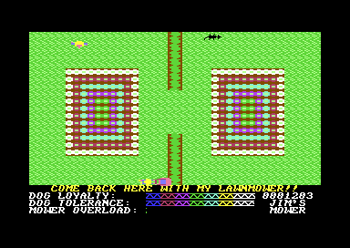

Lawn 2: two ring beds and the centre hedge with its gap.

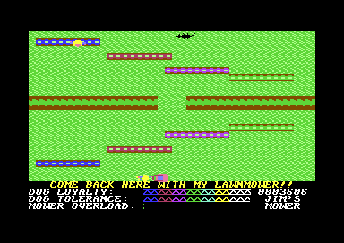

Lawn 3: the steps of flower lines and the horizontal hedge.

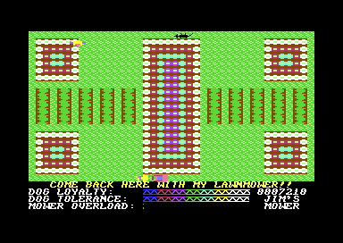

Lawn 4: five ring beds and ten short hedges.

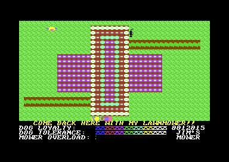

Lawn 5: the cross of flowers and two horizontal hedges.

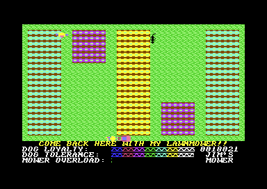

Lawn 6: five beds and no hedges.

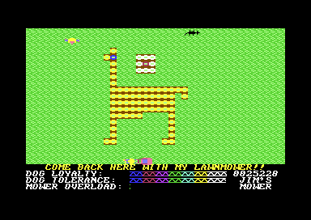

Lawn 7: the llama of yellow flowers.

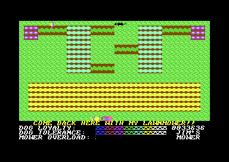

Lawn 8: the wide yellow bed and the short hedges at the top.

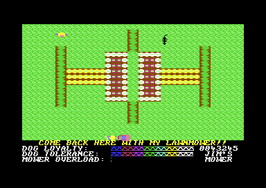

Lawn 9: the cross in the centre and four vertical hedges.

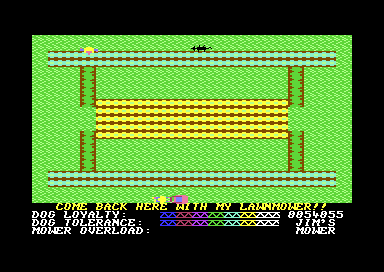

Lawn 10: two long cyan lines and the yellow bed.

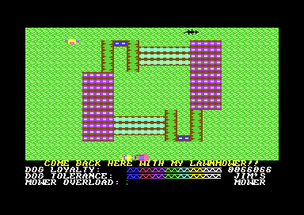

Lawn 11: the pattern with point symmetry and its two hedge gates.

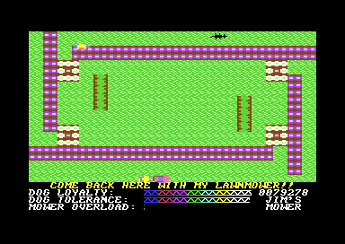

Lawn 12: the purple pinwheel and four small ring beds.

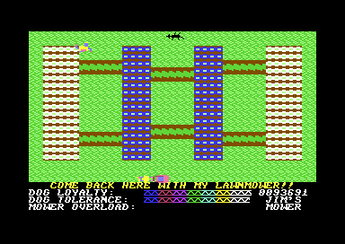

Lawn 13: four tall beds and the ladder of hedges.

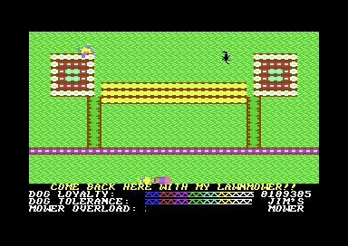

Lawn 14: the purple line across row 16.

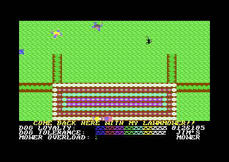

Lawn 15: the large ring bed at the bottom.

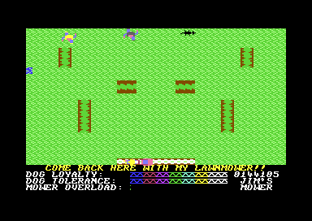

Lawn 16: almost all grass.

## Still open

- No run mowed a full lawn by hand. A recording that mows all grass of lawn 1 can show that the counter gets to 0 with the last square.
- The colours on the screen depend on the charset. Which pixels of `$76` use the colour of the colour RAM is not checked. The lawn images can show it.

The reference has each routine: [lawn layout reader](reference/modules/lawn/lawn_layout_reader.md), [lawn shapes](reference/modules/lawn/lawn_shapes.md), [lawn setup](reference/modules/lawn/setup_lawn.md), [lawn layouts](reference/modules/data/lawn_layouts.md).
