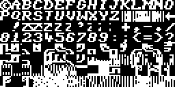
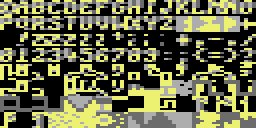
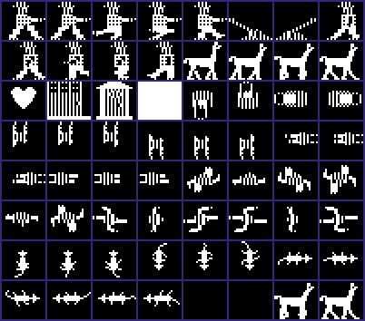
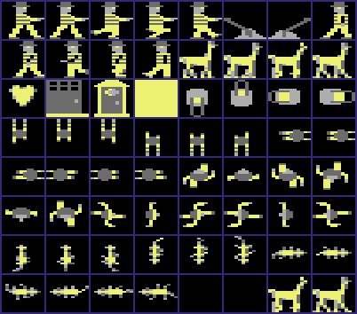

<!-- Generated by c64-docs from knowledge revision 20261025T214622.637-xq1idr and .c64-re-tools/local/generated/src/source-map.json. Do not edit: change the knowledge, generate the source again, then run docs.ts generate. -->
# Graphics

Each sprite, bitmap, charset and screen region of the knowledge. The knowledge gives no display mode and no colours, so a sprite, bitmap or charset shows in hires and in multicolour, in pattern colours: black is pixel value 0, white is 1 in hires; in multicolour light grey is 1, grey is 2 and yellow is 3. Index: [the reference](index.md).

## [`charset_image_2000` `$6400`](../../src/graphics/charset.asm#L6) `$6400-$67FF`

*charset*

The 128 characters of the game. unpack_graphics copies $6400-$67ff to the charset at $2000-$23ff.

## [`sprite_image_3000` `$6C00`](../../src/graphics/sprites.asm#L6) `$6C00-$7BFF`

*sprite*

64 sprites of 64 bytes. unpack_graphics copies them to $3000-$3fff, sprite pointers $c0-$ff.

