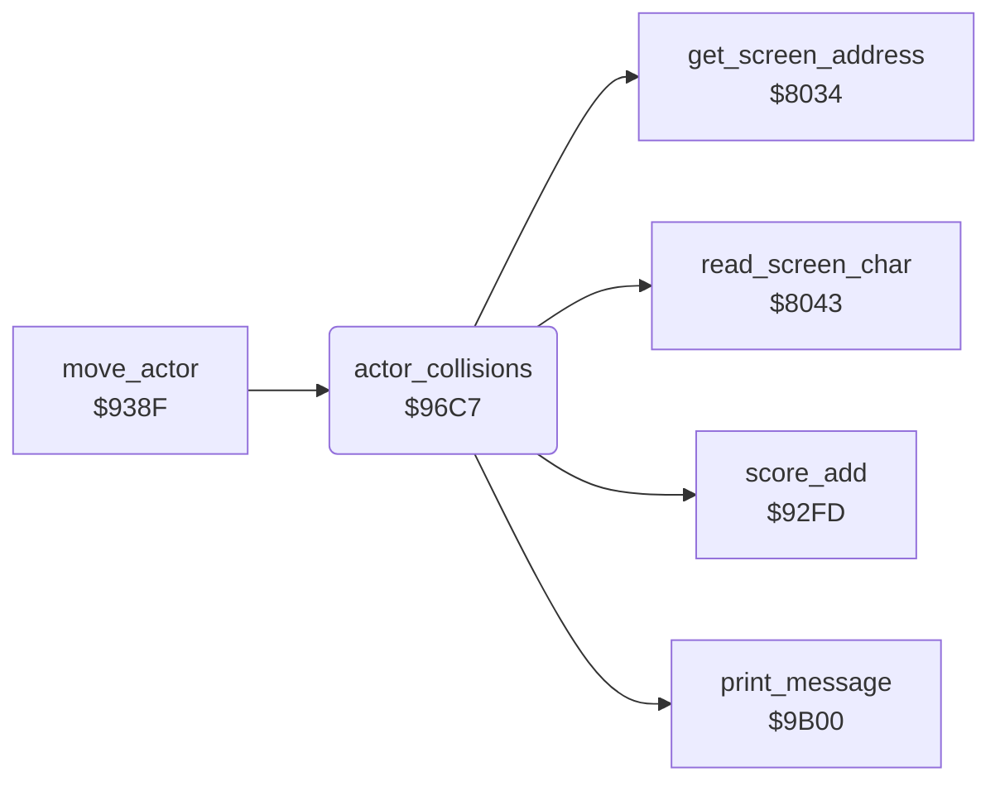

<!-- Generated by c64-docs from knowledge revision 20261025T214622.637-xq1idr and .c64-re-tools/local/generated/src/source-map.json. Do not edit: change the knowledge, generate the source again, then run docs.ts generate. -->
# actors/actor_collision.asm: Collisions of the actors

Range `$96C7-$97AD`. Source: [actors/actor_collision.asm](../../../../src/actors/actor_collision.asm). Index: [the reference](../../index.md).

## Routines

| Routine | Address | Reached from | Summary |
|---|---|---|---|
| [`actor_collisions`](actor_collision.md#actor_collisions) | `$96C7` | [`move_actor`](actor_move.md#move_actor) | Tests actor X against its target $51/$52 and against Gordon $35/$36. |

## Call graph

A solid arrow is a call, a thick arrow a table entry. Rounded nodes are in this file.

## Details

### [`actor_collisions`](../../../../src/actors/actor_collision.asm#L6) `$96C7`

*routine*

Tests actor X against its target $51/$52 and against Gordon $35/$36. The X difference must be -7 to 5 and the Y difference -8 to 7.

- **Called from:** [`move_actor`](actor_move.md#move_actor)
- **Calls:** [`score_add`](../scores/score_add.md#score_add), [`print_message`](../text/messages.md#print_message), [`read_screen_char`](../screen/screen_chars.md#read_screen_char), [`get_screen_address`](../screen/screen_chars.md#get_screen_address)
- **Jumps to:** [`actor_catches_gordon`](../neighbour/neighbour_catch.md#actor_catches_gordon)
- **Reads:** [`target_x`](../../memory-map.md#target_x), [`actor_x`](../../memory-map.md#actor_x), [`work_ptr3_hi`](../../memory-map.md#work_ptr3_hi), [`target_y`](../../memory-map.md#target_y), [`actor_y`](../../memory-map.md#actor_y), [`actor_mode`](../../memory-map.md#actor_mode), [`gordon_x`](../../memory-map.md#gordon_x), [`gordon_y`](../../memory-map.md#gordon_y), [`dog_bit_gordon`](../../memory-map.md#dog_bit_gordon), [`overload_bar`](../../memory-map.md#overload_bar), [`screen_ptr`](../../memory-map.md#screen_ptr)
- **Writes:** [`work_ptr3_hi`](../../memory-map.md#work_ptr3_hi), [`dog_bit_gordon`](../../memory-map.md#dog_bit_gordon), [`cursor_row`](../../memory-map.md#cursor_row), [`cursor_col`](../../memory-map.md#cursor_col), [`overload_bar`](../../memory-map.md#overload_bar), [`message_timer`](../../memory-map.md#message_timer), [`tolerance_bar`](../../memory-map.md#tolerance_bar), [`VCREG3`](../../memory-map.md#VCREG3), [`mower_overheated`](../../memory-map.md#mower_overheated)

| Label | Address | Comment |
|---|---|---|
| [`actor_at_target`](../../../../src/actors/actor_collision.asm#L31) | `$96F4` | The actor is at its target. Mode 0 goes to $9718. Modes 1 and 3 go on to the test against Gordon. |
| [`actor_caught_gordon`](../../../../src/actors/actor_collision.asm#L55) | `$9718` | The dog (actor 1) goes to $974a. The other actors go to $97ae. |
| [`actor_test_gordon`](../../../../src/actors/actor_collision.asm#L70) | `$971F` | Tests actor X against Gordon: an X difference from -5 to 4 and a Y difference from -7 to 6. |
| [`actor_collision_return`](../../../../src/actors/actor_collision.asm#L93) | `$9749` |  |
| [`actor_touches_gordon`](../../../../src/actors/actor_collision.asm#L95) | `$974A` |  |
| [`gordon_hits_dog`](../../../../src/actors/actor_collision.asm#L100) | `$9751` | Gordon touches the dog. One time only ($5e = 3), it fills MOWER OVERLOAD, empties DOG TOLERANCE and stops the mower. |
| [`hit_dog_fill_overload`](../../../../src/actors/actor_collision.asm#L116) | `$976A` | Fills row 24 with full cells ($22) from column $2c to $1e. |
| [`hit_dog_clear_tolerance`](../../../../src/actors/actor_collision.asm#L132) | `$9783` | Empties DOG TOLERANCE: spaces on row 23 from column $10 to $1e, and $2b = $0f. |
| [`hit_dog_clear_loop`](../../../../src/actors/actor_collision.asm#L139) | `$9790` |  |
