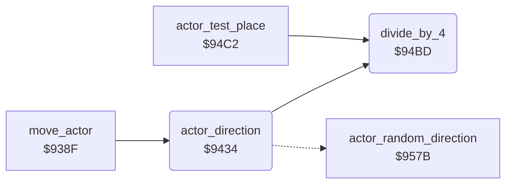

<!-- Generated by c64-docs from knowledge revision 20261024T102038.431-pgzet3 and .c64-re-tools/local/generated/src/source-map.json. Do not edit: change the knowledge, generate the source again, then run docs.ts generate. -->
# actors/actor_direction.asm: Direction of the actors

Range `$9434-$94C1`. Source: [actors/actor_direction.asm](../../../../src/actors/actor_direction.asm). Index: [the reference](../../index.md).

## Call graph

A solid arrow is a call, a thick arrow a table entry, a dotted arrow a jump. Rounded nodes are in this file.

## Names

### [`actor_direction`](../../../../src/actors/actor_direction.asm#L6) `$9434`

*routine*

Sets the direction bits $55 and $56 of actor X. Mode 3 takes a random direction at $957b. Mode 0 goes to Gordon, mode 2 goes to the neighbour (actor 2) and mode 1 goes away from the dog (actor 1). $51/$52 get the position of the target.

- **Called from:** [`move_actor`](actor_move.md#move_actor) [`$93B1`](../../../../src/actors/actor_move.asm#L39)
- **Calls:** [`divide_by_4`](actor_direction.md#divide_by_4)
- **Jumps to:** [`actor_random_direction`](actor_random.md#actor_random_direction)
- **Reads:** [`actor_mode`](../../memory-map.md#actor_mode), [`gordon_x`](../../memory-map.md#gordon_x), [`SP1Y`](../../memory-map.md#SP1Y), [`dog_x`](../../memory-map.md#dog_x), [`dog_y`](../../memory-map.md#dog_y), [`neighbour_x`](../../memory-map.md#neighbour_x), [`neighbour_y`](../../memory-map.md#neighbour_y), [`target_x`](../../memory-map.md#target_x), [`target_y`](../../memory-map.md#target_y), [`actor_x`](../../memory-map.md#actor_x), [`actor_y`](../../memory-map.md#actor_y), [`actor_y4`](../../memory-map.md#actor_y4), [`actor_x4`](../../memory-map.md#actor_x4), [`actor_dir`](../../memory-map.md#actor_dir)
- **Writes:** [`target_x`](../../memory-map.md#target_x), [`target_y`](../../memory-map.md#target_y), [`actor_x4`](../../memory-map.md#actor_x4), [`actor_y4`](../../memory-map.md#actor_y4), [`actor_dir`](../../memory-map.md#actor_dir), [`actor_facing`](../../memory-map.md#actor_facing)

### [`actor_target_gordon`](../../../../src/actors/actor_direction.asm#L11) `$943E`

*label*

Gordon: $35 and the Y of sprite 1.

- **Jumped to from:** [`actor_direction`](actor_direction.md#actor_direction) [`$9439`](../../../../src/actors/actor_direction.asm#L9)

### [`actor_target_neighbour`](../../../../src/actors/actor_direction.asm#L25) `$945D`

*label*

- **Jumped to from:** [`actor_direction`](actor_direction.md#actor_direction) [`$944E`](../../../../src/actors/actor_direction.asm#L19)

### [`actor_compare_target`](../../../../src/actors/actor_direction.asm#L31) `$9467`

*label*

Compares the positions divided by 4. Bit 0 of $55: the actor is not above the target (move up). Bit 1: it is not left of it (move left).

- **Jumped to from:** [`actor_direction`](actor_direction.md#actor_direction) [`$944A`](../../../../src/actors/actor_direction.asm#L17), [`actor_direction`](actor_direction.md#actor_direction) [`$945A`](../../../../src/actors/actor_direction.asm#L24)

### [`actor_compare_x`](../../../../src/actors/actor_direction.asm#L53) `$9495`

*label*

- **Jumped to from:** [`actor_direction`](actor_direction.md#actor_direction) [`$948F`](../../../../src/actors/actor_direction.asm#L50)

### [`actor_test_flee`](../../../../src/actors/actor_direction.asm#L61) `$94A1`

*label*

Mode 1 inverts both bits: the actor goes away from the dog.

- **Jumped to from:** [`actor_direction`](actor_direction.md#actor_direction) [`$9499`](../../../../src/actors/actor_direction.asm#L56)

### [`actor_direction_done`](../../../../src/actors/actor_direction.asm#L68) `$94AE`

*label*

$56 = 1 when bit 0 is 0 (the actor moves down).

- **Jumped to from:** [`actor_direction`](actor_direction.md#actor_direction) [`$94A6`](../../../../src/actors/actor_direction.asm#L64)

### [`divide_by_4`](../../../../src/actors/actor_direction.asm#L79) `$94BD`

*routine*

Divides A by 4 with two RORs and a clear carry.

- **Called from:** [`$9044`](../../../../src/actors/actor_speed_setup.asm#L25), [`actor_direction`](actor_direction.md#actor_direction) [`$946A`](../../../../src/actors/actor_direction.asm#L34), [`actor_direction`](actor_direction.md#actor_direction) [`$9472`](../../../../src/actors/actor_direction.asm#L38), [`actor_direction`](actor_direction.md#actor_direction) [`$947A`](../../../../src/actors/actor_direction.asm#L41), [`actor_direction`](actor_direction.md#actor_direction) [`$9482`](../../../../src/actors/actor_direction.asm#L44), [`actor_test_place`](actor_place_test.md#actor_test_place) [`$94DB`](../../../../src/actors/actor_place_test.asm#L21), [`actor_test_place`](actor_place_test.md#actor_test_place) [`$94E5`](../../../../src/actors/actor_place_test.asm#L26)
