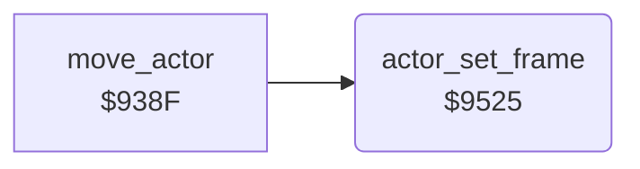

<!-- Generated by c64-docs from knowledge revision 20261025T214622.637-xq1idr and .c64-re-tools/local/generated/src/source-map.json. Do not edit: change the knowledge, generate the source again, then run docs.ts generate. -->
# actors/actor_frame.asm: Sprite frames of the actors

Range `$9525-$957A`. Source: [actors/actor_frame.asm](../../../../src/actors/actor_frame.asm). Index: [the reference](../../index.md).

## Routines

| Routine | Address | Reached from | Summary |
|---|---|---|---|
| [`actor_set_frame`](actor_frame.md#actor_set_frame) | `$9525` | [`move_actor`](actor_move.md#move_actor) | Sets the sprite pointer of actor X (sprite X + 1). |

## Call graph

A solid arrow is a call, a thick arrow a table entry. Rounded nodes are in this file.

## Details

### [`actor_set_frame`](../../../../src/actors/actor_frame.asm#L6) `$9525`

*routine*

Sets the sprite pointer of actor X (sprite X + 1). A blocked actor ($5a) or a Y distance below 8 to the target gets a side frame. Mode 3 or a large Y distance keeps the frame $0c from $938f.

- **Called from:** [`move_actor`](actor_move.md#move_actor)
- **Reads:** [`actor_blocked`](../../memory-map.md#actor_blocked), [`actor_mode`](../../memory-map.md#actor_mode), [`target_y`](../../memory-map.md#target_y), [`actor_y`](../../memory-map.md#actor_y), [`work_ptr3`](../../memory-map.md#work_ptr3), [`actor_frame`](../../memory-map.md#actor_frame), [`work_temp`](../../memory-map.md#work_temp), [`actor_dir`](../../memory-map.md#actor_dir)
- **Writes:** [`work_ptr3`](../../memory-map.md#work_ptr3), [`actor_blocked`](../../memory-map.md#actor_blocked), [`work_temp`](../../memory-map.md#work_temp), [`SPRPTR`](../../memory-map.md#SPRPTR)

| Label | Address | Comment |
|---|---|---|
| [`actor_side_frame`](../../../../src/actors/actor_frame.asm#L24) | `$9545` | Side frame: $ea + the frame, + 3 when the actor moves left. |
| [`actor_frame_direction`](../../../../src/actors/actor_frame.asm#L36) | `$955C` |  |
| [`actor_frame_ready`](../../../../src/actors/actor_frame.asm#L44) | `$9569` |  |
| [`actor_frame_dog_test`](../../../../src/actors/actor_frame.asm#L46) | `$956B` | The frames of the dog (actor 1) are $0c higher. |
| [`actor_frame_store`](../../../../src/actors/actor_frame.asm#L51) | `$9572` |  |
| [`actor_keep_frame`](../../../../src/actors/actor_frame.asm#L54) | `$9576` |  |
