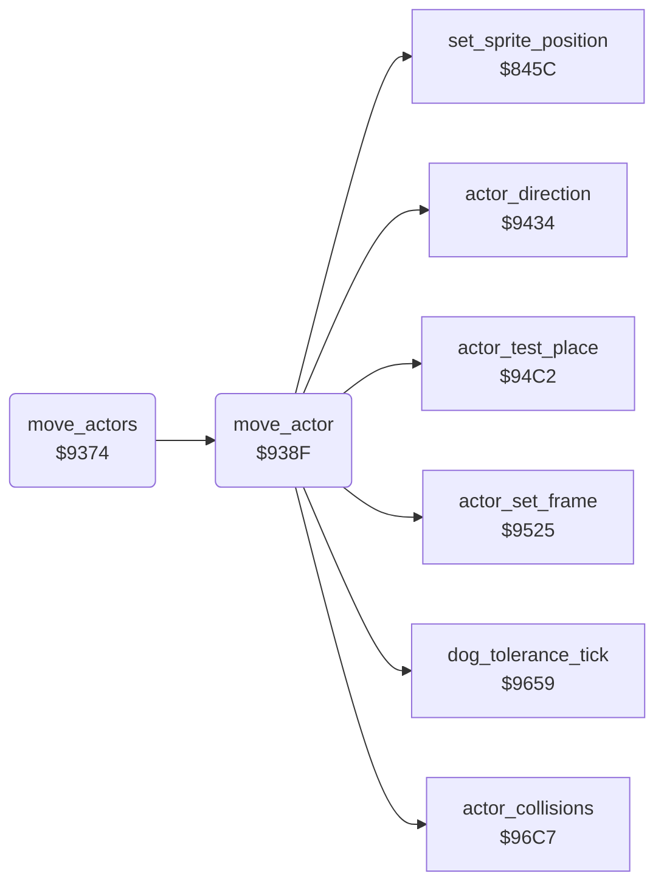

<!-- Generated by c64-docs from knowledge revision 20261025T214622.637-xq1idr and .c64-re-tools/local/generated/src/source-map.json. Do not edit: change the knowledge, generate the source again, then run docs.ts generate. -->
# actors/actor_move.asm: Movement of the actors

Range `$9374-$9433`. Source: [actors/actor_move.asm](../../../../src/actors/actor_move.asm). Index: [the reference](../../index.md).

## Routines

| Routine | Address | Reached from | Summary |
|---|---|---|---|
| [`move_actors`](actor_move.md#move_actors) | `$9374` | [`tick_actors`](tick_actors.md#tick_actors) | Moves the actors $57 down to 1. |
| [`move_actor`](actor_move.md#move_actor) | `$938F` | [`move_actors`](actor_move.md#move_actors) | Moves actor X one step. |

## Call graph

A solid arrow is a call, a thick arrow a table entry. Rounded nodes are in this file.

## Details

### [`move_actors`](../../../../src/actors/actor_move.asm#L6) `$9374`

*routine*

Moves the actors $57 down to 1. An actor moves when its countdown $1f20,x gets to 0. An actor in mode 2 moves on each call.

- **Jumped to from:** [`tick_actors`](tick_actors.md#tick_actors)
- **Calls:** [`move_actor`](actor_move.md#move_actor)
- **Reads:** [`actor_count`](../../memory-map.md#actor_count), [`actor_delay`](../../memory-map.md#actor_delay), [`actor_mode`](../../memory-map.md#actor_mode)
- **Writes:** [`actor_delay`](../../memory-map.md#actor_delay)

| Label | Address | Comment |
|---|---|---|
| [`move_actors_loop`](../../../../src/actors/actor_move.asm#L8) | `$9376` |  |
| [`move_actor_mode_test`](../../../../src/actors/actor_move.asm#L13) | `$9381` |  |
| [`move_actors_next`](../../../../src/actors/actor_move.asm#L18) | `$938B` |  |

### [`move_actor`](../../../../src/actors/actor_move.asm#L23) `$938F`

*routine*

Moves actor X one step. It loads its countdown from $8ff1,x and steps its frame $1f50,x (0-3) every 3 calls. At the end of each frame cycle it calls $9659 (DOG TOLERANCE). Then it moves the actor and places its sprite.

- **Called from:** [`move_actors`](actor_move.md#move_actors)
- **Calls:** [`dog_tolerance_tick`](../dog/dog_tolerance.md#dog_tolerance_tick), [`actor_direction`](actor_direction.md#actor_direction), [`actor_collisions`](actor_collision.md#actor_collisions), [`actor_test_place`](actor_place_test.md#actor_test_place), [`actor_set_frame`](actor_frame.md#actor_set_frame), [`set_sprite_position`](../screen/sprite_position.md#set_sprite_position)
- **Reads:** [`actor_step_delay`](init_actors.md#actor_step_delay), [`actor_frame_delay`](../../memory-map.md#actor_frame_delay), [`actor_frame`](../../memory-map.md#actor_frame), [`actor_facing`](../../memory-map.md#actor_facing), [`work_temp`](../../memory-map.md#work_temp), [`actor_y`](../../memory-map.md#actor_y), [`actor_x`](../../memory-map.md#actor_x), [`actor_dir`](../../memory-map.md#actor_dir), [`work_ptr_hi`](../../memory-map.md#work_ptr_hi), [`work_ptr`](../../memory-map.md#work_ptr)
- **Writes:** [`actor_delay`](../../memory-map.md#actor_delay), [`actor_frame_delay`](../../memory-map.md#actor_frame_delay), [`actor_frame`](../../memory-map.md#actor_frame), [`work_temp`](../../memory-map.md#work_temp), [`work_ptr_hi`](../../memory-map.md#work_ptr_hi), [`work_ptr`](../../memory-map.md#work_ptr), [`actor_blocked`](../../memory-map.md#actor_blocked), [`actor_x`](../../memory-map.md#actor_x), [`actor_y`](../../memory-map.md#actor_y)

| Label | Address | Comment |
|---|---|---|
| [`actor_choose_step`](../../../../src/actors/actor_move.asm#L38) | `$93B1` | $9434 gives the direction $55 and $96c7 tests the collisions. $0c gets the frame $e4 + 3 x $56 + the frame. |
| [`actor_add_frame`](../../../../src/actors/actor_move.asm#L52) | `$93CB` |  |
| [`actor_move_up`](../../../../src/actors/actor_move.asm#L69) | `$93EA` |  |
| [`actor_test_y`](../../../../src/actors/actor_move.asm#L75) | `$93F1` | When $94c2 finds the place blocked, the old Y stays and $5a is $ff. |
| [`actor_step_x`](../../../../src/actors/actor_move.asm#L83) | `$93FF` | Bit 1 of $55 set: X - 1. Else X + 1. |
| [`actor_move_left`](../../../../src/actors/actor_move.asm#L92) | `$940F` |  |
| [`actor_test_x`](../../../../src/actors/actor_move.asm#L97) | `$9416` |  |
| [`actor_store_position`](../../../../src/actors/actor_move.asm#L103) | `$9420` | Stores the position, sets the sprite frame at $9525 and places sprite X + 1 with $845c. |
