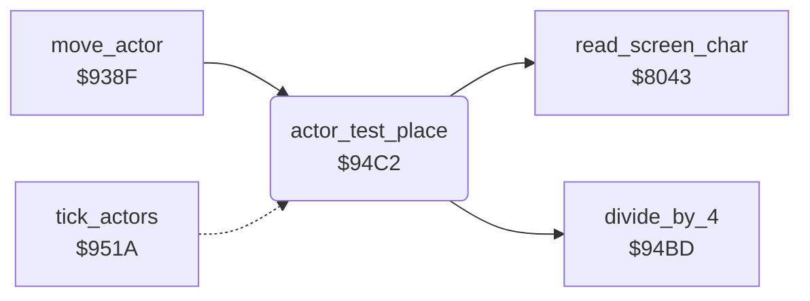

<!-- Generated by c64-docs from knowledge revision 20261024T102038.431-pgzet3 and .c64-re-tools/local/generated/src/source-map.json. Do not edit: change the knowledge, generate the source again, then run docs.ts generate. -->
# actors/actor_place_test.asm: Place test of the actors

Range `$94C2-$9519`. Source: [actors/actor_place_test.asm](../../../../src/actors/actor_place_test.asm). Index: [the reference](../../index.md).

## Call graph

A solid arrow is a call, a thick arrow a table entry, a dotted arrow a jump. Rounded nodes are in this file.

## Names

### [`actor_test_place`](../../../../src/actors/actor_place_test.asm#L6) `$94C2`

*routine*

Tests the place $07/$08 of actor X. It returns A = 0 when the actor can go there, else A = $ff. It keeps X. The limits are Y = $2c or $ce and X = $08 or $a4. Column = (X - 8) / 4, row = (Y - $28) / 8. Characters $73, $7b and $77 are free. Flowers $76 are free for actors 2 and 4, but not for the dog and the gardener.

- **Called from:** [`move_actor`](actor_move.md#move_actor) [`$93F1`](../../../../src/actors/actor_move.asm#L76), [`move_actor`](actor_move.md#move_actor) [`$9416`](../../../../src/actors/actor_move.asm#L98)
- **Calls:** [`divide_by_4`](actor_direction.md#divide_by_4), [`read_screen_char`](../screen/screen_chars.md#read_screen_char)
- **Reads:** [`work_ptr_hi`](../../memory-map.md#work_ptr_hi), [`work_ptr`](../../memory-map.md#work_ptr), [`work_ptr3_hi`](../../memory-map.md#work_ptr3_hi)
- **Writes:** [`cursor_col`](../../memory-map.md#cursor_col), [`cursor_row`](../../memory-map.md#cursor_row), [`work_ptr3_hi`](../../memory-map.md#work_ptr3_hi)

### [`actor_place_blocked`](../../../../src/actors/actor_place_test.asm#L49) `$9510`

*label*

- **Jumped to from:** [`actor_test_place`](actor_place_test.md#actor_test_place) [`$94C8`](../../../../src/actors/actor_place_test.asm#L11), [`actor_test_place`](actor_place_test.md#actor_test_place) [`$94CC`](../../../../src/actors/actor_place_test.asm#L13), [`actor_test_place`](actor_place_test.md#actor_test_place) [`$94D2`](../../../../src/actors/actor_place_test.asm#L16), [`actor_test_place`](actor_place_test.md#actor_test_place) [`$94D6`](../../../../src/actors/actor_place_test.asm#L18), [`actor_test_place`](actor_place_test.md#actor_test_place) [`$9504`](../../../../src/actors/actor_place_test.asm#L43), [`actor_test_place`](actor_place_test.md#actor_test_place) [`$950A`](../../../../src/actors/actor_place_test.asm#L46)

### [`actor_place_free`](../../../../src/actors/actor_place_test.asm#L54) `$9515`

*label*

- **Jumped to from:** [`actor_test_place`](actor_place_test.md#actor_test_place) [`$94F1`](../../../../src/actors/actor_place_test.asm#L32), [`actor_test_place`](actor_place_test.md#actor_test_place) [`$94F5`](../../../../src/actors/actor_place_test.asm#L34), [`actor_test_place`](actor_place_test.md#actor_test_place) [`$94F9`](../../../../src/actors/actor_place_test.asm#L36), [`actor_test_place`](actor_place_test.md#actor_test_place) [`$950E`](../../../../src/actors/actor_place_test.asm#L48)

### [`actor_place_return`](../../../../src/actors/actor_place_test.asm#L58) `$9519`

*label*

- **Jumped to from:** [`tick_actors`](tick_actors.md#tick_actors) [`$951C`](../../../../src/actors/tick_actors.asm#L8)
