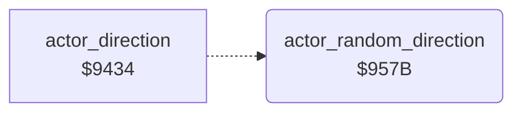

<!-- Generated by c64-docs from knowledge revision 20261024T102038.431-pgzet3 and .c64-re-tools/local/generated/src/source-map.json. Do not edit: change the knowledge, generate the source again, then run docs.ts generate. -->
# actors/actor_random.asm: Random walk of the actors

Range `$957B-$9599`. Source: [actors/actor_random.asm](../../../../src/actors/actor_random.asm). Index: [the reference](../../index.md).

## Call graph

A solid arrow is a call, a thick arrow a table entry, a dotted arrow a jump. Rounded nodes are in this file.

## Names

### [`actor_random_direction`](../../../../src/actors/actor_random.asm#L6) `$957B`

*routine*

Random walk of actor X in mode 3. When the count $1f40,x gets to 0, it takes a new random value $5b. $55 = the value AND 3, and $56 = 1 when bit 0 is 0.

- **Jumped to from:** [`actor_direction`](actor_direction.md#actor_direction) [`$943B`](../../../../src/actors/actor_direction.asm#L10)
- **Reads:** [`actor_wander_time`](../../memory-map.md#actor_wander_time), [`wander_random`](../../memory-map.md#wander_random), [`RASTER`](../../memory-map.md#RASTER)
- **Writes:** [`actor_wander_time`](../../memory-map.md#actor_wander_time), [`wander_random`](../../memory-map.md#wander_random), [`actor_dir`](../../memory-map.md#actor_dir), [`actor_facing`](../../memory-map.md#actor_facing)

### [`actor_new_random`](../../../../src/actors/actor_random.asm#L12) `$9585`

*label*

Reads the raster line $d012 as the random value. The next count is the value AND $3f.

- **Jumped to from:** [`actor_random_direction`](actor_random.md#actor_random_direction) [`$957E`](../../../../src/actors/actor_random.asm#L8)

### [`actor_random_set`](../../../../src/actors/actor_random.asm#L17) `$958F`

*label*

- **Jumped to from:** [`actor_random_direction`](actor_random.md#actor_random_direction) [`$9582`](../../../../src/actors/actor_random.asm#L10)
