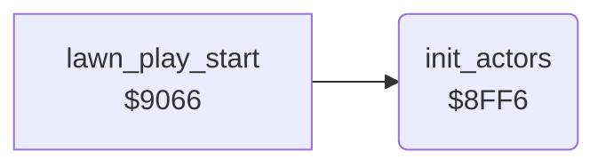

<!-- Generated by c64-docs from knowledge revision 20261025T214622.637-xq1idr and .c64-re-tools/local/generated/src/source-map.json. Do not edit: change the knowledge, generate the source again, then run docs.ts generate. -->
# actors/init_actors.asm: Start values of the actors

Range `$8FE4-$9020`. Source: [actors/init_actors.asm](../../../../src/actors/init_actors.asm). Index: [the reference](../../index.md).

## Routines

| Routine | Address | Reached from | Summary |
|---|---|---|---|
| [`init_actors`](init_actors.md#init_actors) | `$8FF6` | [`lawn_play_start`](../game/main_loop.md#lawn_play_start) | Then it sets $57 and $5c to 2 and the speed values $50, $58 and $60 from the lawn number $21. |

## Data

| Range | Type | Name | Read by | Written by |
|---|---|---|---|---|
| [`$8FE4`](../../../../src/actors/init_actors.asm#L7)-`$8FE7` | bytes | [`actor_start_x`](../../../../src/actors/init_actors.asm#L6) | [`init_actors`](init_actors.md#init_actors) |  |
| [`$8FE8`](../../../../src/actors/init_actors.asm#L10)-`$8FEB` | bytes | [`actor_start_y`](../../../../src/actors/init_actors.asm#L9) | [`init_actors`](init_actors.md#init_actors) |  |
| [`$8FEC`](../../../../src/actors/init_actors.asm#L13)-`$8FF0` | bytes | [`actor_start_state`](../../../../src/actors/init_actors.asm#L12) | [`init_actors`](init_actors.md#init_actors) |  |
| [`$8FF1`](../../../../src/actors/init_actors.asm#L16)-`$8FF5` | bytes | [`actor_step_delay`](../../../../src/actors/init_actors.asm#L15) | [`move_actor`](actor_move.md#move_actor) |  |

## Call graph

A solid arrow is a call, a thick arrow a table entry. Rounded nodes are in this file.

## Details

### [`actor_start_x`](../../../../src/actors/init_actors.asm#L6) `$8FE4-$8FE7`

*data*

Start values of actors 1-4, index X = 1-4 (index 0 is the byte before). X positions to $1f00+X.

- **Read by:** [`init_actors`](init_actors.md#init_actors)

### [`actor_start_y`](../../../../src/actors/init_actors.asm#L9) `$8FE8-$8FEB`

*data*

Y positions of actors 1-4 to $1f10+X.

- **Read by:** [`init_actors`](init_actors.md#init_actors)

### [`actor_start_state`](../../../../src/actors/init_actors.asm#L12) `$8FEC-$8FF0`

*data*

Start values of actors 1-4 to $1f30+X. $9381 compares this value with 2.

- **Read by:** [`init_actors`](init_actors.md#init_actors)

### [`actor_step_delay`](../../../../src/actors/init_actors.asm#L15) `$8FF1-$8FF5`

*data*

Reload values of the step counter $1f20+X of actors 1-4. $938f reads them.

- **Read by:** [`move_actor`](actor_move.md#move_actor)

### [`init_actors`](../../../../src/actors/init_actors.asm#L18) `$8FF6`

*routine*

Then it sets $57 and $5c to 2 and the speed values $50, $58 and $60 from the lawn number $21. After lawn 16 it uses the maximum speed.

- **Called from:** [`lawn_play_start`](../game/main_loop.md#lawn_play_start)
- **Reads:** [`actor_start_x`](init_actors.md#actor_start_x), [`actor_start_y`](init_actors.md#actor_start_y), [`actor_start_state`](init_actors.md#actor_start_state), [`actor_setup_return`](actor_speed_setup.md#actor_setup_return)
- **Writes:** [`actor_x`](../../memory-map.md#actor_x), [`actor_y`](../../memory-map.md#actor_y), [`actor_mode`](../../memory-map.md#actor_mode), [`actor_delay`](../../memory-map.md#actor_delay), [`actor_frame`](../../memory-map.md#actor_frame), [`actor_wander_time`](../../memory-map.md#actor_wander_time), [`actor_frame_delay`](../../memory-map.md#actor_frame_delay), [`SP1COL`](../../memory-map.md#SP1COL)
- **Refers to:** [`actor_colours`](actor_speed_setup.md#actor_colours)

| Label | Address | Comment |
|---|---|---|
| [`init_actors_loop`](../../../../src/actors/init_actors.asm#L20) | `$8FF8` |  |
