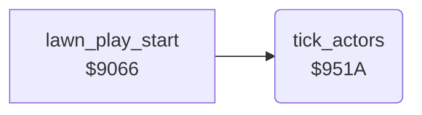

<!-- Generated by c64-docs from knowledge revision 20261025T214622.637-xq1idr and .c64-re-tools/local/generated/src/source-map.json. Do not edit: change the knowledge, generate the source again, then run docs.ts generate. -->
# actors/tick_actors.asm: Timer of the actors

Range `$951A-$9524`. Source: [actors/tick_actors.asm](../../../../src/actors/tick_actors.asm). Index: [the reference](../../index.md).

## Routines

| Routine | Address | Reached from | Summary |
|---|---|---|---|
| [`tick_actors`](tick_actors.md#tick_actors) | `$951A` | [`lawn_play_start`](../game/main_loop.md#lawn_play_start) | Counts down $58. |

## Call graph

A solid arrow is a call, a thick arrow a table entry. Rounded nodes are in this file.

## Details

### [`tick_actors`](../../../../src/actors/tick_actors.asm#L6) `$951A`

*routine*

Counts down $58. At 0 it loads $58 from the period $50 and moves the actors at $9374.

- **Called from:** [`lawn_play_start`](../game/main_loop.md#lawn_play_start)
- **Jumps to:** [`actor_place_return`](actor_place_test.md#actor_place_return), [`move_actors`](actor_move.md#move_actors)
- **Reads:** [`actor_timer`](../../memory-map.md#actor_timer), [`actor_speed`](../../memory-map.md#actor_speed)
- **Writes:** [`actor_timer`](../../memory-map.md#actor_timer)
