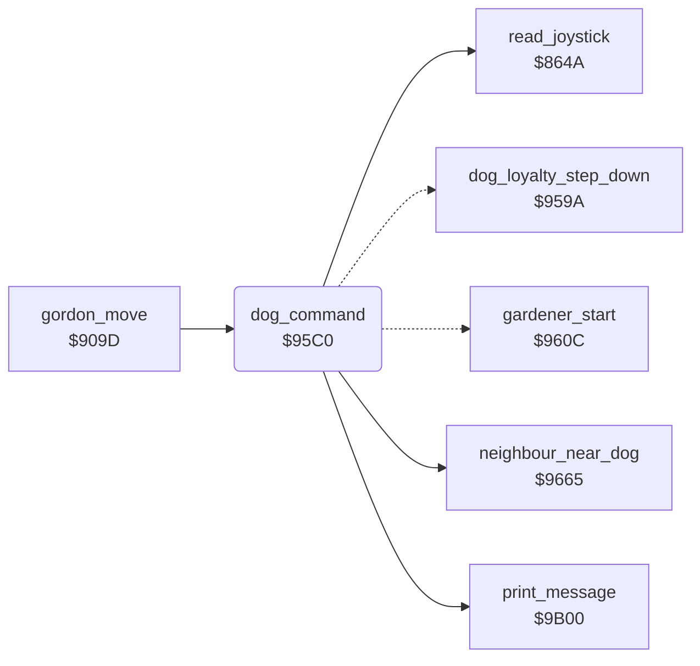

<!-- Generated by c64-docs from knowledge revision 20261024T102038.431-pgzet3 and .c64-re-tools/local/generated/src/source-map.json. Do not edit: change the knowledge, generate the source again, then run docs.ts generate. -->
# dog/dog_command.asm: Dog command from the fire button

Range `$95C0-$960B`. Source: [dog/dog_command.asm](../../../../src/dog/dog_command.asm). Index: [the reference](../../index.md).

## Call graph

A solid arrow is a call, a thick arrow a table entry, a dotted arrow a jump. Rounded nodes are in this file.

## Names

### [`dog_command`](../../../../src/dog/dog_command.asm#L6) `$95C0`

*routine*

Reads the joystick. With bit 4 (fire) or bit 6 of $1b and DOG LOYALTY left, the dog attacks the neighbour. Else the dog walks at random and the neighbour and the gardener chase Gordon.

- **Called from:** [`gordon_move`](../player/gordon_move.md#gordon_move) [`$909D`](../../../../src/player/gordon_move.asm#L7)
- **Calls:** [`read_joystick`](../input/joystick.md#read_joystick), [`neighbour_near_dog`](../neighbour/neighbour_flee.md#neighbour_near_dog), [`print_message`](../text/messages.md#print_message)
- **Jumps to:** [`gardener_start_return`](../gardener/gardener_start.md#gardener_start_return), [`dog_loyalty_step_down`](dog_loyalty.md#dog_loyalty_step_down)
- **Reads:** [`joy_bits`](../../memory-map.md#joy_bits), [`dog_bit_gordon`](../../memory-map.md#dog_bit_gordon), [`tolerance_bar`](../../memory-map.md#tolerance_bar), [`loyalty_bar`](../../memory-map.md#loyalty_bar), [`loyalty_timer`](../../memory-map.md#loyalty_timer), [`loyalty_rate`](../../memory-map.md#loyalty_rate)
- **Writes:** [`dog_mode`](../../memory-map.md#dog_mode), [`neighbour_mode`](../../memory-map.md#neighbour_mode), [`gardener_mode`](../../memory-map.md#gardener_mode), [`loyalty_timer`](../../memory-map.md#loyalty_timer)

### [`dog_no_attack`](../../../../src/dog/dog_command.asm#L12) `$95C9`

*label*

The dog takes mode 3 (random). With an empty DOG TOLERANCE ($2b = $0f) and $5e = 0, it takes mode 0 (chase Gordon).

- **Jumped to from:** [`dog_command`](dog_command.md#dog_command) [`$95ED`](../../../../src/dog/dog_command.asm#L33)

### [`dog_others_chase`](../../../../src/dog/dog_command.asm#L23) `$95DD`

*label*

Actors 2 and 3 take mode 0. Then $9665 tests if the neighbour is near the dog.

- **Jumped to from:** [`dog_command`](dog_command.md#dog_command) [`$95D0`](../../../../src/dog/dog_command.asm#L16), [`dog_command`](dog_command.md#dog_command) [`$95D6`](../../../../src/dog/dog_command.asm#L19)

### [`dog_attack`](../../../../src/dog/dog_command.asm#L30) `$95E9`

*label*

Fire: with DOG LOYALTY left, message 4 shows ('ROVER.. KILL!! GO ON, BOY! SIEZE! KILL!'). The dog takes mode 2 and actors 2 and 3 take mode 1 (flee). Every $60 calls, DOG LOYALTY goes down one step.

- **Jumped to from:** [`dog_command`](dog_command.md#dog_command) [`$95C7`](../../../../src/dog/dog_command.asm#L10)
