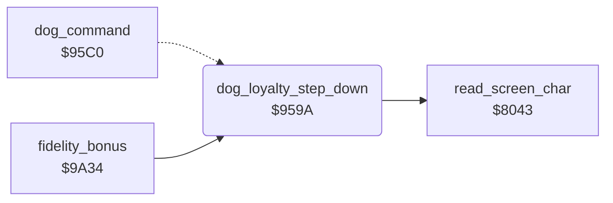

<!-- Generated by c64-docs from knowledge revision 20261024T102038.431-pgzet3 and .c64-re-tools/local/generated/src/source-map.json. Do not edit: change the knowledge, generate the source again, then run docs.ts generate. -->
# dog/dog_loyalty.asm: DOG LOYALTY scale

Range `$959A-$95BF`. Source: [dog/dog_loyalty.asm](../../../../src/dog/dog_loyalty.asm). Index: [the reference](../../index.md).

## Call graph

A solid arrow is a call, a thick arrow a table entry, a dotted arrow a jump. Rounded nodes are in this file.

## Names

### [`dog_loyalty_step_down`](../../../../src/dog/dog_loyalty.asm#L6) `$959A`

*routine*

Removes one step from the DOG LOYALTY scale on row 22 at column $2a. Column $0f is an empty scale. When a cell becomes empty, the column $2a moves one to the left. The bonus at $9a80 also calls it.

- **Called from:** [`fidelity_bonus`](../lawn/lawn_complete.md#fidelity_bonus) [`$9A80`](../../../../src/lawn/lawn_complete.asm#L112)
- **Jumped to from:** [`dog_command`](dog_command.md#dog_command) [`$9609`](../../../../src/dog/dog_command.asm#L45)
- **Calls:** [`read_screen_char`](../screen/screen_chars.md#read_screen_char)
- **Reads:** [`loyalty_bar`](../../memory-map.md#loyalty_bar), [`mow_square_done`](../lawn/mow_square.md#mow_square_done), [`mown_grass_operand`](../lawn/mow_square.md#mown_grass_operand), [`screen_ptr`](../../memory-map.md#screen_ptr)
- **Writes:** [`cursor_row`](../../memory-map.md#cursor_row), [`cursor_col`](../../memory-map.md#cursor_col), [`loyalty_bar`](../../memory-map.md#loyalty_bar)
- **Refers to:** [`scale_chars`](../status/scale_chars.md#scale_chars)

### [`loyalty_find_char`](../../../../src/dog/dog_loyalty.asm#L15) `$95AB`

*label*

- **Jumped to from:** [`dog_loyalty_step_down`](dog_loyalty.md#dog_loyalty_step_down) [`$95B1`](../../../../src/dog/dog_loyalty.asm#L19)

### [`loyalty_step`](../../../../src/dog/dog_loyalty.asm#L20) `$95B3`

*label*

- **Jumped to from:** [`dog_loyalty_step_down`](dog_loyalty.md#dog_loyalty_step_down) [`$95AE`](../../../../src/dog/dog_loyalty.asm#L17)

### [`loyalty_return`](../../../../src/dog/dog_loyalty.asm#L25) `$95BC`

*label*

- **Jumped to from:** [`dog_loyalty_step_down`](dog_loyalty.md#dog_loyalty_step_down) [`$95A2`](../../../../src/dog/dog_loyalty.asm#L11)

### [`loyalty_cell_empty`](../../../../src/dog/dog_loyalty.asm#L27) `$95BD`

*label*

- **Jumped to from:** [`dog_loyalty_step_down`](dog_loyalty.md#dog_loyalty_step_down) [`$95BA`](../../../../src/dog/dog_loyalty.asm#L24)
