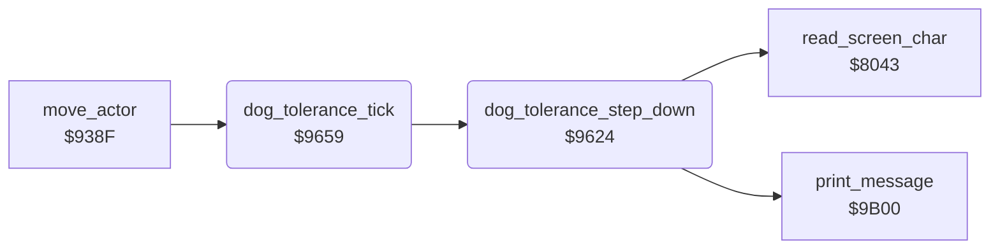

<!-- Generated by c64-docs from knowledge revision 20261025T214622.637-xq1idr and .c64-re-tools/local/generated/src/source-map.json. Do not edit: change the knowledge, generate the source again, then run docs.ts generate. -->
# dog/dog_tolerance.asm: DOG TOLERANCE scale

Range `$9624-$9664`. Source: [dog/dog_tolerance.asm](../../../../src/dog/dog_tolerance.asm). Index: [the reference](../../index.md).

## Routines

| Routine | Address | Reached from | Summary |
|---|---|---|---|
| [`dog_tolerance_step_down`](dog_tolerance.md#dog_tolerance_step_down) | `$9624` | [`dog_tolerance_tick`](dog_tolerance.md#dog_tolerance_tick) | Removes one step from the DOG TOLERANCE scale on row 23 at column $2b. |
| [`dog_tolerance_tick`](dog_tolerance.md#dog_tolerance_tick) | `$9659` | [`move_actor`](../actors/actor_move.md#move_actor) | Calls $9624 and keeps X and Y. |

## Call graph

A solid arrow is a call, a thick arrow a table entry. Rounded nodes are in this file.

## Details

### [`dog_tolerance_step_down`](../../../../src/dog/dog_tolerance.asm#L6) `$9624`

*routine*

Removes one step from the DOG TOLERANCE scale on row 23 at column $2b. Column $0f is an empty scale. When the scale becomes empty, the dog takes mode 0 and message 8 shows ('OH DEAR... THE DOG LOOKS ANNOYED...!').

- **Called from:** [`dog_tolerance_tick`](dog_tolerance.md#dog_tolerance_tick)
- **Calls:** [`read_screen_char`](../screen/screen_chars.md#read_screen_char), [`print_message`](../text/messages.md#print_message)
- **Jumps to:** [`gardener_start_return`](../gardener/gardener_start.md#gardener_start_return)
- **Reads:** [`tolerance_bar`](../../memory-map.md#tolerance_bar), [`mow_square_done`](../lawn/mow_square.md#mow_square_done), [`mown_grass_operand`](../lawn/mow_square.md#mown_grass_operand), [`screen_ptr`](../../memory-map.md#screen_ptr)
- **Writes:** [`cursor_col`](../../memory-map.md#cursor_col), [`cursor_row`](../../memory-map.md#cursor_row), [`tolerance_bar`](../../memory-map.md#tolerance_bar), [`dog_mode`](../../memory-map.md#dog_mode)
- **Refers to:** [`scale_chars`](../status/scale_chars.md#scale_chars)

| Label | Address | Comment |
|---|---|---|
| [`tolerance_find_char`](../../../../src/dog/dog_tolerance.asm#L25) | `$9635` |  |
| [`tolerance_step`](../../../../src/dog/dog_tolerance.asm#L30) | `$963D` |  |

### [`dog_tolerance_tick`](../../../../src/dog/dog_tolerance.asm#L45) `$9659`

*routine*

Calls $9624 and keeps X and Y. $938f calls it at the end of each frame cycle of an actor.

- **Called from:** [`move_actor`](../actors/actor_move.md#move_actor)
- **Calls:** [`dog_tolerance_step_down`](dog_tolerance.md#dog_tolerance_step_down)
