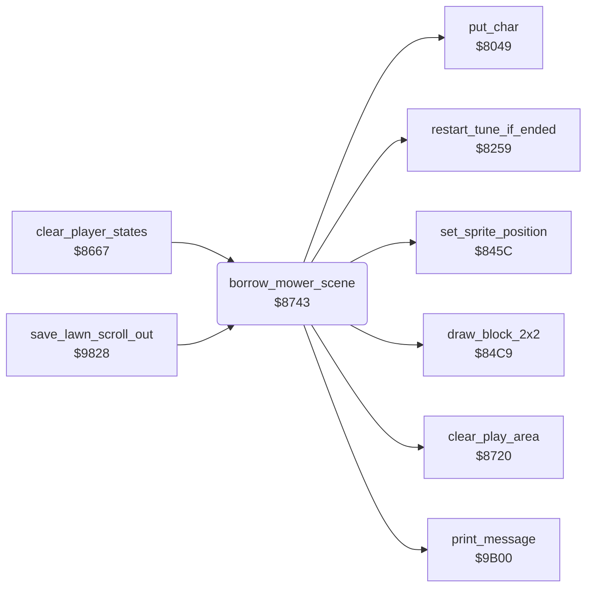

<!-- Generated by c64-docs from knowledge revision 20261024T102038.431-pgzet3 and .c64-re-tools/local/generated/src/source-map.json. Do not edit: change the knowledge, generate the source again, then run docs.ts generate. -->
# game/borrow_mower_scene.asm: Borrow scene

Range `$8743-$8994`. Source: [game/borrow_mower_scene.asm](../../../../src/game/borrow_mower_scene.asm). Index: [the reference](../../index.md).

## Call graph

A solid arrow is a call, a thick arrow a table entry, a dotted arrow a jump. Rounded nodes are in this file.

## Data

| Range | Type | Name | Read by | Written by |
|---|---|---|---|---|
| [`$890B`](../../../../src/game/borrow_mower_scene.asm#L240)-`$8922` | bytes | [`lender_roof_column`](../../../../src/game/borrow_mower_scene.asm#L239) | [`borrow_mower_scene`](borrow_mower_scene.md#borrow_mower_scene) |  |

## Names

### [`borrow_mower_scene`](../../../../src/game/borrow_mower_scene.asm#L6) `$8743`

*routine*

Scene at the start of a lawn: Gordon borrows the mower of the lender $20 (1 = JIM, 2 = TOM, 3 = ALF). Puts the sprites 0-4 at 0,0 and clears the play area. Shows the message of the lender (message $20 - 1). Sets the colours, frames and multicolour mode of the sprites. Turns on multicolour text and draws the block of the lender. The routine ends at $8994.

- **Called from:** [`clear_player_states`](player_turn.md#clear_player_states) [`$8706`](../../../../src/game/player_turn.asm#L90), [`save_lawn_scroll_out`](../neighbour/neighbour_catch.md#save_lawn_scroll_out) [`$98CD`](../../../../src/neighbour/neighbour_catch.asm#L178)
- **Calls:** [`set_sprite_position`](../screen/sprite_position.md#set_sprite_position), [`clear_play_area`](../screen/clear_play_area.md#clear_play_area), [`print_message`](../text/messages.md#print_message), [`put_char`](../screen/screen_chars.md#put_char), [`draw_block_2x2`](../screen/draw_block.md#draw_block_2x2), [`restart_tune_if_ended`](../music/tune_start.md#restart_tune_if_ended)
- **Reads:** [`mower_lender`](../../memory-map.md#mower_lender), [`work_temp`](../../memory-map.md#work_temp), [`SCROLX`](../../memory-map.md#SCROLX), [`cursor_col`](../../memory-map.md#cursor_col), [`cursor_row`](../../memory-map.md#cursor_row), [`SP4COL`](../../memory-map.md#SP4COL), [`work_ptr_hi`](../../memory-map.md#work_ptr_hi), [`work_ptr2`](../../memory-map.md#work_ptr2), [`work_ptr`](../../memory-map.md#work_ptr), [`SPRPTR+1`](../../memory-map.md#SPRPTR), [`work_count`](../../memory-map.md#work_count)
- **Writes:** [`work_ptr`](../../memory-map.md#work_ptr), [`work_ptr_hi`](../../memory-map.md#work_ptr_hi), [`SPENA`](../../memory-map.md#SPENA), [`work_temp`](../../memory-map.md#work_temp), [`SP4COL`](../../memory-map.md#SP4COL), [`SP0COL`](../../memory-map.md#SP0COL), [`SP2COL`](../../memory-map.md#SP2COL), [`SP3COL`](../../memory-map.md#SP3COL), [`SP1COL`](../../memory-map.md#SP1COL), [`SPMC0`](../../memory-map.md#SPMC0), [`SPMC1`](../../memory-map.md#SPMC1), [`SPMC`](../../memory-map.md#SPMC), [`SCROLX`](../../memory-map.md#SCROLX), [`SPRPTR`](../../memory-map.md#SPRPTR), [`SPRPTR+4`](../../memory-map.md#SPRPTR), [`SPRPTR+3`](../../memory-map.md#SPRPTR), [`SPRPTR+1`](../../memory-map.md#SPRPTR), [`SPRPTR+2`](../../memory-map.md#SPRPTR), [`BGCOL1`](../../memory-map.md#BGCOL1), [`BGCOL2`](../../memory-map.md#BGCOL2), [`cursor_row`](../../memory-map.md#cursor_row), [`cursor_char`](../../memory-map.md#cursor_char), [`cursor_colour`](../../memory-map.md#cursor_colour), [`cursor_col`](../../memory-map.md#cursor_col), [`work_ptr2`](../../memory-map.md#work_ptr2), [`work_count`](../../memory-map.md#work_count)

### [`borrow_hide_sprites`](../../../../src/game/borrow_mower_scene.asm#L11) `$874B`

*label*

- **Jumped to from:** [`borrow_mower_scene`](borrow_mower_scene.md#borrow_mower_scene) [`$8755`](../../../../src/game/borrow_mower_scene.asm#L19)

### [`borrow_colour_offset`](../../../../src/game/borrow_mower_scene.asm#L30) `$876C`

*label*

- **Jumped to from:** [`borrow_mower_scene`](borrow_mower_scene.md#borrow_mower_scene) [`$8770`](../../../../src/game/borrow_mower_scene.asm#L34)

### [`borrow_set_colours`](../../../../src/game/borrow_mower_scene.asm#L35) `$8772`

*label*

- **Jumped to from:** [`borrow_mower_scene`](borrow_mower_scene.md#borrow_mower_scene) [`$876A`](../../../../src/game/borrow_mower_scene.asm#L29)

### [`borrow_fill_row`](../../../../src/game/borrow_mower_scene.asm#L77) `$87D7`

*label*

- **Jumped to from:** [`borrow_mower_scene`](borrow_mower_scene.md#borrow_mower_scene) [`$87FA`](../../../../src/game/borrow_mower_scene.asm#L97)

### [`borrow_fill_column`](../../../../src/game/borrow_mower_scene.asm#L80) `$87DB`

*label*

- **Jumped to from:** [`borrow_mower_scene`](borrow_mower_scene.md#borrow_mower_scene) [`$87E4`](../../../../src/game/borrow_mower_scene.asm#L85)

### [`borrow_fill_next_row`](../../../../src/game/borrow_mower_scene.asm#L95) `$87F8`

*label*

- **Jumped to from:** [`borrow_mower_scene`](borrow_mower_scene.md#borrow_mower_scene) [`$87EC`](../../../../src/game/borrow_mower_scene.asm#L89)

### [`borrow_wall_top_row`](../../../../src/game/borrow_mower_scene.asm#L103) `$8804`

*label*

Rows 12-13, columns 12-31.

- **Jumped to from:** [`borrow_mower_scene`](borrow_mower_scene.md#borrow_mower_scene) [`$8819`](../../../../src/game/borrow_mower_scene.asm#L115)

### [`borrow_wall_top_col`](../../../../src/game/borrow_mower_scene.asm#L106) `$8808`

*label*

- **Jumped to from:** [`borrow_mower_scene`](borrow_mower_scene.md#borrow_mower_scene) [`$8811`](../../../../src/game/borrow_mower_scene.asm#L111)

### [`borrow_wall_base_row`](../../../../src/game/borrow_mower_scene.asm#L116) `$881B`

*label*

Rows 14-17, columns 7-31.

- **Jumped to from:** [`borrow_mower_scene`](borrow_mower_scene.md#borrow_mower_scene) [`$8830`](../../../../src/game/borrow_mower_scene.asm#L128)

### [`borrow_wall_base_col`](../../../../src/game/borrow_mower_scene.asm#L119) `$881F`

*label*

- **Jumped to from:** [`borrow_mower_scene`](borrow_mower_scene.md#borrow_mower_scene) [`$8828`](../../../../src/game/borrow_mower_scene.asm#L124)

### [`borrow_roof_row`](../../../../src/game/borrow_mower_scene.asm#L190) `$88B0`

*label*

- **Jumped to from:** [`borrow_mower_scene`](borrow_mower_scene.md#borrow_mower_scene) [`$88F3`](../../../../src/game/borrow_mower_scene.asm#L226)

### [`borrow_roof_fill`](../../../../src/game/borrow_mower_scene.asm#L202) `$88C7`

*label*

- **Jumped to from:** [`borrow_mower_scene`](borrow_mower_scene.md#borrow_mower_scene) [`$88D8`](../../../../src/game/borrow_mower_scene.asm#L211)

### [`borrow_roof_right_edge`](../../../../src/game/borrow_mower_scene.asm#L212) `$88DA`

*label*

- **Jumped to from:** [`borrow_mower_scene`](borrow_mower_scene.md#borrow_mower_scene) [`$88C1`](../../../../src/game/borrow_mower_scene.asm#L199)

### [`borrow_roof_done`](../../../../src/game/borrow_mower_scene.asm#L227) `$88F6`

*label*

Draws a 2x2 block of chars $60-$63 at the roof column + 4, two rows up.

- **Jumped to from:** [`borrow_mower_scene`](borrow_mower_scene.md#borrow_mower_scene) [`$88E9`](../../../../src/game/borrow_mower_scene.asm#L221)

### [`lender_roof_column`](../../../../src/game/borrow_mower_scene.asm#L239) `$890B`

*data*

Scene layout of each lender, 8 bytes for Jim, Tom and Alf. Index $0c = (lender - 1) * 8. Bytes: roof column, window 1 column and row, window 2 column and row, sprite 4 colour, sprite 0 colour, sprite 4 X.

- **Read by:** [`borrow_mower_scene`](borrow_mower_scene.md#borrow_mower_scene) [`$88A3`](../../../../src/game/borrow_mower_scene.asm#L184)

### [`lender_window1_column`](../../../../src/game/borrow_mower_scene.asm#L241) `$890C`

*data*

- **Read by:** [`borrow_mower_scene`](borrow_mower_scene.md#borrow_mower_scene) [`$8851`](../../../../src/game/borrow_mower_scene.asm#L145)

### [`lender_window1_row`](../../../../src/game/borrow_mower_scene.asm#L243) `$890D`

*data*

- **Read by:** [`borrow_mower_scene`](borrow_mower_scene.md#borrow_mower_scene) [`$8856`](../../../../src/game/borrow_mower_scene.asm#L147)

### [`lender_window2_column`](../../../../src/game/borrow_mower_scene.asm#L245) `$890E`

*data*

- **Read by:** [`borrow_mower_scene`](borrow_mower_scene.md#borrow_mower_scene) [`$8870`](../../../../src/game/borrow_mower_scene.asm#L159)

### [`lender_window2_row`](../../../../src/game/borrow_mower_scene.asm#L247) `$890F`

*data*

- **Read by:** [`borrow_mower_scene`](borrow_mower_scene.md#borrow_mower_scene) [`$8875`](../../../../src/game/borrow_mower_scene.asm#L161)

### [`lender_sprite4_colour`](../../../../src/game/borrow_mower_scene.asm#L249) `$8910`

*data*

- **Read by:** [`borrow_mower_scene`](borrow_mower_scene.md#borrow_mower_scene) [`$8776`](../../../../src/game/borrow_mower_scene.asm#L38)

### [`lender_sprite0_colour`](../../../../src/game/borrow_mower_scene.asm#L251) `$8911`

*data*

- **Read by:** [`borrow_mower_scene`](borrow_mower_scene.md#borrow_mower_scene) [`$877C`](../../../../src/game/borrow_mower_scene.asm#L40)

### [`lender_sprite4_x`](../../../../src/game/borrow_mower_scene.asm#L253) `$8912-$8922`

*data*

- **Read by:** [`borrow_mower_scene`](borrow_mower_scene.md#borrow_mower_scene) [`$8893`](../../../../src/game/borrow_mower_scene.asm#L176)

### [`borrow_walk_left`](../../../../src/game/borrow_mower_scene.asm#L258) `$8923`

*label*

Gordon (sprite 1, frames $c7-$cb) walks left from X $b8 to X $2c at Y $ad.

- **Jumped to from:** [`borrow_mower_scene`](borrow_mower_scene.md#borrow_mower_scene) [`$8908`](../../../../src/game/borrow_mower_scene.asm#L237)

### [`borrow_walk_left_step`](../../../../src/game/borrow_mower_scene.asm#L263) `$892B`

*label*

- **Jumped to from:** [`borrow_mower_scene`](borrow_mower_scene.md#borrow_mower_scene) [`$8953`](../../../../src/game/borrow_mower_scene.asm#L284)

### [`borrow_walk_left_delay`](../../../../src/game/borrow_mower_scene.asm#L272) `$893F`

*label*

- **Jumped to from:** [`borrow_mower_scene`](borrow_mower_scene.md#borrow_mower_scene) [`$8938`](../../../../src/game/borrow_mower_scene.asm#L269)

### [`borrow_walk_left_wait`](../../../../src/game/borrow_mower_scene.asm#L275) `$8943`

*label*

Waits. $8259 starts the tune again when it has ended.

- **Jumped to from:** [`borrow_mower_scene`](borrow_mower_scene.md#borrow_mower_scene) [`$8947`](../../../../src/game/borrow_mower_scene.asm#L278), [`borrow_mower_scene`](borrow_mower_scene.md#borrow_mower_scene) [`$894B`](../../../../src/game/borrow_mower_scene.asm#L280)

### [`borrow_push_right_step`](../../../../src/game/borrow_mower_scene.asm#L288) `$895A`

*label*

- **Jumped to from:** [`borrow_mower_scene`](borrow_mower_scene.md#borrow_mower_scene) [`$8992`](../../../../src/game/borrow_mower_scene.asm#L318)

### [`borrow_push_right_delay`](../../../../src/game/borrow_mower_scene.asm#L307) `$8980`

*label*

- **Jumped to from:** [`borrow_mower_scene`](borrow_mower_scene.md#borrow_mower_scene) [`$8979`](../../../../src/game/borrow_mower_scene.asm#L304)

### [`borrow_push_right_wait`](../../../../src/game/borrow_mower_scene.asm#L310) `$8984`

*label*

- **Jumped to from:** [`borrow_mower_scene`](borrow_mower_scene.md#borrow_mower_scene) [`$8988`](../../../../src/game/borrow_mower_scene.asm#L313), [`borrow_mower_scene`](borrow_mower_scene.md#borrow_mower_scene) [`$898C`](../../../../src/game/borrow_mower_scene.asm#L315)
